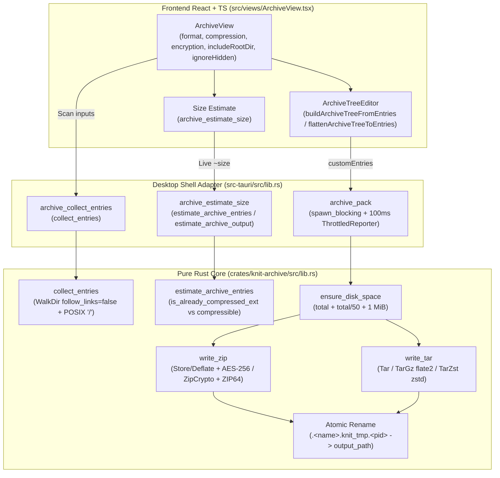

> Index: [`/llms.txt`](../llms.txt) · Runnable API & IPC Guide: [`docs/archive-agent-guide.md`](./archive-agent-guide.md) · JSON Schema Contract: [`docs/specs/archive.schema.json`](./specs/archive.schema.json) · Functional Tests: [`docs/archive-functional-tests.md`](./archive-functional-tests.md)

# Kiến trúc & Cơ chế Hoạt động của `Archive Packager` (`archive`, Knit `v0.2.0`)

Tài liệu này mô tả thiết kế và luồng dữ liệu của công cụ **`Archive Packager`** (`ArchiveView` + `crates/knit-archive/src/lib.rs`) dùng để đóng gói tệp/thư mục thành `.zip` (hỗ trợ **AES-256** & **ZipCrypto**), `.tar`, `.tar.gz`, và `.tar.zst` theo cơ chế streaming I/O an toàn.

---

## 1. Tổng quan Kiến trúc 3 Tầng

Sơ đồ kiến trúc 3 tầng tách phần quét cây tệp, chỉnh sửa cấu trúc cây trên UI (`ArchiveTreeEditor`) và streaming ra đĩa (`.mmd`: [`archive_01_architecture_pipeline.mmd`](./diagrams/archive_01_architecture_pipeline.mmd)):

---

## 2. Quét Tệp, Cây Tuỳ biến (`ArchiveTreeEditor`) & Chuẩn hóa Đường dẫn

- **Thu thập đệ quy an toàn (`collect_entries`):** Dùng `WalkDir::new(input).follow_links(false).sort_by_file_name()` để tránh lặp vô hạn do symlink; bỏ qua các thành phần ẩn (`has_hidden_component`, tên bắt đầu bằng `.`) khi `ignore_hidden = true`.
- **Chuẩn hóa đường dẫn POSIX (`path_to_posix`):** Mọi đường dẫn lưu trong archive (`ArchiveEntrySpec.archive_path`) dùng dấu `/` chuẩn POSIX bất kể chạy trên Windows hay Linux. Nếu `include_root_dir = true` với thư mục nguồn, đường dẫn có tiền tố `<root_name>/<rel_posix>`.
- **Chỉnh cây trước khi nén (`ArchiveTreeEditor` + `src/lib/archiveTree.ts`):** `buildArchiveTreeFromEntries` dựng cây thư mục phân cấp cho phép người dùng đổi tên, di chuyển file/folder hoặc gắn `compression_override` từng mục (`ArchiveEntrySpec.compression_override`), sau đó `flattenArchiveTreeToEntries` xuất mảng `customEntries` truyền thẳng xuống `archive_pack` và `archive_estimate_size`.

---

## 3. Ước lượng Dung lượng Không Chặn UI (`estimate_archive_entries`)

Để hiển thị dung lượng ước tính ngay khi người dùng thay đổi cấu hình nén mà không đọc nội dung tệp trên đĩa:
- Phân loại từng `ArchiveEntrySpec` theo phần mở rộng qua `is_already_compressed_ext` (như `jpg`, `jpeg`, `png`, `webp`, `avif`, `gif`, `zip`, `cbz`, `7z`, `rar`, `gz`, `zst`, `mp3`, `mp4`, `pdf`, `woff2`...).
- Nhân `compressible_bytes` và `precompressed_bytes` với hệ số thực nghiệm theo từng `(ArchiveFormat, CompressionLevel)` và cộng thêm `overhead_per_file` (`96 B` cho `Zip`, `512 B` header TAR cho `Tar` / `TarGz` / `TarZst`):

| `ArchiveFormat` | `Store` (comp / pre) | `Fast` (comp / pre) | `Normal` (comp / pre) | `Best` (comp / pre) | Overhead / file |
|---|---|---|---|---|---|
| `zip` | `1.00 / 1.00` | `0.55 / 0.99` | `0.45 / 0.985` | `0.38 / 0.98` | `96 B` |
| `tar` | `1.00 / 1.00` | `1.00 / 1.00` | `1.00 / 1.00` | `1.00 / 1.00` | `512 B` |
| `tar_gz` | `1.00 / 1.00` | `0.50 / 0.99` | `0.42 / 0.985` | `0.36 / 0.98` | `512 B` |
| `tar_zst` | `1.00 / 1.00` | `0.46 / 0.99` | `0.36 / 0.985` | `0.30 / 0.98` | `512 B` |

---

## 4. Streaming I/O, Mã hóa & Ghi Nguyên tử

- **Tiền kiểm dung lượng (`ensure_disk_space`):** Kiểm tra thư mục đích có tối thiểu `total_bytes + total_bytes / 50 + 1 MiB` trước khi mở tệp tạm.
- **Buffer cố định 64 KiB & Hỗ trợ hủy tức thì (`copy_with_cancel`):** Đọc qua `BufReader` theo từng chunk `64 * 1024` bytes và gọi `token.check()?` trước mỗi lần đọc. Tiến độ được tiết lưu `100ms` qua `ThrottledReporter` để không làm nghẽn WebView.
- **ZIP (`write_zip` & `build_zip_options`):**
  - Ánh xạ `CompressionLevel`: `Store` → `Stored`, `Fast` → `Deflated(1)`, `Normal` → `Deflated(6)`, `Best` → `Deflated(9)`, ưu tiên `entry.compression_override` nếu có.
  - Tự bật cờ **ZIP64** (`large_file(size_bytes >= u32::MAX as u64)`) cho các tệp >= 4 GiB.
  - Hỗ trợ `ZipEncryption::Aes256(pwd)` (khuyến nghị) và `ZipEncryption::ZipCrypto(pwd)` (tương thích giải nén cũ); từ chối đặt mật khẩu cho định dạng `tar*` và từ chối mật khẩu rỗng.
- **TAR (`write_tar`):** Hỗ trợ `Tar` thuần, `TarGz` (`flate2`: `none/fast/default/best`) và `TarZst` (`zstd`: mức nén `1/1/3/15`).
- **Atomic Output:** Ghi toàn bộ vào `.<filename>.knit_tmp.<pid>`, tự xóa file tạm nếu lỗi hoặc bị hủy, và chỉ `fs::rename` sang `output_path` khi `writer.finish()` thành công 100%, sau đó gọi `trim_process_heap()`.

---

## 5. Tham chiếu Mã nguồn (Source Map)

- **Agent API & Schema:** [`docs/archive-agent-guide.md`](./archive-agent-guide.md), [`docs/specs/archive.schema.json`](./specs/archive.schema.json), [`docs/archive-functional-tests.md`](./archive-functional-tests.md)
- **Pure-Rust Core:** [`crates/knit-archive/src/lib.rs`](../crates/knit-archive/src/lib.rs) (`collect_entries`, `estimate_archive_output`, `estimate_archive_entries`, `pack_entries`)
- **Tauri IPC:** [`src-tauri/src/lib.rs`](../src-tauri/src/lib.rs) (`archive_collect_entries`, `archive_estimate_size`, `archive_pack`, `get_file_size_bytes`)
- **Frontend:** [`src/views/ArchiveView.tsx`](../src/views/ArchiveView.tsx), [`src/components/ArchiveTreeEditor.tsx`](../src/components/ArchiveTreeEditor.tsx), [`src/lib/archiveTree.ts`](../src/lib/archiveTree.ts), [`src/lib/ipc.ts`](../src/lib/ipc.ts)
