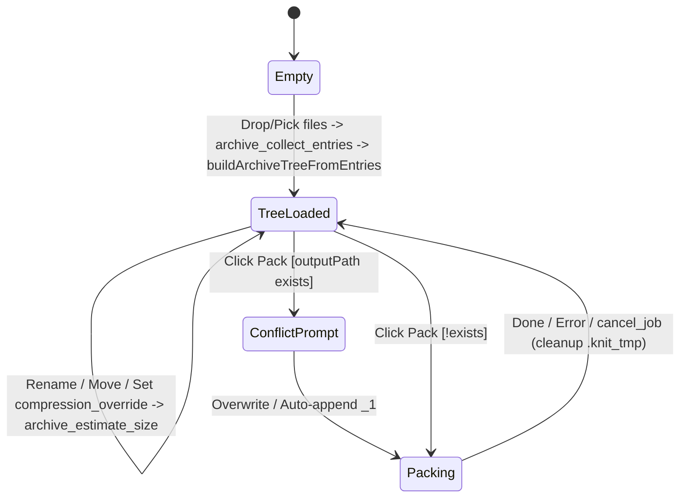

> Index: [`/llms.txt`](../llms.txt) · Agent Integration Guide: [`docs/archive-agent-guide.md`](./archive-agent-guide.md) · Architecture: [`docs/archive-architecture.md`](./archive-architecture.md) · Machine-Readable Spec: [`docs/specs/archive.schema.json`](./specs/archive.schema.json)

# Bộ Test Case Chức năng — `Archive Packager` (`archive`, Knit `v0.2.0`)

Bộ thiết kế kiểm thử chức năng cho **`Archive Packager`** (`ArchiveView` + `crates/knit-archive/src/lib.rs`), đối chiếu trực tiếp với [`docs/archive-agent-guide.md`](./archive-agent-guide.md) và [`docs/specs/archive.schema.json`](./specs/archive.schema.json).

---

## 0. Tập Yêu cầu Nghiệp vụ (BR Inventory)

| Mã BR | Tóm tắt yêu cầu nghiệp vụ (`archive`) | Kỹ thuật chính | Kỹ thuật bổ trợ |
|---|---|---|---|
| **BR-01** | Thu thập danh sách tệp/thư mục (`collect_entries`) an toàn (không theo symlink), lọc tệp/thư mục ẩn theo `ignore_hidden`, giữ hoặc bỏ thư mục gốc theo `include_root_dir`, chuẩn hóa đường dẫn POSIX `/`. | Domain (EP/BVA) | Use Case |
| **BR-02** | Tương tác giữa `ArchiveFormat` (`zip`, `tar`, `tar_gz`, `tar_zst`), `CompressionLevel`, `ZipEncryption` (`none`, `aes256`, `zip_crypto`), và `compression_override` từng mục. | Decision Table | Domain (EP/BVA) |
| **BR-03** | Chỉnh sửa cây thư mục ảo trên `ArchiveTreeEditor` (`buildArchiveTreeFromEntries` / `flattenArchiveTreeToEntries`) và cập nhật ước lượng dung lượng không chặn UI (`archive_estimate_size`). | State Transition | Use Case |
| **BR-04** | Tiền kiểm dung lượng đĩa (`ensure_disk_space`), bật ZIP64 cho tệp `>= u32::MAX`, hủy giữa chừng (`copy_with_cancel`) và ghi nguyên tử `.knit_tmp.<pid>`. | Error Guessing | Use Case |

---

## 1. Domain Testing (EP + BVA) — Kiểm thử Miền giá trị & Biên

| TC ID | Biến kiểm thử | Lớp / Điểm biên | Đầu vào | Kết quả mong đợi | BR |
|---|---|---|---|---|---|
| **TC-DOM-01** | `inputs` | Invalid (`[]`, không tồn tại, toàn file ẩn) | Case A: `inputs = []` Case B: `["/tmp/missing"]` Case C: Thư mục chỉ chứa `.DS_Store`, `ignore_hidden=true` | Case A: `"Chưa chọn file hoặc thư mục nào để nén"` Case B: `"Path not found: /tmp/missing"` Case C: `"Không tìm thấy tệp hợp lệ nào để nén"` | BR-01 |
| **TC-DOM-02** | `entries` | Invalid (`[]` empty) | `pack_entries(&[], out, ...)` | Trả `"Danh sách tệp cần nén đang rỗng"` | BR-01 |
| **TC-DOM-03** | `ZipEncryption.password` | Invalid (`""`, LB−1) vs Valid (`len >= 1`) | `format="zip"`, `encryption={kind:"aes256", password:""}` | Trả `"Mật khẩu ZIP không được để trống"` | BR-02 |
| **TC-DOM-04** | `ArchiveEntrySpec.size_bytes` | BVA ZIP64 (`u32::MAX - 1` vs `u32::MAX`) | `build_zip_options(Normal, None, u32::MAX as u64)` | Bật `.large_file(true)` để sinh header ZIP64 hợp lệ khi tệp đạt ngưỡng 4 GiB | BR-04 |

---

## 2. Decision Table Testing — Ma trận Định dạng × Mã hóa × Nén

| Điều kiện / Hành động | TC-DT-01 | TC-DT-02 | TC-DT-03 | TC-DT-04 | TC-DT-05 |
|---|---|---|---|---|---|
| `ArchiveFormat` | `zip` | `zip` | `zip` | `tar` / `tar_gz` / `tar_zst` | `tar` / `tar_gz` / `tar_zst` |
| `ZipEncryption` | `none` | `aes256` (pass hợp lệ) | `zip_crypto` (pass hợp lệ) | `none` | `aes256` / `zip_crypto` |
| `compression_override` trên entry | `Some(store)` (parent `best`) | `None` | `None` | N/A | N/A |
| **Kết quả:** Chấp nhận & dùng `Stored` cho entry đó | ✓ | — | — | — | — |
| **Kết quả:** Tạo ZIP mã hóa đúng chuẩn | — | ✓ *(AES-256)* | ✓ *(ZipCrypto)* | — | — |
| **Kết quả:** Tạo TAR / GZ / ZST | — | — | — | ✓ | — |
| **Kết quả:** Từ chối `"Chỉ định dạng ZIP mới hỗ trợ đặt mật khẩu"` | — | — | — | — | ✓ |

---

## 3. State Transition Testing & Use Case

| TC ID | Loại | Mô tả | Đầu vào & Thao tác | Kết quả mong đợi | BR |
|---|---|---|---|---|---|
| **TC-ST-01** | State Transition | Tái tổ chức cây trong `ArchiveTreeEditor` & nén bằng `customEntries` | Nạp `/tmp/dir/a.txt` (`10 KB`) và `/tmp/dir/b.png` (`50 KB`); đổi thư mục gốc thành `bundle`, gắn `b.png` `compressionOverride = "store"`, đóng gói ZIP `Normal` | `flattenArchiveTreeToEntries` xuất đường dẫn `bundle/a.txt` (`override=null`) và `bundle/b.png` (`override="store"`); tệp ZIP tạo ra giữ nguyên cấu trúc `bundle/...` với `b.png` ở phương thức `Stored` và `a.txt` ở `Deflated` | BR-02, BR-03 |
| **TC-UCT-01** | Use Case | Đóng gói thư mục đa cấp sang `.zip` mã hóa `aes256` và `.tar.zst` | Thư mục `/tmp/pack_src` (chứa file `.txt`, `.jpg`, và `.gitkeep`), `include_root_dir=true`, `ignore_hidden=true` | 1. `.gitkeep` bị loại. 2. Đường dẫn trong ZIP/TAR là `pack_src/...` dùng `/` trên mọi OS. 3. ZIP giải nén thất bại nếu sai mật khẩu, thành công đúng nội dung khi đúng mật khẩu | BR-01, BR-02 |
| **TC-EG-01** | Fault Attack | Symlink vòng lặp trong thư mục đầu vào | Tạo symlink trỏ ngược lên thư mục cha bên trong `/tmp/loop_dir` | `WalkDir` với `.follow_links(false)` bỏ qua symlink vòng, không treo hoặc tràn stack | BR-01 |
| **TC-EG-02** | Fault Attack | Hủy job giữa chừng khi đang stream tệp lớn (`copy_with_cancel`) | Nạp tệp 500 MB, chạy `archive_pack`, gọi `cancel_job` giữa luồng copy 64 KiB | `copy_with_cancel` dừng ngay, xóa sạch `.knit_tmp.<pid>`, không tạo hay ghi đè file đích | BR-04 |

---

## 4. Requirements Traceability Matrix (RTM)

| BR ID | Domain (EP/BVA) | Decision Table | State Transition | Use Case | Error Guessing | Trạng thái |
|---|---|---|---|---|---|---|
| **BR-01** | TC-DOM-01, TC-DOM-02 | — | — | TC-UCT-01 | TC-EG-01 | ✓ Covered |
| **BR-02** | TC-DOM-03 | TC-DT-01..05 | TC-ST-01 | TC-UCT-01 | — | ✓ Covered |
| **BR-03** | — | — | TC-ST-01 | — | — | ✓ Covered |
| **BR-04** | TC-DOM-04 | — | — | — | TC-EG-02 | ✓ Covered |
