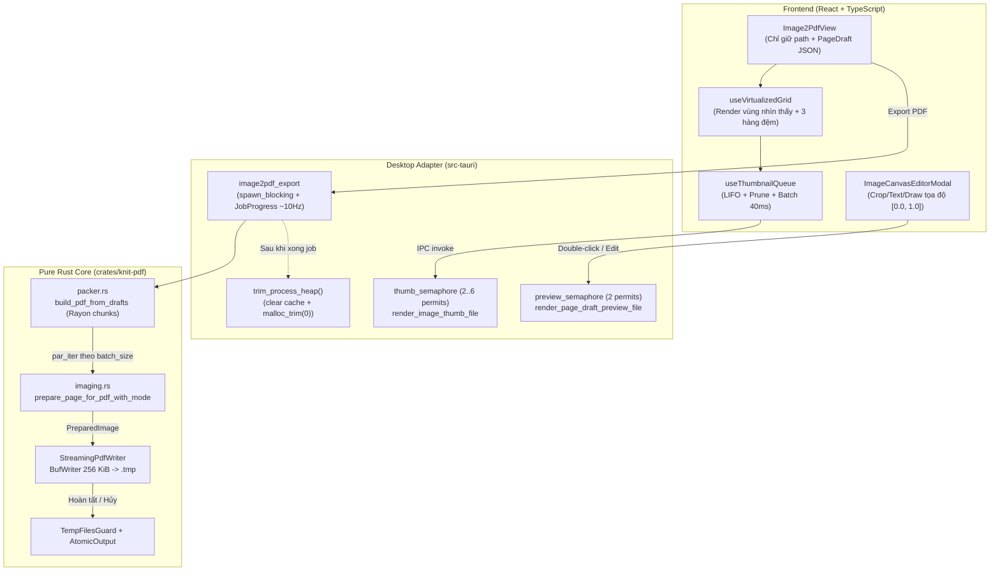
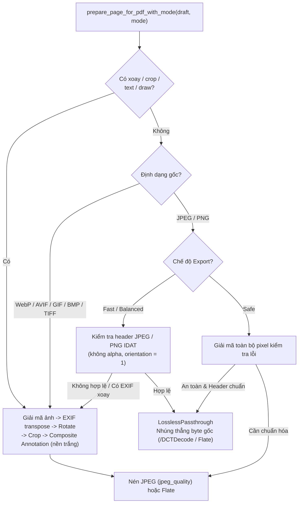
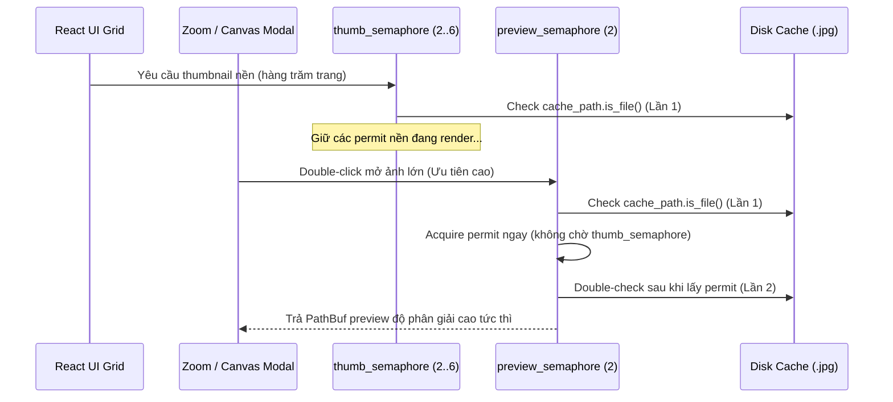

# Kiến trúc & Cơ chế Hoạt động của `image2pdf` (Knit)

Tài liệu này mô tả chi tiết cách công cụ **`image2pdf`** của Knit chuyển đổi hàng nghìn ảnh dung lượng lớn (1.5 GB – 2+ GB) thành PDF, đồng thời giải quyết 3 bài toán cốt lõi: **chống tràn RAM**, **giữ UI mượt mà khi thao tác**, và **đạt tốc độ export cao**.

---

## 1. Tổng quan Kiến trúc 3 Tầng

`image2pdf` tách biệt hoàn toàn trạng thái giao diện nhẹ trên WebView khỏi quá trình giải mã/đóng gói ảnh nặng dưới Rust:

---

## 2. Mô hình Dữ liệu Không Phá Hủy (`PageDraft`)

Thay vì sao chép hoặc chỉnh sửa trực tiếp file ảnh gốc trên ổ đĩa (hay giữ ảnh bitmap đã chỉnh sửa trong RAM trình duyệt), `image2pdf` biểu diễn mỗi trang bằng cấu trúc `PageDraft` (`crates/knit-pdf/src/models.rs`):

- **Nguồn (`PageSource`):** Chỉ lưu đường dẫn file ảnh trên đĩa (hoặc `PdfPageRef`), giữ nguyên trạng thái read-only cho dữ liệu gốc.
- **Chỉnh sửa chuẩn hóa (`[0.0, 1.0]`):** Góc xoay (`0/90/180/270`), vùng cắt (`CropRect`), chữ chèn (`TextAnnotation`) và nét vẽ (`StrokeAnnotation`) đều lưu dưới dạng **tọa độ tương đối `[0.0, 1.0]`** không phụ thuộc độ phân giải màn hình.
- **Hệ quả:** Danh sách 2.000+ ảnh trên Frontend chỉ tốn vài trăm KB JSON trong state React; mọi phép dựng ảnh thật chỉ chạy đúng 1 lần trên Rust khi Export hoặc khi mở modal xem chi tiết.

---

## 3. Luồng Chuyển đổi & Cơ chế Chống Tràn RAM khi Export

### 3.1. `StreamingPdfWriter` — Ghi thẳng xuống đĩa, không dựng PDF DOM trong RAM

Nếu dùng thư viện PDF giữ toàn bộ cây object (`lopdf::Document`) trong bộ nhớ, toàn bộ stream của 1.5 GB ảnh sẽ bị giữ lại trong RAM đến tận lúc gọi `save()`, gây phình RAM gấp nhiều lần (5–10 GB) và crash tiến trình.

Trong `crates/knit-pdf/src/packer.rs`, `StreamingPdfWriter` giải quyết triệt để vấn đề này:

1. **Buffer ghi tuần tự cố định (`STREAM_BUF_CAPACITY = 256 * 1024` — 256 KiB):** Mở trực tiếp file tạm `.tmp` qua `BufWriter` và ghi phần header `%PDF-1.5`.
2. **Ghi từng trang và giải phóng ngay lập tức:** Với mỗi trang `write_page(...)`:
   - Ghi ngay Image XObject stream (`/DCTDecode` hoặc `/FlateDecode`), Page Content stream và Page Dictionary xuống đĩa thông qua `CountingWriter` (đếm chính xác `bytes_written`).
   - Chỉ lưu lại `offsets: Vec<u64>` (vị trí byte của từng object để lập bảng `xref` ở cuối file) và `page_ids: Vec<u32>`.
   - Ngay khi `write_page` kết thúc, vector byte của `PreparedImage` bị **`drop()` khỏi RAM ngay lập tức**.
3. **Chia Part tự động (`max_mb` / `max_pages_per_file`):**
   - Trước khi ghi trang kế tiếp, kiểm tra `cur_writer.bytes_written() + stream_len + PAGE_STRUCT_OVERHEAD (700B) + TAIL_OVERHEAD (2048B) > max_bytes`.
   - Nếu vượt ngưỡng, đóng gói phần hiện tại (`finish(&part_bookmarks)` kèm `remap_tree` để cập nhật lại chỉ số trang của cây `BookmarkNode`), sau đó mở `StreamingPdfWriter` mới cho part tiếp theo.
4. **An toàn nguyên tử (`TempFilesGuard` + `AtomicOutput`):**
   - Mọi file tạm `.tmp` được đăng ký vào `TempFilesGuard`. Nếu `CancellationToken` kích hoạt hoặc gặp lỗi I/O giữa chừng, `Drop` trait tự động xóa sạch toàn bộ file tạm dở dang. Chỉ đổi tên sang file `.pdf` đích khi ghi và flush hoàn tất 100%.

### 3.2. Xử lý Song song Theo Chunk Giới Hạn (`drafts.chunks(batch_size)`)

Nếu gọi `drafts.par_iter()` trên toàn bộ 2.000 ảnh cùng lúc, các luồng Rayon sẽ đồng thời nạp và giải mã hàng trăm ảnh lớn, khiến RAM tăng vọt trước khi `StreamingPdfWriter` kịp ghi xuống đĩa.

`build_pdf_from_drafts` chia `drafts` thành từng nhóm nhỏ `drafts.chunks(batch_size)` chạy trên một `rayon::ThreadPool` riêng biệt:
- Chỉ có tối đa `batch_size` ảnh tồn tại trong bộ nhớ tại một thời điểm.
- Xong 1 chunk → ghi tuần tự toàn bộ kết quả chunk đó xuống đĩa → giải phóng RAM → mới sang chunk kế tiếp.

### 3.3. Ba Chế độ Export (`PdfExportMode`)

Knit cung cấp 3 chế độ cân bằng giữa **Tốc độ**, **Mức RAM đỉnh** và **Độ an toàn kiểm chứng dữ liệu**:

| Chế độ (`PdfExportMode`) | `worker_threads` | `batch_size` | Kiểm tra dung lượng đĩa & Chia Part | Mức nén Flate & Kiểm tra ảnh (`imaging.rs`) | Phù hợp khi |
|---|---|---|---|---|---|
| **1. `Fast`** *(Tốc độ tối đa)* | `cpus.clamp(4, 8)` | `24` | Bỏ qua `ensure_disk_space` & bỏ qua split rules (xuất 1 file) | Cho phép passthrough JPEG/PNG tối đa, bỏ qua decode kiểm tra sâu, zlib `fast` | Bộ ảnh sạch, muốn tốc độ ngang `img2pdf` |
| **2. `Balanced`** *(Mặc định)* | `cpus.clamp(2, 4)` | `4..8` | Có kiểm tra `ensure_disk_space (1x)` & hỗ trợ chia part | Kiểm tra header JPEG (`SOF`/`EXIF`/`APP14`) & PNG `IDAT`, lỗi header mới fallback decode | Sử dụng hàng ngày, cân bằng RAM và tốc độ |
| **3. `Safe`** *(An toàn tối đa)* | `cpus.clamp(2, 4)` | `4` | Kiểm tra `ensure_disk_space (2x)` & hỗ trợ chia part | **Giải mã toàn vẹn pixel** để phát hiện JPEG bị cụt/hỏng trước khi cho phép passthrough | Nguồn ảnh tải từ mạng không rõ chất lượng |

### 3.4. Nhánh Kép `LosslessPassthrough` vs `Render & Composite` (`imaging.rs`)

### 3.5. Thu hồi Heap Chủ động Sau Job (`malloc_trim(0)`)

Trên Linux (glibc `ptmalloc2`), khi giải phóng các vùng nhớ lớn (ảnh đã giải mã), trình cấp phát thường giữ lại arena trên heap thay vì trả ngay về hệ điều hành, khiến biểu đồ RAM của app vẫn neo cao dù logic Rust đã `drop()`.

Trong `src-tauri/src/lib.rs`, hàm `trim_process_heap()` gọi `unsafe { malloc_trim(0); }` (trên Linux GNU) tại 2 thời điểm:
1. Ngay sau khi job `image2pdf_export` hoàn tất (hoặc bị hủy).
2. Khi người dùng bấm **Clear List** (`clear_image_preview_cache`), đồng thời dọn sạch cache thư mục thumbnail tạm trên đĩa và các `Ref`/`Cache` bên React.

---

## 4. Cơ chế Giữ Độ Mượt UI & Tránh Nghẽn IPC

### 4.1. Giao tiếp Qua Đường Dẫn File Cache (Không Gửi Base64 Qua IPC)

Thay vì mã hóa ảnh thumbnail thành chuỗi Base64 khổng lồ gửi qua cầu nối JSON IPC (gây nghẽn serialize và phình RAM WebView):
- Rust render thumbnail JPEG kích thước vừa phải vào thư mục cache tạm (`thumb_cache_dir()`), trả về `PathBuf`.
- Frontend chuyển đường dẫn thành URL nội bộ qua `convertFileSrc(path)` để WebView nạp ảnh bất đồng bộ qua Asset Protocol chuẩn OS (`loading="lazy" decoding="async"`).

### 4.2. Tách IPC Semaphore & Double-Checked Caching

Nếu dùng chung một hàng đợi cho cả thumbnail lưới nền và ảnh phóng to khi double-click, thao tác xem chi tiết của người dùng sẽ bị treo chờ hàng trăm thumbnail phía trước. `src-tauri/src/lib.rs` tách làm **2 semaphore độc lập**:

### 4.3. Ảo hóa Lưới (`useVirtualizedGrid`) & Hàng đợi LIFO (`useThumbnailQueue`)

- **Ảo hóa DOM (`src/hooks/useVirtualizedGrid.ts`):** Chỉ render các thẻ ảnh nằm trong vùng cuộn hiện tại cộng thêm đệm `overscanRows = 3` hàng trên/dưới. Sử dụng `topPadPx` và `bottomPadPx` để giữ thanh cuộn đúng tỷ lệ mà không tạo hàng nghìn DOM node.
- **Hàng đợi ưu tiên LIFO & Cắt tỉa (`src/hooks/useThumbnailQueue.ts`):**
  - Khi người dùng cuộn xuống vùng mới, `enqueueWindow(keys, true)` đẩy các key đang nằm trên màn hình lên đầu hàng đợi (LIFO) và **loại bỏ (prune)** các key đã cuộn khuất khỏi hàng chờ.
  - **Bảo vệ cache LRU:** `mergeThumbCacheLru` giới hạn số lượng URL giữ trong bộ nhớ (`THUMB_CACHE_MAX_ENTRIES`), nhưng luôn bảo vệ các key đang hiển thị (`visibleKeysRef`) và các key đã ghim (`pinnedKeysRef`).
  - **Gộp trạng thái 40ms (`flushIntervalMs = 40`):** Gom các URL thumbnail vừa load xong lại và cập nhật React state theo chu kỳ 40ms, tránh re-render liên tục làm giật khung hình.
- **Kéo-thả không gây Layout Reflow (`hitTestGridInsertIndex`):** Lưu cache geometry của lưới và tính toán vị trí chèn $O(1)$ trong `requestAnimationFrame` thay vì gọi `getBoundingClientRect()` trên từng card mỗi khung hình.

---

## 5. Tổng hợp Quyết định Thiết kế & Đánh đổi (Trade-offs)

| Quyết định Kiến trúc | Phương án bị loại bỏ | Lý do chọn & Đánh đổi |
|---|---|---|
| **Ghi PDF trực tiếp bằng `StreamingPdfWriter`** | Dựng toàn bộ `lopdf::Document` trong RAM rồi mới gọi `save()` | **Được:** RAM giữ ổn định ở mức thấp (vài chục MB) kể cả với 2 GB ảnh. **Đổi:** Phải tự quản lý byte offset bảng `xref` và object ID thủ công trong `packer.rs`. |
| **Lưu chỉnh sửa dưới dạng `PageDraft` chuẩn hóa `[0.0, 1.0]`** | Render bitmap mỗi lần crop/vẽ rồi lưu PNG tạm hoặc gửi DataURL qua IPC | **Được:** Không phá hủy ảnh gốc, hỗ trợ Undo/Redo tức thì, giữ được nhánh `LosslessPassthrough` cho trang không sửa. **Đổi:** Khi xuất PDF phải có bộ rasterizer riêng bằng Rust (`imaging.rs`) cho các trang có chỉnh sửa. |
| **Tách 3 Export Mode (`Fast` / `Balanced` / `Safe`)** | Chỉ có 1 pipeline kiểm tra chặt chẽ duy nhất | **Được:** Đáp ứng linh hoạt nhu cầu người dùng — tốc độ ngang `img2pdf` khi nguồn ảnh chuẩn (`Fast`) hoặc kiểm tra lỗi toàn vẹn từng pixel (`Safe`). |
| **Dùng Asset Protocol (`convertFileSrc`) thay Base64** | Trả về chuỗi Base64 PNG/JPEG qua Tauri Command | **Được:** Tránh tốn CPU encode/decode Base64 và không làm phình heap JS của WebView. **Đổi:** Cần quản lý vòng đời thư mục cache tạm (`clear_image_preview_cache`). |

---

## 6. Tham chiếu Mã nguồn (Source Map)

- **Core PDF Models & Export Modes:** [`crates/knit-pdf/src/models.rs`](../crates/knit-pdf/src/models.rs) (`PageDraft`, `PdfExportMode`, `Image2PdfConfig`)
- **Streaming PDF Writer & Bounded Chunks:** [`crates/knit-pdf/src/packer.rs`](../crates/knit-pdf/src/packer.rs) (`StreamingPdfWriter`, `build_pdf_from_drafts`, `TempFilesGuard`)
- **Lossless Passthrough & Rasterizer:** [`crates/knit-pdf/src/imaging.rs`](../crates/knit-pdf/src/imaging.rs) (`prepare_page_for_pdf_with_mode`, `try_passthrough_jpeg_owned`, `try_passthrough_png_from_bytes`)
- **IPC Semaphores & Heap Trimming:** [`src-tauri/src/lib.rs`](../src-tauri/src/lib.rs) (`thumb_semaphore`, `preview_semaphore`, `trim_process_heap`, `clear_image_preview_cache`)
- **Frontend Workbench & Hooks:**
  - [`src/views/Image2PdfView.tsx`](../src/views/Image2PdfView.tsx)
  - [`src/hooks/useVirtualizedGrid.ts`](../src/hooks/useVirtualizedGrid.ts)
  - [`src/hooks/useThumbnailQueue.ts`](../src/hooks/useThumbnailQueue.ts)
