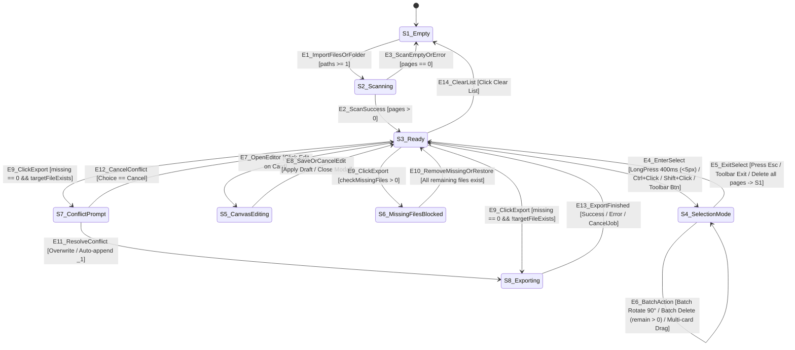

> Index: [`/llms.txt`](../llms.txt) · Agent Integration Guide: [`docs/image2pdf-agent-guide.md`](./image2pdf-agent-guide.md) · Architecture: [`docs/image2pdf-architecture.md`](./image2pdf-architecture.md) · Machine-Readable Spec: [`docs/specs/image2pdf.schema.json`](./specs/image2pdf.schema.json)

# Bộ Test Case Chức năng — `Image → PDF` (`image2pdf`, Knit `v0.1.0`)

Bộ thiết kế kiểm thử chức năng (**Functional Test Suite**) cho công cụ **`Image → PDF` (`image2pdf`)** của Knit, được xây dựng theo quy trình điều phối của skill `functional-test-design` và 5 kỹ thuật kiểm thử chuẩn ISTQB, đối chiếu trực tiếp với đặc tả tại [`docs/image2pdf-agent-guide.md`](./image2pdf-agent-guide.md), [`docs/specs/image2pdf.schema.json`](./specs/image2pdf.schema.json) và [`crates/knit-pdf/src/models.rs`](../crates/knit-pdf/src/models.rs).

---

## 0. Điều phối Kỹ thuật & Tập Yêu cầu Nghiệp vụ (BR Inventory)

Theo **Pattern 4 (Complex Business Rules Embedded in a Flow)** và **Pattern 2 (Stateful Feature with Input Validation)** của `functional-test-design`, 5 kỹ thuật được phân bổ không chồng lấn như sau:

| Mã BR | Tóm tắt yêu cầu nghiệp vụ (`image2pdf`) | Kỹ thuật chính | Kỹ thuật bổ trợ |
|---|---|---|---|
| **BR-01** | Quét file/thư mục ảnh hỗ trợ `jpg, jpeg, jfif, png, webp, avif, gif, bmp, tiff, tif`; tự sinh cây `BookmarkNode` theo thư mục và ghim `cover.*` lên đầu. | Use Case (`use-case-testing`) | Domain (`domain-testing`) |
| **BR-02** | Ràng buộc miền giá trị đầu vào: `jpeg_quality` (`1..=100`), `dpi` (`> 0`), `margin_pt` (`>= 0`), `rotation_deg` (`{0,90,180,270}`), tọa độ chuẩn hóa `CropRect`/Annotation `[0.0, 1.0]`, kích thước trang PDF ISO `[3.0, 14400.0]` pt, `max_mb` (`> 0`), `max_pages_per_file` (`>= 1`). | Domain (`domain-testing` — EP + BVA) | — |
| **BR-03** | Quyết định nhánh xử lý ảnh: `LosslessPassthrough` (`/DCTDecode` hoặc PNG `IDAT` `/FlateDecode`) chỉ kích hoạt khi `lossless_passthrough = true`, `has_pixel_edits() = false`, định dạng JPEG/PNG hợp lệ (không alpha/`tRNS`, EXIF orientation = 1), và vượt qua bước kiểm tra theo `PdfExportMode`. | Decision Table (`decision-table-testing`) | Error Guessing |
| **BR-04** | Tương tác giữa `PdfExportMode` (`fast` / `balanced` / `safe`), quy tắc chia file (`max_mb` / `max_pages_per_file`), và kiểm tra dung lượng đĩa trống (`ensure_disk_space`: bỏ qua ở `fast`, `1x` ở `balanced`, `2x` ở `safe`; `fast` luôn xuất 1 file duy nhất). | Decision Table (`decision-table-testing`) | Domain (`domain-testing`) |
| **BR-05** | Vòng đời trạng thái Workbench: `Empty` ↔ `Scanning` ↔ `Ready` ↔ `SelectionMode` (long-press `400ms` vs kéo `>= 5px`, `Ctrl`/`Shift`, xoay/xóa/kéo nhóm) ↔ `CanvasEditing` ↔ `Exporting` / `MissingFilesBlocked` / `Cancelled`. | State Transition (`state-transition-testing`) | — |
| **BR-06** | Xóa trang (đơn lẻ hoặc hàng loạt) khi bật `autoUpdateBookmarksOnDelete` phải tự động ánh xạ lại `target_page_index` theo khoảng `[target, nextStop)` và khôi phục đồng bộ qua `Ctrl+Z` (Undo). | Use Case (`use-case-testing`) | Domain (`domain-testing`) |
| **BR-07** | Tiền kiểm `check_missing_files` trước khi mở hộp thoại lưu / xuất PDF; chặn xuất và gắn badge `Missing file` nếu tệp gốc bị xóa/di chuyển sau khi import. | Use Case (`use-case-testing`) | State Transition |
| **BR-08** | Hủy tiến trình (`cancel_job`) và lỗi I/O giữa chừng phải kích hoạt `TempFilesGuard` xóa sạch mọi file `.knit_tmp.<pid>.pXX` chưa commit và gọi `trim_process_heap()`. | Use Case (`use-case-testing`) | Error Guessing |

---

## 1. Domain Testing (EP + BVA) — Kiểm thử Miền giá trị & Biên

### Step 1: Variable Inventory Table

| Variable Name | Type | Constraint / Description | Mandatory? | Source |
|---|---|---|---|---|
| `paths` | `string[]` | Mảng đường dẫn file/folder; `minItems: 1`; đuôi file thuộc `SUPPORTED_IMAGE_EXTS` | Yes | BR-01 |
| `jpeg_quality` | `u8` (Integer) | `[1, 100]` trong `Image2PdfConfig` (mặc định `88`); clamp `[40, 95]` cho hàm preview/thumb | Yes | BR-02 |
| `layout.dpi` | `f32` (Float) | `> 0.0` (mặc định `72.0`); kích thước trang tính ra `px * 72.0 / dpi` được clamp trong `[3.0, 14400.0]` pt | Cond. (`original_size`) | BR-02 |
| `layout.margin_pt` | `f32` (Float) | `>= 0.0` pt (UI quy đổi `1 mm = 72 / 25.4 pt`, clamp `Math.max(0, marginValue)`) | Cond. (`fit_a4`/`fit_letter`) | BR-02 |
| `rotation_deg` | `i32` (Enum) | `{0, 90, 180, 270}` (chuẩn hóa `rem_euclid(360)`) | Yes | BR-02 |
| `crop.{x,y,width,height}` | `f32` (Float) | `x, y ∈ [0.0, 1.0]`; `width, height ∈ (0.0, 1.0]`; `x + width <= 1.0`, `y + height <= 1.0` | No (`Option`) | BR-02 |
| `max_mb` | `f64` (Float) | `None` hoặc `Some(mb)` với `mb > 0.0` (khi `<= 0.0` bị `.filter(\|&mb\| mb > 0.0)` loại bỏ) | No (`Option`) | BR-02, BR-04 |
| `max_pages_per_file` | `usize` (Int) | `None` hoặc `Some(n)` với `n >= 1` (khi `n == 0` bị `.filter(\|&n\| n > 0)` loại bỏ) | No (`Option`) | BR-02, BR-04 |
| `color_hex` | `String` | `#RRGGBB` (6 ký tự hex) hoặc `#RRGGBBAA` (8 ký tự hex); sai định dạng fallback về `Rgba([220, 53, 69, 255])` | Cond. (Annotation) | BR-02 |

### Step 2: Equivalence Class Table

| Class ID | Variable | Class Type | Value / Range / Description | BVA Applicable? | Rationale / Notes |
|---|---|---|---|---|---|
| **EC-01** | `paths` | Valid | Mảng `>= 1` đường dẫn ảnh hợp lệ (`jpg, png, webp, avif, gif, bmp, tiff`) | Yes (count) | LB = 1 file |
| **EC-02** | `paths` | Invalid | Mảng rỗng `[]` | Yes (count) | LB−1 = 0 → lỗi `"Chua chon anh hoac thu muc anh"` |
| **EC-03** | `paths` | Invalid | Đường dẫn không tồn tại trên đĩa | No | Trả lỗi `"Path not found: <path>"` |
| **EC-04** | `paths` | Invalid | Chỉ chứa file không phải ảnh (`.txt`, `.mp4`, `.pdf`) | No | Scan lọc bỏ → `pages = []`; khi gọi export trả `"Khong co trang nao de tao PDF"` |
| **EC-05** | `jpeg_quality` | Valid | `1..=100` (Nominal = `88`) | Yes | LB = `1`, UB = `100` |
| **EC-06** | `jpeg_quality` | Invalid | `<= 0` hoặc `> 100` (trên UI / JSON payload) | Yes | LB−1 = `0`, UB+1 = `101` |
| **EC-07** | `Computed Page Box (pt)` | Valid | Chiều rộng/cao trang tính theo DPI nằm trong `[3.0, 14400.0]` pt | Yes | LB = `3.0` pt, UB = `14400.0` pt (chuẩn ISO 32000) |
| **EC-08** | `Computed Page Box (pt)` | Valid (Clamped) | `< 3.0` pt (ảnh 1×1 px ở 300 DPI → `0.24` pt) hoặc `> 14400.0` pt (ảnh 20000 px ở 72 DPI) | Yes | Tự động clamp cứng về `ISO_MIN_PT = 3.0` hoặc `ISO_MAX_PT = 14400.0` |
| **EC-09** | `crop.{width,height}` | Valid | `(0.0, 1.0]` và `x + width <= 1.0` | Yes | LB = `0.01` (1 pixel tối thiểu), UB = `1.0` |
| **EC-10** | `crop.{width,height}` | Invalid / Edge | `width = 0.0` hoặc `x + width > 1.0` | Yes | Backend clamp tối thiểu `>= 1 px` và không vượt kích thước ảnh gốc |
| **EC-11** | `max_pages_per_file` | Valid | `>= 1` (khi `export_mode != "fast"`) | Yes | LB = `1` trang/file, Nominal = `10` |
| **EC-12** | `max_pages_per_file` | Disabled (`0`) | `0` hoặc `null` | Yes | LB−1 = `0` → bị lọc thành `None` (không chia part) |
| **EC-13** | `max_mb` | Valid | `> 0.0` MiB (khi `export_mode != "fast"`) | Yes | Ngưỡng cắt part khi `bytes_written + stream_len + 700 + 2048 > limit` |
| **EC-14** | `color_hex` | Valid | `#RRGGBB` (6 hex) hoặc `#RRGGBBAA` (8 hex) | No | Parse chính xác kênh RGBA |
| **EC-15** | `color_hex` | Invalid (Fallback) | Chuỗi sai độ dài/ký tự (vd: `"#XYZ"`, `"red"`) | No | `parse_hex_rgba` fallback an toàn về đỏ `#DC3545` (`Rgba([220,53,69,255])`), không panic |

### Step 3 & 4: Domain Test Case Suite (EP + BVA)

*(Quy tắc áp dụng: Gộp các lớp Valid vào các ca kiểm thử chuẩn; mỗi lớp Invalid hoặc biên đặc biệt được cô lập riêng 1 test case với tất cả biến còn lại ở giá trị Valid Nominal để tránh Defect Masking).*

| TC ID | Description | Variable(s) Under Test | EC(s) Covered | BVA Point | Input Value(s) | Expected Output | Req / BR |
|---|---|---|---|---|---|---|---|
| **TC-DOM-01** | Xuất PDF chuẩn với các giá trị Nominal hợp lệ trên toàn bộ tham số | `paths`<br>`jpeg_quality`<br>`dpi`<br>`crop`<br>`color_hex` | EC-01, EC-05, EC-07, EC-09, EC-14 | Nominal | `paths=["/tmp/a.jpg"]` (800×600)<br>`jpeg_quality=88`<br>`dpi=72.0`<br>`crop={x:0.1,y:0.1,width:0.8,height:0.8}`<br>`color_hex="#007BFF80"` | Xuất thành công 1 file PDF (`total_pages=1`), trang kích thước `640×480` pt, có nét vẽ xanh bán trong suốt | BR-01, BR-02 |
| **TC-DOM-02** | Quét với mảng `paths` rỗng (biên dưới LB−1 của số lượng đường dẫn) | `paths` | EC-02 | LB−1 (`0` items) | `paths=[]`<br>`isFolder=false`<br>`animatedPolicy="first_frame_only"` | IPC `pdf_scan_images` trả lỗi `"Chua chon anh hoac thu muc anh"` | BR-01 |
| **TC-DOM-03** | Quét thư mục không tồn tại trên ổ đĩa | `paths` | EC-03 | N/A | `paths=["/tmp/non_existent_dir_999"]`<br>`isFolder=true` | Trả lỗi `"Path not found: /tmp/non_existent_dir_999"` | BR-01 |
| **TC-DOM-04** | Quét thư mục chỉ chứa tệp không được hỗ trợ rồi gọi xuất PDF | `paths`<br>`drafts` | EC-04 | LB−1 (`0` drafts) | Scan `["/tmp/readme.txt", "/tmp/doc.pdf"]` → `scan.pages = []` → gọi `build_pdf_from_drafts` với `drafts=[]` | Scan trả `pages: []`; `build_pdf_from_drafts` trả lỗi `"Invalid input: Khong co trang nao de tao PDF"` | BR-01 |
| **TC-DOM-05** | Biên `jpeg_quality` tại cận dưới `LB = 1` và cận trên `UB = 100` (ảnh có edit để buộc re-encode JPEG) | `jpeg_quality` | EC-05 | LB (`1`), UB (`100`) | Ảnh PNG có `rotation_deg=90`<br>Run 1: `jpeg_quality=1`<br>Run 2: `jpeg_quality=100` | Cả 2 tạo PDF hợp lệ (`passthrough_pages=0`); kích thước `total_bytes` của Run 1 nhỏ hơn rõ rệt so với Run 2 | BR-02 |
| **TC-DOM-06** | Biên kích thước trang PDF cực nhỏ (`< 3.0` pt) và cực lớn (`> 14400.0` pt) theo chuẩn ISO | `layout.dpi`<br>`width_px, height_px` | EC-07, EC-08 | LB−1 (`0.24` pt), UB+1 (`20000.0` pt) | Case A: Ảnh `1×1` px, `dpi=300.0` (`0.24` pt)<br>Case B: Ảnh `20000×20000` px, `dpi=72.0` (`20000` pt) | `/MediaBox` trong PDF xuất ra được clamp đúng bằng `[0 0 3 3]` ở Case A và `[0 0 14400 14400]` ở Case B | BR-02 |
| **TC-DOM-07** | Biên `CropRect` cực tiểu (`width=0.0`, `height=0.0`) và tràn biên (`x=0.9, width=0.5`) | `crop` | EC-09, EC-10 | LB−1 (`0.0`), UB+1 (`x+w=1.4`) | Ảnh `400×300` px<br>`crop={x:0.9, y:0.9, width:0.0, height:0.5}` | Không panic (`ZeroDimensions`); vùng crop tự kẹp về chiều rộng `>= 1` px và không vượt biên phải/dưới của ảnh (`400×300`) | BR-02 |
| **TC-DOM-08** | Biên `max_pages_per_file` tại `LB−1 = 0`, `LB = 1`, `LB+1 = 2` với bộ 3 ảnh (chế độ `Balanced`) | `max_pages_per_file` | EC-11, EC-12 | LB−1 (`0`), LB (`1`), LB+1 (`2`) | 3 ảnh hợp lệ, `export_mode="balanced"`<br>Case A: `0`<br>Case B: `1`<br>Case C: `2` | Case A: 1 file (3 trang)<br>Case B: 3 file (`_part01.._part03`, mỗi file 1 trang)<br>Case C: 2 file (`_part01` có 2 trang, `_part02` có 1 trang) | BR-02, BR-04 |
| **TC-DOM-09** | Biên `max_mb` ngay tại ngưỡng `bytes_written + stream_len + 700 + 2048` | `max_mb` | EC-13 | UB / UB+1 | 3 ảnh JPEG (mỗi ảnh `400 KB`), `export_mode="balanced"`, `max_mb=0.5` (`524,288` bytes) | Trang 1 ghi vào `_part01.pdf`; trang 2 làm tổng vượt `524,288` bytes nên tự ngắt sang `_part02.pdf`; tạo đúng 3 file `_part01.._part03.pdf` | BR-02, BR-04 |
| **TC-DOM-10** | Mã màu `color_hex` sai định dạng trên `TextAnnotation` / `StrokeAnnotation` | `color_hex` | EC-15 | N/A | `color_hex="invalid_hex"` trên `TextAnnotation` | Không lỗi xuất file; chữ vẫn được vẽ bằng màu dự phòng `Rgba([220, 53, 69, 255])` (`#DC3545`) | BR-02 |

---

## 2. Decision Table Testing — Bảng Quyết định Đa Điều kiện

### 2A. Bảng Quyết định Nhánh Xử lý Ảnh (`LosslessPassthrough` vs `Render & Composite`)

#### Step 1: Conditions & Actions List

| ID | Loại | Mô tả | Giá trị có thể | Nguồn |
|---|---|---|---|---|
| **C1** | Condition | Cấu hình `lossless_passthrough` đang bật? | `T` / `F` | BR-03 |
| **C2** | Condition | Trang có chỉnh sửa pixel (`draft.has_pixel_edits()`: `rotation_deg != 0` hoặc có `crop` / `texts` / `strokes`)? | `T` / `F` | BR-03 |
| **C3** | Condition | Định dạng ảnh nguồn thuộc nhóm hỗ trợ passthrough (`JPEG` hoặc `PNG`)? *(F = WebP / AVIF / GIF / BMP / TIFF)* | `T` / `F` | BR-03 |
| **C4** | Condition | Header & thuộc tính gốc đạt chuẩn passthrough? *(JPEG: SOF hợp lệ & EXIF orientation = 1; PNG: 8-bit Gray/RGB, non-interlaced, không có chunk `tRNS`/alpha)* | `T` / `F` | BR-03 |
| **C5** | Condition | Chế độ `export_mode` là `Safe` (yêu cầu giải mã toàn bộ pixel kiểm tra hỏng dữ liệu)? *(F = `Fast` hoặc `Balanced`)* | `T` (`Safe`) / `F` (`Fast`/`Bal`) | BR-03 |
| **A1** | Action | Chỉ đọc/kiểm tra header, **không** giải mã toàn bộ pixel trước khi quyết định passthrough | `X` / blank | BR-03 |
| **A2** | Action | Giải mã toàn bộ pixel để xác minh bitstream không bị cụt/hỏng (`Safe` verification) | `X` / blank | BR-03 |
| **A3** | Action | **Lossless Passthrough**: nhúng thẳng byte gốc (`/DCTDecode` hoặc `/FlateDecode` `/Predictor 15`), tăng `passthrough_pages += 1` | `X` / blank | BR-03 |
| **A4** | Action | **Rasterize & Re-encode**: giải mã bitmap, xoay EXIF + `rotation_deg`, cắt `crop`, vẽ `annotations` lên nền trắng RGB, nén lại JPEG/Flate (`passthrough_pages` không tăng) | `X` / blank | BR-03 |

#### Step 2 & 3: Reduced Decision Table (Sau khi gộp các nhánh `Don't Care (—)`)

*(Từ $2^5 = 32$ tổ hợp đầy đủ, các quy tắc có `C1 = F`, hoặc `C2 = T`, hoặc `C3 = F`, hoặc `C4 = F` đều hội tụ về cùng hành động `A4` bất kể các điều kiện phía sau).*

```
┌──────────────────────────────────────┬───────┬───────┬───────┬───────┬───────┬───────┐
│                                      │  R1   │  R2   │  R3   │  R4   │  R5   │  R6   │
├──────────────────────────────────────┼───────┼───────┼───────┼───────┼───────┼───────┤
│ CONDITIONS                           │       │       │       │       │       │       │
│ C1: lossless_passthrough = true      │   T   │   T   │   T   │   T   │   T   │   F   │
│ C2: has_pixel_edits() = true         │   F   │   F   │   F   │   F   │   T   │   —   │
│ C3: Format is JPEG or PNG            │   T   │   T   │   T   │   F   │   —   │   —   │
│ C4: Header & EXIF=1 / No-Alpha valid │   T   │   T   │   F   │   —   │   —   │   —   │
│ C5: export_mode == Safe              │   F   │   T   │   —   │   —   │   —   │   —   │
├──────────────────────────────────────┼───────┼───────┼───────┼───────┼───────┼───────┤
│ ACTIONS                              │       │       │       │       │       │       │
│ A1: Header-only verification         │   X   │       │   X   │       │       │       │
│ A2: Full pixel decode verification   │       │   X   │       │       │       │       │
│ A3: LosslessPassthrough (stream raw) │   X   │   X   │       │       │       │       │
│ A4: Rasterize, Composite & Re-encode │       │       │   X   │   X   │   X   │   X   │
├──────────────────────────────────────┼───────┼───────┼───────┼───────┼───────┼───────┤
│ Số rule gốc được đại diện (32 rules) │   1   │   1   │   2   │   4   │   8   │  16   │
└──────────────────────────────────────┴───────┴───────┴───────┴───────┴───────┴───────┘
```

#### Step 4: Test Case Suite từ Bảng Quyết định 2A

| TC ID | Description | Reduced Rule | C1 | C2 | C3 | C4 | C5 | Expected: A1/A2 | Expected: A3 (Passthrough) | Expected: A4 (Re-encode) | Req/BR |
|---|---|---|---|---|---|---|---|---|---|---|---|
| **TC-DT-01** | JPEG/PNG chuẩn (RGB8, EXIF=1) không chỉnh sửa ở chế độ `Balanced` → đi thẳng `LosslessPassthrough` qua kiểm tra header | **R1** | T | F | T (JPEG/PNG RGB8) | T | F (`Balanced`) | A1: Chỉ đọc header `SOF`/`IHDR` | `passthrough_pages = 1`, byte stream trong PDF khớp byte gốc | N/A | BR-03 |
| **TC-DT-02** | JPEG chuẩn không chỉnh sửa ở chế độ `Safe` → giải mã kiểm tra toàn vẹn pixel rồi mới `LosslessPassthrough` | **R2** | T | F | T (JPEG) | T | T (`Safe`) | A2: Giải mã toàn bộ pixel thành công | `passthrough_pages = 1` | N/A | BR-03 |
| **TC-DT-03** | PNG có kênh Alpha (RGBA8 hoặc có chunk `tRNS`) hoặc JPEG có EXIF Orientation != 1 dù không chỉnh sửa trên UI | **R3** | T | F | T (PNG RGBA / JPEG EXIF=6) | F | F\* (`Balanced`) | A1: Phát hiện alpha / EXIF != 1 ở header | N/A (`passthrough_pages = 0`) | Giải mã, xoay đúng chiều EXIF / trải nền trắng RGB và nén lại | BR-03 |
| **TC-DT-04** | Ảnh `WebP` hoặc `AVIF` không chỉnh sửa, đang bật `lossless_passthrough = true` | **R4** | T | F | F (`AVIF`/`WebP`) | — | F\* (`Balanced`) | N/A | N/A (`passthrough_pages = 0`) | Luôn giải mã sang bitmap và mã hóa JPEG/Flate cho PDF | BR-03 |
| **TC-DT-05** | Ảnh JPEG chuẩn nhưng người dùng xoay `90°` (hoặc thêm `CropRect` / `TextAnnotation`) | **R5** | T | T (`rotation_deg=90`) | T\* (JPEG) | T\* | F\* (`Balanced`) | N/A | N/A (`passthrough_pages = 0`) | Bắt buộc giải mã, áp dụng phép xoay/crop/vẽ và nén lại | BR-03 |
| **TC-DT-06** | Ảnh JPEG chuẩn không chỉnh sửa nhưng người dùng tắt `lossless_passthrough = false` (ở chế độ `Balanced`) | **R6** | F | F\* | T\* (JPEG) | T\* | F\* (`Balanced`) | N/A | N/A (`passthrough_pages = 0`) | Nén lại toàn bộ ảnh theo `jpeg_quality` đã cấu hình | BR-03 |

---

### 2B. Bảng Quyết định `PdfExportMode` × Chia Part × Kiểm tra Dung lượng Đĩa

```
┌──────────────────────────────────────────┬───────┬───────┬───────┬───────┬───────┬───────┐
│                                          │  R7   │  R8   │  R9   │  R10  │  R11  │  R12  │
├──────────────────────────────────────────┼───────┼───────┼───────┼───────┼───────┼───────┤
│ CONDITIONS                               │       │       │       │       │       │       │
│ C6: export_mode                          │ Fast  │  Bal  │  Bal  │  Bal  │ Safe  │ Safe  │
│ C7: Split rule configured (max_mb/pages) │   T   │   F   │   T   │   —   │   T   │   —   │
│ C8: Disk free space vs est_input_bytes   │   —   │ >= 1x │ >= 1x │ < 1x  │ >= 2x │ 1..2x │
├──────────────────────────────────────────┼───────┼───────┼───────┼───────┼───────┼───────┤
│ ACTIONS                                  │       │       │       │       │       │       │
│ A5: Bỏ qua ensure_disk_space & split     │   X   │       │       │       │       │       │
│ A6: Xuất 1 file PDF duy nhất             │   X   │   X   │       │       │       │       │
│ A7: Xuất nhiều part (_part01, ..)      │       │       │   X   │       │   X   │       │
│ A8: Chặn xuất với InsufficientDiskSpace  │       │       │       │   X   │       │   X   │
└──────────────────────────────────────────┴───────┴───────┴───────┴───────┴───────┴───────┘
```

| TC ID | Description | Reduced Rule | C6 (`export_mode`) | C7 (Split) | C8 (Free Disk) | Expected Result | Req/BR |
|---|---|---|---|---|---|---|---|
| **TC-DT-07** | Chế độ `Fast` có truyền kèm `max_mb = 1.0` hoặc `max_pages_per_file = 2` trên bộ 10 ảnh | **R7** | `fast` | `T` (`max_pages=2`) | `—` | Bỏ qua kiểm tra đĩa và bỏ qua split rule; xuất đúng **1 file PDF duy nhất** chứa đủ 10 trang (`output_files.len() == 1`) | BR-04 |
| **TC-DT-08** | Chế độ `Balanced` không bật chia part, ổ đĩa còn trống `>= 1x` dung lượng ảnh đầu vào | **R8** | `balanced` | `F` | `1.2x` input | Vượt qua `ensure_disk_space`, xuất 1 file PDF hoàn chỉnh | BR-04 |
| **TC-DT-09** | Chế độ `Balanced` bật chia part `max_pages_per_file = 5` trên 12 ảnh, kèm cây Bookmark 3 chương | **R9** | `balanced` | `T` (`5` pages/file) | `>= 1x` | Xuất 3 file (`_part01.pdf` 5 trang, `_part02.pdf` 5 trang, `_part03.pdf` 2 trang); mỗi part được `remap_tree` chỉ giữ bookmark thuộc đoạn trang tương ứng | BR-04 |
| **TC-DT-10** | Chế độ `Balanced` khi ổ đĩa đích còn trống `< 1x` tổng dung lượng ảnh ước lượng | **R10** | `balanced` | `—` | `0.5x` input | Từ chối xuất ngay từ đầu với lỗi `"Insufficient disk space: need ~..., available ..."` | BR-04 |
| **TC-DT-11** | Chế độ `Safe` khi ổ đĩa đích còn trống `1.5x` dung lượng ảnh (đủ cho `Balanced` nhưng thiếu cho `Safe` `2x`) | **R12** | `safe` | `—` | `1.5x` input | Chặn xuất với lỗi `"Insufficient disk space: need ~<2x>, available <1.5x>"` do `Safe` nhân đôi ngưỡng dự phòng | BR-04 |

---

## 3. State Transition Testing — Kiểm thử Chuyển dịch Trạng thái Workbench

### Step 1 & 2: Mô hình FSM & State Transition Diagram (STD)

Các trạng thái của `Image2PdfView`:
- **S1: `Empty`** — Danh sách `pages = []`, nút Export bị khóa (`disabled`).
- **S2: `Scanning`** — Đang chạy `pdf_scan_images`, `busy = true`.
- **S3: `Ready (Normal)`** — Có `pages.length > 0`, chế độ kéo thả sắp xếp từng thẻ & double-click xem zoom.
- **S4: `SelectionMode`** — `selectionMode = true`, cho phép chọn nhiều thẻ (`Ctrl`/`Shift`/click), xoay hàng loạt, xóa hàng loạt, hoặc kéo thả cả nhóm thẻ đã chọn (`reorderSelectedPages`).
- **S5: `CanvasEditing`** — Đang mở `ImageCanvasEditorModal` chỉnh sửa `CropRect` / `TextAnnotation` / `StrokeAnnotation` cho 1 `PageDraft`.
- **S6: `MissingFilesBlocked`** — Tiền kiểm `checkMissingFiles` phát hiện `missing.length > 0`; hiển thị `ErrorBanner` và gắn badge `Missing file` lên thẻ bị mất tệp gốc.
- **S7: `ConflictPrompt`** — Đang mở `ExportConflictModal` do tệp đích tại thư mục xuất mặc định đã tồn tại.
- **S8: `Exporting`** — Đang chạy `pdf_build_from_images`, khóa thao tác xuất mới, cho phép bấm `Cancel`.



### Step 3: State Transition Table (STT — Các tổ hợp State × Event trọng yếu & Invalid Transitions)

| Current State | `E1: Import` | `E4: LongPress 400ms / Ctrl+Click` | `E9: Click Export PDF` | `E14: Clear List` | `E15: Cancel Job` |
|---|---|---|---|---|---|
| **S1: `Empty`** | `S2` / Bắt đầu quét | **IT-1:** `—` / Không có thẻ để chọn | **IT-2:** `—` / Nút Export bị `disabled` (`pages.length === 0`) | **IT-3:** `—` / Nút Clear ẩn/no-op | **IT-4:** `—` / Không có job đang chạy |
| **S3: `Ready`** | `S2` / Quét nối thêm trang & dời offset bookmark | `S4` / Bật `SelectionMode` & chọn thẻ mục tiêu | `S6` (nếu thiếu file), `S7` (nếu trùng tên), hoặc `S8` (xuất ngay) | `S1` / Xóa state, xóa undo, gọi `clear_image_preview_cache` | **IT-5:** `—` / Không có job đang chạy |
| **S4: `SelectionMode`** | `S2` / Quét nối thêm trang | `S4` / Toggle chọn hoặc chọn dải `Shift` | `S6` / `S7` / `S8` | `S1` / Thoát chọn & xóa sạch danh sách | **IT-6:** `—` / Không có job đang chạy |
| **S6: `MissingFilesBlocked`** | `S2` / Quét thêm | `S4` / Chọn thẻ để xóa thẻ lỗi | `S6` / Tiếp tục chặn nếu chưa xóa/khôi phục file thiếu | `S1` / Xóa sạch danh sách & lỗi | **IT-7:** `—` / Không có job đang chạy |
| **S8: `Exporting`** | **IT-8:** `—` / Chặn import khi `busy == true` | **IT-9:** `—` / Khóa thao tác sửa khi đang xuất | **IT-10:** `—` / Guard `if (busy) return;` chặn double-submit | **IT-11:** `—` / Bị khóa khi `busy` | `S3` / Gửi `cancel_job`, xóa `.tmp`, báo `"Job cancelled by user"` |

### Step 4 & 5: State Transition Test Cases

| TC ID | Description | Precondition | Event Sequence (Steps) | Expected Result & Post-Step State | Coverage |
|---|---|---|---|---|---|
| **TC-ST-01** | Kích hoạt `SelectionMode` bằng giữ chuột 400ms (không di chuyển `>= 5px`), xoay hàng loạt, hoàn tác `Ctrl+Z`, và thoát bằng `Esc` | **S3 (`Ready`)** với 4 ảnh (`rotation_deg = 0`) | 1. Nhấn giữ chuột trái trên Thẻ #2 trong `450ms` (di chuyển `< 2px`)<br>2. `Shift+Click` vào Thẻ #4<br>3. Bấm nút `Xoay 90°` trên thanh Selection<br>4. Bấm `Ctrl+Z`<br>5. Bấm phím `Escape` | 1. Chuyển sang **S4 (`SelectionMode`)**, Thẻ #2 được chọn<br>2. Thẻ #2, #3, #4 được chọn<br>3. Cả 3 thẻ xoay `90°` trong 1 snapshot Undo<br>4. Cả 3 thẻ quay về `0°`<br>5. Thoát về **S3 (`Ready`)**, `selectedPageIds` rỗng | `T4, T6, T5` |
| **TC-ST-02** | Phân biệt giữ chuột 400ms (vào `SelectionMode`) với kéo nhanh `< 400ms` (giữ ở `Ready` để sắp xếp thẻ) | **S3 (`Ready`)** với 3 ảnh | 1. Nhấn chuột trái trên Thẻ #1 và di chuyển ngay `15px` sang phải sau `100ms`<br>2. Thả chuột tại vị trí sau Thẻ #2 | 1. Timer `400ms` bị hủy ngay khi di chuyển `>= 5px`; **không** nhảy sang `SelectionMode` (**S4**)<br>2. Thẻ #1 được dời sang vị trí #2 ở trạng thái **S3 (`Ready`)** | Guard `E4` (`<5px` vs `>=5px`) |
| **TC-ST-03** | Kéo thả sắp xếp một nhóm nhiều thẻ không liền kề đang được chọn trong `SelectionMode` | **S4 (`SelectionMode`)** với 5 ảnh `[A, B, C, D, E]`; đang chọn `{A, C, E}` | 1. Nhấn giữ vào thẻ `C` (thuộc nhóm đang chọn) và kéo `>= 5px` tới vị trí sau `D`<br>2. Thả chuột | 1. Hiển thị drag ghost kèm số lượng `3` trang; các thẻ `A, C, E` mờ đi<br>2. `reorderSelectedPages` gom `{A, C, E}` thành khối liền kề giữ nguyên thứ tự tương đối → `[B, D, A, C, E]`; vẫn ở **S4** và lưu 1 snapshot Undo | `T6` (Multi-card drag) |
| **TC-ST-04** | Chặn xuất khi file ảnh nguồn bị xóa sau khi import (`S3 → S6 → S3 → S8`) | **S3 (`Ready`)** với 2 ảnh `img1.jpg`, `img2.jpg` | 1. Xóa `img2.jpg` trên ổ đĩa ngoài ứng dụng<br>2. Bấm `Export PDF`<br>3. Xóa thẻ `img2.jpg` khỏi lưới rồi bấm `Export PDF` lại | 1. File mất trên đĩa<br>2. Chuyển sang **S6 (`MissingFilesBlocked`)**: hiện `ErrorBanner` báo thiếu `img2.jpg`, thẻ #2 hiện viền vàng `#FFC107` + badge `Missing file`, không mở save dialog<br>3. `checkMissingFiles` trả `[]` → chuyển sang **S8 (`Exporting`)** và xuất PDF 1 trang thành công | `T9, T10` |
| **TC-ST-05** | Kiểm thử các chuyển dịch không hợp lệ khi danh sách trống (`S1`) hoặc đang xuất (`S8`) | Case A: **S1 (`Empty`)**<br>Case B: **S8 (`Exporting`)** | Case A: Bấm nút `Export PDF`<br>Case B: Click đúp liên tiếp 2 lần vào `Export PDF` khi job đang chạy | Case A (**IT-2**): Nút `Export PDF` bị `disabled`, không gọi IPC<br>Case B (**IT-10**): Lần click thứ 2 bị chặn bởi `if (pages.length === 0 \|\| busy) return;`, không sinh job trùng | `IT-2, IT-10` |
| **TC-ST-06** | Dọn sạch bộ nhớ và về trạng thái `Empty` khi bấm `Clear List` (`S3 → S1`) | **S3 (`Ready`)** sau khi đã chỉnh sửa ảnh, mở zoom modal và có 3 bước Undo | Bấm nút `Clear List` | Chuyển về **S1 (`Empty`)**: `pages = []`, `bookmarks = []`, `undoCount = 0`, `hiResCache` & `editedPreviewCache` rỗng, gọi IPC `clear_image_preview_cache` xóa file `.jpg` tạm và gọi `malloc_trim(0)` | `T14` |

---

## 4. Use Case Testing — Kiểm thử Luồng Tương tác End-to-End

### Step 1 & 2: Flow Inventory (`UC-IMG2PDF-01: Chuyển đổi bộ ảnh & thư mục chương sang PDF`)

| Flow ID | Type | Short Description | Branches From | Endpoint | Classification |
|---|---|---|---|---|---|
| **MF** | Main | Import thư mục nhiều chương → tự tạo Bookmark & Cover → xem preview/sắp xếp → tiền kiểm file → xuất PDF thành công | — | PDF tạo trên đĩa + Toast hoàn tất | Happy Path |
| **AF-1** | Alternate | Import nhiều thư mục/file lẻ liên tiếp → nối tiếp danh sách trang và tự cộng dồn `offset` cho `BookmarkNode` mới | Step 1 | Rejoin MF tại Step 2 | Optional |
| **AF-2** | Alternate | Import ảnh động GIF/WebP với `animated_policy = "unpack_all_frames"` → tách từng frame kèm thời lượng `/Dur` | Step 1 | Rejoin MF tại Step 2 | Optional |
| **AF-3** | Alternate | Xóa ảnh thuộc chương đầu khi bật `autoUpdateBookmarksOnDelete` → tự lùi `target_page_index` các chương sau; bấm `Ctrl+Z` khôi phục cả ảnh và bookmark | Step 3 | Rejoin MF tại Step 4 | Optional |
| **AF-4** | Alternate | Tệp đích tại thư mục xuất mặc định đã tồn tại → mở `ExportConflictModal` (`Overwrite` / `Auto-append _1` / `Cancel`) | Step 5 | Rejoin MF tại Step 6 (hoặc hủy về `Ready`) | Optional |
| **AF-5** | Alternate | Người dùng bấm `Cancel` giữa lúc đang chạy `pdf_build_from_images` → hủy `CancellationToken`, xóa `.tmp` qua `TempFilesGuard` | Step 6 | Terminate tại `Ready` với trạng thái `"cancelled"` | Exception |

### Step 3: Scenario Matrix

| Scenario ID | Path Composition | Alternate Flows | Priority | Endpoint | Status |
|---|---|---|---|---|---|
| **S1** | `MF` (Main Flow only) | None | Critical | 1 file PDF có `/Outlines` đúng chương + `Cover` ở trang 1 | To test |
| **S2** | `MF` + `AF-1` + `AF-3` | `AF-1, AF-3` | High | Bookmark nối thêm đúng offset, tự cập nhật khi xóa trang & hồi phục khi Undo | To test |
| **S3** | `MF` + `AF-2` | `AF-2` | High | PDF nhiều trang từ GIF/WebP động có trường `/Dur` trên từng `/Page` | To test |
| **S4** | `MF` + `AF-4` (Auto-append `_1`) | `AF-4` | Medium | Tạo file `<name>_1.pdf`, giữ nguyên file gốc `<name>.pdf` | To test |
| **S5** | `MF` + `AF-5` (Cancel mid-job) | `AF-5` | Critical | Không còn file `.knit_tmp.*` trên đĩa; thông báo hủy đúng ngôn ngữ UI | To test |

### Step 4: Executable Use Case Test Cases

| TC ID | Scenario | Preconditions & Test Data | Steps (Actor → System) | Postconditions (Verifiable Assertions) | Req/BR |
|---|---|---|---|---|---|
| **TC-UCT-01** | **S1**: Luồng chính — Quét thư mục truyện có `cover.jpg` + 2 thư mục con và xuất PDF | Thư mục `/tmp/manga` gồm:<br>- `cover.jpg` (1 ảnh)<br>- `Chap 1/01.jpg, 02.jpg` (2 ảnh)<br>- `Chap 2/01.png, 02.avif` (2 ảnh) | 1. Chọn `Import Folder` → `/tmp/manga`<br>2. Kiểm tra danh sách trang và cây Bookmark<br>3. Bấm `Export PDF` → lưu tại `/tmp/manga.pdf` | 1. `scan.pages.len() == 5`, `cover.jpg` đứng ở index `0`<br>2. `scan.bookmarks` có 3 mục: `"Cover"` (`target=0`), `"Chap 1"` (`target=1`), `"Chap 2"` (`target=3`)<br>3. File `/tmp/manga.pdf` tồn tại, `inspect_pdf` trả `page_count == 5`, `bookmarks.len() == 3`, `passthrough_pages == 4` (3 JPEG + 1 PNG RGB8; riêng 1 AVIF được encode) | BR-01, BR-03 |
| **TC-UCT-02** | **S2**: Xóa trang trong khoảng chương & tự động cập nhật Bookmark + Hoàn tác `Ctrl+Z` | Đã nạp 3 chương: `Chap 1` (trang 0..9), `Chap 2` (trang 10..19), `Chap 3` (trang 20..29); `autoUpdateBookmarksOnDelete = true` | 1. Chọn và xóa 5 ảnh đầu tiên của `Chap 1` (index `0..4`)<br>2. Kiểm tra `target_page_index` của 3 bookmark<br>3. Xóa nốt 5 ảnh còn lại của `Chap 1`<br>4. Bấm `Ctrl+Z` 2 lần | 1. Sau bước 1: `Chap 1` vẫn còn sống tại `target=0` (trỏ vào ảnh thứ 6 cũ), `Chap 2` dời từ `10 → 5`, `Chap 3` dời từ `20 → 15`<br>2. Sau bước 3: toàn bộ khoảng của `Chap 1` bị xóa sạch nên bookmark `Chap 1` tự bị gỡ; `Chap 2` về `0`, `Chap 3` về `10`<br>3. Sau bước 4: khôi phục đủ 30 trang và 3 bookmark gốc (`0, 10, 20`) | BR-06 |
| **TC-UCT-03** | **S3**: Tách khung ảnh động GIF/WebP (`unpack_all_frames`) kèm thời lượng `/Dur` | File `anim.gif` có 3 frame (mỗi frame `120ms`) | 1. Chọn `animated_policy = "unpack_all_frames"`<br>2. Import `anim.gif`<br>3. Xuất PDF `/tmp/anim.pdf` | 1. `scan.pages` tạo 3 `PageDraft` với `source.kind == "animated_frame"`, `frame_index = 0, 1, 2`, `duration_ms = 120`<br>2. Trong `/tmp/anim.pdf`, cả 3 Page dictionary đều ghi `/Dur 0.120000` | BR-01, BR-02 |
| **TC-UCT-04** | **S4**: Xử lý xung đột trùng tên file tại thư mục xuất mặc định (`Auto-append _1`) | Đã cấu hình Default Export Directory = `/tmp/out`, trên đĩa đã có sẵn `/tmp/out/album.pdf` | 1. Đặt tên file xuất `album.pdf`<br>2. Bấm `Export PDF`<br>3. Trong `ExportConflictModal`, chọn `Auto-append (_1, _2...)` | 1. `checkExportConflicts` phát hiện `/tmp/out/album.pdf` tồn tại và mở modal<br>2. `resolveUniqueExportPath` chọn `/tmp/out/album_1.pdf`<br>3. File `/tmp/out/album_1.pdf` được tạo mới; file `/tmp/out/album.pdf` cũ giữ nguyên không bị ghi đè | BR-05 |
| **TC-UCT-05** | **S5**: Hủy job giữa chừng (`cancel_job`) và kiểm chứng tính nguyên tử của `TempFilesGuard` | Bộ 100 ảnh lớn, `export_mode = "safe"`, đích `/tmp/cancel_test.pdf` | 1. Bấm `Export PDF` (lấy `jobId`)<br>2. Khi `JobProgress` báo `done >= 10`, gọi `cancelActiveJob(jobId)` | 1. Job dừng ngay ở biên trang/chunk kế tiếp, trả lỗi `"Job cancelled by user"`<br>2. UI hiển thị thông báo hủy theo ngôn ngữ đang chọn (`t.common.jobCancelledMsg`)<br>3. Trên ổ đĩa `/tmp` **không** tồn tại `/tmp/cancel_test.pdf` và **không** còn file tạm `.cancel_test.pdf.knit_tmp.*` | BR-08 |

---

## 5. Error Guessing (Structured Fault Attack) — Kiểm thử Đột kích Lỗi Đặc thù

### Step 1–4: Danh sách Giả thuyết Lỗi (Fault List — Đã ưu tiên theo `Risk = Probability × Impact`)

| Fault ID | Category | Hypothesis (Giả thuyết lỗi đặc thù trên Knit) | Rationale (Lý do nghi ngờ dựa trên kiến trúc `knit-pdf`) | Risk |
|---|---|---|---|---|
| **FH-01** | Corrupted Bitstream vs Passthrough | File JPEG có header `SOF0` hợp lệ nhưng phần thân entropy bên dưới bị cụt (truncated file) sẽ lọt qua kiểm tra header ở `Fast`/`Balanced`, trong khi `Safe` phải phát hiện và chặn lại. | `Fast` và `Balanced` chỉ quét marker header JPEG để đạt tốc độ cao; chỉ `Safe` mới giải mã toàn bộ pixel trước khi cho phép passthrough. | **High** |
| **FH-02** | ISOBMFF / AVIF Header Seek | File AVIF có box `mdat` nằm trước `meta` hoặc có box kích thước `size32 == 0` (kéo dài tới EOF) hoặc `size32 == 1` (64-bit extended size) làm hàm `read_avif_header_boxes` seek sai offset khi quét kích thước. | `read_avif_header_boxes` tự parse các box ISOBMFF (`ftyp`, `meta`, `moov`) để nhảy qua `mdat` không nạp pixel vào RAM. | **High** |
| **FH-03** | Polymorphic Type Leak (`PageSource::PdfPage`) | Truyền một `PageDraft` có `source: PageSource::PdfPage` (biến thể dùng chung trong `models.rs`) vào `build_pdf_from_drafts` hoặc `render_page_draft_preview_jpeg`. | `PageSource` là enum dùng chung giữa `image2pdf` và PDF editor; nếu thiếu nhánh kiểm tra sẽ gây panic hoặc lỗi không rõ ràng. | **High** |
| **FH-04** | Natural Sort & Unicode NFC Collision | Các file ảnh có tên số thứ tự không đệm số 0 (`1.jpg, 2.jpg, 10.jpg, 100.jpg`) hoặc tên tiếng Việt tổ hợp (NFD) vs dựng sẵn (NFC) bị sắp xếp sai thứ tự chương/trang. | Hệ thống tệp Linux/Windows trả thứ tự `read_dir` tùy ý; nếu dùng lexicographical sort thay vì `natural_cmp` thì `10.jpg` sẽ đứng trước `2.jpg`. | **High** |
| **FH-05** | IPC Semaphore Starvation | Khi lưới đang xếp hàng tạo 500 thumbnail nền (`thumb_semaphore`), người dùng double-click mở ảnh phóng to hoặc mở Canvas Editor (`render_page_draft_preview_file`) bị treo chờ hàng đợi thumbnail. | Đã từng xảy ra ở bản v1.11 trước khi tách `preview_semaphore (2 permits)` riêng khỏi `thumb_semaphore (2..4 permits)`. | **High** |
| **FH-06** | Bookmark Tree Logical Warnings & Cycle Guard | Người dùng kéo thả node Bookmark cha thả vào chính node con cháu của nó (`moveBookmarkNode`), hoặc chỉnh số trang mục con nhỏ hơn mục cha / vượt quá `totalPages`. | Cây đệ quy `BookmarkNode` nếu không chặn ancestor-into-descendant sẽ mất nhánh cây hoặc lặp vô hạn; lỗi thứ tự trang phải cảnh báo nhưng **không** được chặn nút Export. | **Medium** |
| **FH-07** | Multi-part Split Filename Overwrite | Khi xuất chia nhiều part (`max_mb` / `max_pages_per_file`), tất cả các part ghi trùng vào cùng một file tạm `.tmp` hoặc ghi đè lên nhau thay vì tách `_part01.pdf`, `_part02.pdf`. | `part_temp_path` và `part_output_path` phải sinh hậu tố `.p01`, `.p02` riêng biệt và chỉ dùng hậu tố `_part01` khi `finished_parts.len() > 1`. | **Medium** |
| **FH-08** | Double-Click Action Button Bubbling | Người dùng click nhanh 2 lần vào nút `Rotate` hoặc `Delete` nhỏ nằm trên góc `ImagePageCard` làm sự kiện `onDoubleClick` nổi bọt (bubble) lên thẻ cha và mở nhầm `ImagePreviewModal`. | Đã từng là bug thực tế trong Review v1.11; cần guard `closest("button")` và `suppressClickUntilRef`. | **Low** |

### Step 5: Supplementary Error Guessing Test Cases

| TC ID | Fault ID | Description | Input & Setup | Expected Result | Priority |
|---|---|---|---|---|---|
| **TC-EG-01** | **FH-01** | Đối chiếu xử lý file JPEG bị cụt thân dữ liệu (truncated bitstream) giữa chế độ `Balanced` và `Safe` | Tạo file `truncated.jpg` có đủ SOI + APP0 + SOF0 hợp lệ (`200×200`) nhưng cắt cụt 50% byte dữ liệu scan phía sau.<br>Run A: `export_mode = "balanced"`<br>Run B: `export_mode = "safe"` | Run A (`Balanced`): Header hợp lệ nên đi qua nhánh header check nhanh.<br>Run B (`Safe`): Bước giải mã toàn vẹn pixel phát hiện dữ liệu JPEG bị cụt và trả lỗi `"Invalid input: Loi giai ma anh ..."` thay vì xuất ra file PDF hỏng trang | **High** |
| **TC-EG-02** | **FH-02** | Quét kích thước file AVIF có box `mdat` đứng trước `meta` và box 64-bit extended size (`size32 == 1`) | File `complex.avif` (`128×96`) có thứ tự box `ftyp` → `mdat` → `meta` | `inspect_image_dimensions` nhảy qua `mdat` bằng `SeekFrom::Current`, đọc đúng `(128, 96)` mà không nạp payload `mdat` vào RAM | **High** |
| **TC-EG-03** | **FH-03** | Truyền `PageDraft` chứa `PageSource::PdfPage` vào pipeline `image2pdf` | `draft.source = { kind: "pdf_page", path: "/tmp/a.pdf", page_index: 0 }` → gọi `build_pdf_from_drafts` | Trả về lỗi rõ ràng `"Invalid input: PdfPage duoc xu ly truc tiep trong PDF ops"`, không panic | **High** |
| **TC-EG-04** | **FH-04** | Kiểm tra sắp xếp tự nhiên (`natural_cmp`) khi quét danh sách file/thư mục không đệm số 0 | Thư mục chứa `page2.jpg`, `page10.jpg`, `page1.jpg`, `page20.jpg`, `page3.jpg` | `scan_image_folder` trả về thứ tự trang chính xác: `page1.jpg` → `page2.jpg` → `page3.jpg` → `page10.jpg` → `page20.jpg` | **High** |
| **TC-EG-05** | **FH-05** | Kiểm chứng độ trễ mở Zoom Modal (`preview_semaphore`) khi `thumb_semaphore` đang bận 100% | Nạp 300 ảnh lớn (hàng đợi `render_image_thumb_file` đang chạy kín `thumb_semaphore`), lập tức double-click vào Thẻ #1 để gọi `render_page_draft_preview_file` | `render_page_draft_preview_file` lấy permit từ `preview_semaphore` độc lập và trả đường dẫn ảnh preview ngay lập tức mà không phải đợi 300 thumbnail nền hoàn tất | **High** |
| **TC-EG-06** | **FH-06** | Kéo thả mục Bookmark cha vào chính mục con của nó & kiểm tra cảnh báo trang sai thứ tự (`validateBookmarks`) | Cây Bookmark có `Parent (Tr. 5)` → `Child (Tr. 3)` và `Bookmark 2 (Tr. 999)` trên tổng `10` trang | 1. Kéo `Parent` thả vào grip của `Child`: `moveBookmarkNode` từ chối thao tác (cây giữ nguyên).<br>2. `validateBookmarks` trả 3 cảnh báo (`parent`: `3 < 5`, `order`, `out_of_range`: `999 > 10`), hiển thị badge vàng trên dòng vi phạm nhưng nút `Export PDF` vẫn bấm xuất bình thường (khi ghi PDF, `999` được clamp an toàn về `page_ids.len() - 1 = 9`) | **Medium** |
| **TC-EG-07** | **FH-07** | Kiểm tra đặt tên file khi chia part có đúng 1 part vs nhiều part | Bộ 4 trang:<br>Run A: `max_pages_per_file = 10` (chỉ tạo 1 part)<br>Run B: `max_pages_per_file = 2` (tạo 2 part), `output_path = "/tmp/out.pdf"` | Run A (`multi == false`): Xuất ra đúng `/tmp/out.pdf` (không có hậu tố `_part01`).<br>Run B (`multi == true`): Xuất ra `/tmp/out_part01.pdf` và `/tmp/out_part02.pdf`, xóa sạch các file `.out.pdf.knit_tmp.*` | **Medium** |
| **TC-EG-08** | **FH-08** | Click đúp nhanh vào nút `Rotate 90°` trên góc thẻ ảnh | Trên `ImagePageCard`, click nhanh 2 lần liên tiếp vào nút `Rotate` | Ảnh xoay 2 lần (`0° → 90° → 180°`); `ImagePreviewModal` **không** bị bật lên | **Low** |

---

## 6. Tổng hợp Độ phủ Yêu cầu (Requirements Traceability Matrix — RTM)

| BR ID | Mô tả Yêu cầu | Domain (EP/BVA) | Decision Table | State Transition | Use Case | Error Guessing | Trạng thái |
|---|---|---|---|---|---|---|---|
| **BR-01** | Quét ảnh, định dạng hỗ trợ, ảnh động `/Dur` & tự sinh Bookmark/Cover | TC-DOM-01..04 | — | TC-ST-05 | TC-UCT-01, TC-UCT-03 | TC-EG-02, TC-EG-04 | ✓ Covered |
| **BR-02** | Miền giá trị & biên cấu hình (`jpeg_quality`, `dpi`, ISO box, `crop`, `color_hex`) | TC-DOM-05..10 | — | — | TC-UCT-03 | TC-EG-03 | ✓ Covered |
| **BR-03** | Nhánh `LosslessPassthrough` vs `Render & Composite` | TC-DOM-05 | TC-DT-01..06 | — | TC-UCT-01 | TC-EG-01 | ✓ Covered |
| **BR-04** | `PdfExportMode` (`Fast`/`Balanced`/`Safe`), chia part & `ensure_disk_space` | TC-DOM-08, TC-DOM-09 | TC-DT-07..11 | — | — | TC-EG-01, TC-EG-07 | ✓ Covered |
| **BR-05** | Vòng đời trạng thái UI, `SelectionMode`, kéo nhóm thẻ, xung đột tên file & Clear List | — | — | TC-ST-01..06 | TC-UCT-04 | TC-EG-05, TC-EG-08 | ✓ Covered |
| **BR-06** | Tự động cập nhật Bookmark khi xóa trang, kéo thả cây Bookmark & Undo `Ctrl+Z` | — | — | TC-ST-01 | TC-UCT-02 | TC-EG-06 | ✓ Covered |
| **BR-07** | Tiền kiểm `check_missing_files` và cảnh báo thẻ thiếu tệp trước khi xuất | — | — | TC-ST-04 | — | — | ✓ Covered |
| **BR-08** | Hủy job (`cancel_job`), dọn file tạm nguyên tử `TempFilesGuard` & `malloc_trim(0)` | — | — | TC-ST-06 | TC-UCT-05 | — | ✓ Covered |
