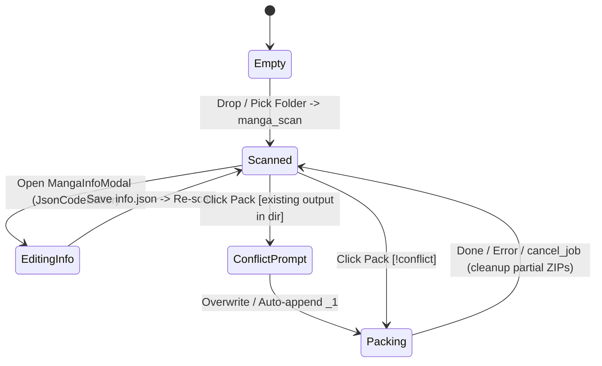

> Index: [`/llms.txt`](../llms.txt) · Agent Integration Guide: [`docs/manga-pack-agent-guide.md`](./manga-pack-agent-guide.md) · Architecture: [`docs/manga-pack-architecture.md`](./manga-pack-architecture.md) · Machine-Readable Spec: [`docs/specs/manga-pack.schema.json`](./specs/manga-pack.schema.json)

# Bộ Test Case Chức năng — `Manga Packager` (`manga-pack`, Knit `v0.2.0`)

Bộ thiết kế kiểm thử chức năng cho **`Manga Packager`** (`MangaPackView` + `crates/knit-manga`), đối chiếu trực tiếp với [`docs/manga-pack-agent-guide.md`](./manga-pack-agent-guide.md) và [`docs/specs/manga-pack.schema.json`](./specs/manga-pack.schema.json).

---

## 0. Tập Yêu cầu Nghiệp vụ (BR Inventory)

| Mã BR | Tóm tắt yêu cầu nghiệp vụ (`manga-pack`) | Kỹ thuật chính | Kỹ thuật bổ trợ |
|---|---|---|---|
| **BR-01** | Nhận diện chế độ quét `MangaScanMode` (`Auto` heuristic `looks_like_single_story`, `Single`, `Library`), chuẩn hóa NFC và parse `Volume`/`Arc`/`Chapter` (kể cả số thập phân `1.5`). | Decision Table | Domain (EP/BVA) |
| **BR-02** | Xác định ảnh bìa ưu tiên (`cover_art` > `cover` > `poster`), bảo vệ chống path traversal từ `info.json` (`safe_join_within`), đọc `info.json` có UTF-8 BOM và hỗ trợ sửa trong `MangaInfoModal`. | Error Guessing | Use Case |
| **BR-03** | Nhóm nguyên bộ truyện theo `max_gb` (`group_by_size`, không cắt đôi 1 truyện), chọn mức nén ảnh (`0` = `Store`, `1..9` = `Deflate`), đặt tên `.zip`/`.cbz` và dọn sạch part khi lỗi/hủy. | Domain (EP/BVA) | Use Case |
| **BR-04** | Chế độ `MangamentPackageMode`: sinh `stories.csv` chuẩn RFC 4180 riêng cho từng file ZIP part với `NODE_HEADERS * max_depth` căn phải và đóng gói kèm `info.json`. | Use Case | Decision Table |

---

## 1. Domain Testing (EP + BVA) — Kiểm thử Miền giá trị & Biên

| TC ID | Biến kiểm thử | Lớp / Điểm biên | Đầu vào | Kết quả mong đợi | BR |
|---|---|---|---|---|---|
| **TC-DOM-01** | `NodeRef.order_index` / `fmt_num` | Số nguyên (`1.0`) vs Thập phân (`1.5`, `10.250`) | Thư mục: `"Chương 01"`, `"Chap 1.5"`, `"Vol.2"`, `"10"` | `fmt_num(1.0) == "1"` (`Chapter 1`), `fmt_num(1.5) == "1.5"` (`Chapter 1.5`), `Vol.2` → `Volume 2`, `"10"` → `Chapter 10` | BR-01 |
| **TC-DOM-02** | `MangaPackOptions.image_compression` | `0` (Store), `1..3` (Fast), `4..6` (Normal), `7..9` (Best) | Đóng gói cùng thư mục với `image_compression = 0`, `3`, `6`, `9` | Ánh xạ lần lượt sang `Store`, `Fast`, `Normal`, `Best`; riêng `info.json` và `stories.csv` luôn dùng `Normal` | BR-03 |
| **TC-DOM-03** | `MangaPackOptions.max_gb` & `group_by_size` | `<= 0.0` vs `> 0.0` (1 truyện lớn hơn `max_gb` vs nhiều truyện) | `sizes = [600MB, 500MB, 400MB]`, `max_bytes = 1000MB` (và `[1500MB, 200MB]`) | Case 1: `[[0], [1, 2]]` (`_part01.zip`, `_part02.zip`). Case 2: `[[0], [1]]` — truyện `1500MB` không bị cắt đôi | BR-03 |
| **TC-DOM-04** | `stories` (Pack input) | Invalid (`[]` empty) | `pack_stories(&[], out, ...)` | Trả `"Không có truyện nào để đóng gói"` | BR-03 |
| **TC-DOM-05** | `manga_pack.output_name` | `null` vs `".cbz"` vs không có đuôi | 1 truyện `my_manga`: Case A: `output_name = null` Case B: `"vol1.cbz"` Case C: `"custom"` | Case A: `my_manga.zip` Case B: `vol1.cbz` Case C: `custom.zip` | BR-03 |

---

## 2. Decision Table Testing — Heuristic `Auto` & `MangamentPackageMode`

### 2A. Nhận diện `MangaScanMode::Auto` (`looks_like_single_story`)

| Điều kiện / Hành động | TC-DT-01 | TC-DT-02 | TC-DT-03 | TC-DT-04 |
|---|---|---|---|---|
| Có `info.json` hoặc file ảnh ngay tại gốc? | Có | Không | Không | Không |
| Có thư mục con trực tiếp chứa `info.json`? | — | Có | Không | Không |
| Tỷ lệ thư mục con khớp `parse_node_folder_name` | — | — | `>= 50%` (`valid*2 >= total`) | `< 50%` |
| **Kết quả:** Quét theo `Single` (1 truyện) | ✓ | — | ✓ | — |
| **Kết quả:** Quét theo `Library` (nhiều truyện) | — | ✓ | — | ✓ |

### 2B. Đóng gói `stories.csv` trong `MangamentPackageMode`

| Điều kiện / Hành động | TC-DT-05 | TC-DT-06 |
|---|---|---|
| `mangament_package_mode` | `false` | `true` |
| Chia part (`max_gb > 0` tạo 2 part) | Có | Có |
| **Kết quả:** Chỉ đóng gói ảnh + `info.json` gốc | ✓ | — |
| **Kết quả:** Sinh `stories.csv` riêng trong mỗi part (`_part01.zip`, `_part02.zip`), mỗi file chỉ chứa các truyện thuộc part đó | — | ✓ |

---

## 3. State Transition, Use Case & Error Guessing (Fault Attack)

| TC ID | Loại | Mô tả / Giả thuyết lỗi | Dữ liệu & Bước thực hiện | Kết quả mong đợi | BR |
|---|---|---|---|---|---|
| **TC-UCT-01** | Use Case | Đóng gói 2 bộ truyện khác độ sâu cây (`Volume > Chapter` vs `Chapter` lẻ) với `MangamentPackageMode = true` | Truyện A có `Vol 1/Chap 1/01.jpg`; Truyện B chỉ có `Chap 2/01.jpg` | `max_depth == 2`; trong `stories.csv`, dòng của Truyện A điền cả 2 nhóm cột `Volume` + `Chapter`; dòng của Truyện B để trống 3 cột trái và điền `Chapter 2` ở nhóm cột bên phải (`node_cols` căn phải) | BR-01, BR-04 |
| **TC-ST-01** | State Transition | Tạo / sửa `info.json` qua `MangaInfoModal` (`JsonCodeEditor`) và quét lại | Truyện chưa có `info.json` → mở `MangaInfoModal` → sửa `title`, `genres`, `authors` → Save & Rescan | Ghi `info.json` UTF-8 hợp lệ; `Story.info` và banner tổng hợp trên UI cập nhật ngay tiêu đề mới | BR-02 |
| **TC-EG-01** | Fault Attack (Security) | Path traversal qua trường `cover_art` trong `info.json` | Đặt `"cover_art": "../../etc/passwd"` hoặc `"/tmp/secret.jpg"` trong `info.json` (khi gốc truyện không có `cover.*`) | `safe_join_within` từ chối đường dẫn thoát khỏi `story_dir`; `Story.cover` trả `None`, không rò rỉ file hệ thống vào ZIP | BR-02 |
| **TC-EG-02** | Fault Attack | Tên thư mục tiếng Việt dạng NFD (macOS) vs NFC & trùng `(kind, order_index)` | Hai thư mục `Chường 1` (NFD) và `Chap 01` cùng trong 1 truyện, cộng thêm `info.json` có UTF-8 BOM `\u{FEFF}` | `nfc_normalize` parse chính xác `Chapter 1` cho cả 2 thư mục và ghi cảnh báo `"2 thư mục cùng thành 'Chapter 1': ..."` vào `Story.warnings`; `info.json` có BOM vẫn đọc bình thường | BR-01, BR-02 |
| **TC-EG-03** | Fault Attack | Hủy job ở part thứ 2 trong quá trình chia multi-part `max_gb` | Thư viện 3 truyện chia 2 part; kích hoạt `cancel_job` khi đang ghi part 2 | Part 1 đã hoàn tất trước đó **bị xóa sạch** (`for p in created { remove_file(p) }`), không sót file part nửa chừng | BR-03 |

---

## 4. Requirements Traceability Matrix (RTM)

| BR ID | Domain (EP/BVA) | Decision Table | State Transition | Use Case | Error Guessing | Trạng thái |
|---|---|---|---|---|---|---|
| **BR-01** | TC-DOM-01 | TC-DT-01..04 | — | TC-UCT-01 | TC-EG-02 | ✓ Covered |
| **BR-02** | — | — | TC-ST-01 | — | TC-EG-01, TC-EG-02 | ✓ Covered |
| **BR-03** | TC-DOM-02..05 | — | — | — | TC-EG-03 | ✓ Covered |
| **BR-04** | — | TC-DT-05, TC-DT-06 | — | TC-UCT-01 | — | ✓ Covered |
