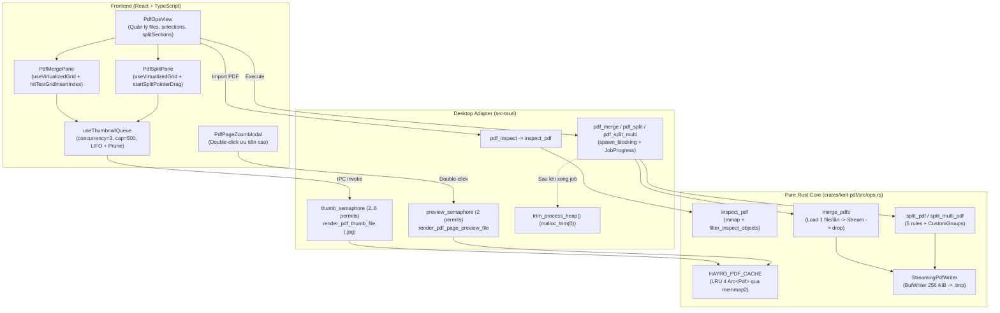
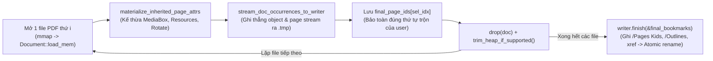

# Kiến trúc & Cơ chế Hoạt động của `PDF Merge & Split` (Knit)

Tài liệu này mô tả cách công cụ **`PDF Merge & Split`** (`PdfOpsView` + `crates/knit-pdf/src/ops.rs`) xử lý hàng loạt tệp PDF dung lượng lớn (tổng lên tới nhiều GB / hàng nghìn trang) mà vẫn **không tràn RAM**, **giữ cuộn/kéo-thả mượt mà** và **bảo toàn cây mục lục (Bookmarks)**.

---

## 1. Tổng quan Kiến trúc 3 Tầng



---

## 2. Cơ chế Chống Tràn RAM & Tối ưu CPU ở Backend (`crates/knit-pdf/src/ops.rs`)

### 2.1. `inspect_pdf` Siêu nhẹ — Bỏ qua Stream Ảnh khi Đọc Metadata

Khi người dùng import nhiều tệp PDF tổng dung lượng vài GB chỉ để lấy số trang (`page_count`) và cây mục lục (`/Outlines`), việc parse toàn bộ stream ảnh/font vào RAM sẽ gây phình bộ nhớ ngay lúc mới thêm file.

`inspect_pdf` giải quyết bằng 2 lớp tối ưu:
1. Ánh xạ tệp ở chế độ chỉ đọc qua `memmap2` (`mmap_pdf_readonly(path)`), không cấp phát `Vec<u8>` đọc cả file.
2. Nạp cấu trúc bằng `Document::load_mem_with_options(&mmap, LoadOptions::with_filter(filter_inspect_objects))`:
   - Hàm lọc `filter_inspect_objects` chỉ giữ lại các object cấu trúc và `/ObjStm` (Object Streams nén của PDF 1.5+).
   - **Loại bỏ hoàn toàn mọi `Object::Stream` dữ liệu nặng** (ảnh, content stream, font nhúng) ngay trong quá trình parse, sau đó `drop(mmap)` ngay khi đọc xong `page_count` và `bookmarks`.

### 2.2. `HAYRO_PDF_CACHE` — Tránh Parse Lại Bảng `xref` khi Render Thumbnail

Trước đây, mỗi lần render 1 trang thumbnail đều gọi `Pdf::new(...)` lại từ đầu; với PDF vài nghìn trang, việc parse lại bảng `xref` và cây `/Pages` lặp đi lặp lại khiến CPU quá tải và đơ hàng đợi thumbnail.

`load_cached_hayro_pdf(path)` giải quyết triệt để:
- Duy trì cache LRU nội bộ `HAYRO_PDF_CACHE` tối đa **`HAYRO_CACHE_CAP = 4`** đối tượng `Arc<Pdf>` dựng trên `memmap2::Mmap`.
- Khóa cache theo bộ 3: `(canonical_path, file_len, mtime_nanos)` để tự vô hiệu hóa nếu tệp trên đĩa bị thay đổi.
- Khi cuộn qua hàng trăm trang của cùng một PDF, bảng `xref` và cây trang chỉ bị parse **đúng 1 lần duy nhất**.
- Khi người dùng xóa danh sách PDF hoặc dọn cache, `clear_pdf_reader_cache()` xóa sạch các `Arc<Pdf>` để nhả mapping ngay lập tức.

### 2.3. `merge_pdfs` Streaming — Chỉ Giữ Tối Đa 1 PDF Nguồn Trong RAM

Khi ghép nhiều file PDF (ví dụ 20 tệp tổng 6.6 GB) và đặc biệt khi người dùng kéo-thả trộn xen kẽ trang từ các file khác nhau (`selected_pages`), nếu mở tất cả `Document` nguồn cùng lúc để copy object thì RAM sẽ tràn ngay lập tức.

`merge_pdfs` thực thi theo vòng lặp tuần tự từng tệp nguồn (`for (file_idx, path) in config.inputs.iter().enumerate()`):



- **Chỉ giữ tối đa 1 tệp nguồn trong RAM** tại bất kỳ thời điểm nào.
- Ghi thẳng các object cần thiết xuống đĩa qua `StreamingPdfWriter` (buffer `256 KiB` -> `.tmp`), giữ `TempFilesGuard` để tự động xóa `.tmp` nếu bị hủy giữa chừng.
- Gọi `drop(doc)` và `trim_heap_if_supported()` (`malloc_trim(0)` trên Linux glibc) ngay sau khi xử lý xong mỗi tệp nguồn.
- Cuối cùng, tổng hợp cây bookmark bằng `remap_bookmarks_for_selection` (hoặc dùng `custom_bookmarks` từ `BookmarkTreeEditor`) và ghi vào đuôi file trước khi `fs::rename` nguyên tử sang file đích.

### 2.4. `split_pdf` & `split_multi_pdf` — 5 Chế độ Tách & Ghép Chéo Đa Tệp

| Chế độ (`PdfSplitRule`) | Cơ chế thực thi & Xử lý dữ liệu |
|---|---|
| **`PageRanges`** (`"1-5, 8, 10-15"`) | Parse bằng `parse_page_ranges`, stream các trang khớp ra `<stem>_extracted.pdf` qua `stream_subset_pdf_to_path`. |
| **`EveryNPages`** (`n`) | Chia đều từng block `n` trang thành `<stem>_part01.pdf`, `<stem>_part02.pdf`... |
| **`ExtractSelected`** | Xuất danh sách `page_indices` đã chọn thành `<stem>_selected.pdf`. |
| **`MaxBytes`** (`max_mb`) | `split_pdf_by_max_bytes` stream từng trang và theo dõi kích thước đã ghi để tự động cắt sang part mới khi gần chạm ngưỡng `max_mb`. |
| **`CustomGroups`** *(Kéo-thả Section)* | • **1 file:** Gọi `stream_subset_pdf_to_path` cho từng section kèm góc xoay `rotation_deg` riêng từng trang.<br>• **Nhiều file (`split_multi_pdf`):** Với mỗi section, ánh xạ các `PageSelection` (mang `file_index` khác nhau) sang chỉ số cục bộ `local_inputs` rồi gọi `merge_pdfs` ở chế độ streaming, tự động xử lý trùng tên section (`_2`, `_3`...). |

---

## 3. Cơ chế Giữ Độ Mượt UI & Quản lý Hàng đợi Frontend (`src/`)

### 3.1. Tách IPC Semaphore cho Thumbnail Lưới vs Double-Click Zoom

Tương tự `image2pdf`, tầng `src-tauri/src/lib.rs` dùng đĩa làm cache `.jpg` (`render_pdf_thumbnail_jpeg` trả về `PathBuf` cho `convertFileSrc`) và tách cứng 2 semaphore:

```mermaid
sequenceDiagram
    participant Grid as Virtualized Grid
    participant Modal as PdfPageZoomModal
    participant TSem as thumb_semaphore (2..6)
    participant PSem as preview_semaphore (2)
    participant Cache as HAYRO_PDF_CACHE + Disk .jpg

    Grid->>TSem: Cuộn qua hàng trăm trang PDF
    TSem->>Cache: Kiểm tra cache .jpg (Lần 1)
    Note over TSem: Các worker nền đang bận render...

    Modal->>PSem: User double-click vào trang bất kỳ
    PSem->>Cache: Kiểm tra cache .jpg độ phân giải cao
    PSem->>PSem: Lấy permit riêng ngay lập tức
    PSem->>Cache: Dùng chung Arc&lt;Pdf&gt; đã parse sẵn trong LRU
    PSem-->>Modal: Hiển thị ảnh phóng to ngay, không chờ hàng đợi nền
```

### 3.2. Ảo hóa Lưới 2 Chiều & Sửa Lỗi Co Chiều Cao WebKitGTK (`PdfMergePane` & `PdfSplitPane`)

- **Ảo hóa cả Merge lẫn Split Source:** Cả lưới sắp xếp của tab Merge (`PdfMergePane.tsx`) và khung `Source PDF Pages` của tab Split (`PdfSplitPane.tsx`) đều dùng chung hook `useVirtualizedGrid` (`overscanRows = 3`).
- **Khắc phục lỗi sụp chiều cao trên >300 trang:** Khung preview của `MergePageCard`, `SplitSourceCard`, `SplitSectionItemCard` (`src/components/PdfPageCards.tsx`) bắt buộc gắn `shrink-0` và lưới sử dụng `auto-rows-max`, ngăn WebKitGTK nén chiều cao hàng xuống vài pixel khi tổng số hàng vượt quá hàng trăm hàng.

### 3.3. Hàng đợi LIFO & Chiến lược `PinnedKeys` cho Tab Split

Trong `src/views/PdfOpsView.tsx`, `useThumbnailQueue` cấu hình `concurrency: 3`, `maxCacheEntries: 500`, `flushIntervalMs: 40`:
- **Ưu tiên Viewport & Cắt tỉa (Prune):** Khi cuộn, `enqueueWindow(visibleKeys, true)` đẩy các trang vừa vào màn hình lên đầu hàng đợi LIFO và cắt bỏ ngay các trang đã cuộn khuất khỏi hàng chờ.
- **Bảo vệ Cache không gây Preload mù (`setPinnedKeys(pinned, false)`):** Các trang đã được kéo vào `Output PDF Sections` ở tab Split được đánh dấu là `pinned` để **không bị LRU eviction đẩy khỏi bộ nhớ**, nhưng tham số `enqueueMissing = false` đảm bảo chúng không tự động chèn hàng trước các trang nguồn mà người dùng đang cuộn xem.
- **Double-Click Button Guard:** Các nút hành động nhanh trên thẻ (`Xoay`, `Xóa`, `Thêm nhanh`) chặn `dblclick` nổi bọt (`closest("button")` check + `stopPropagation`) để click nhanh không mở nhầm modal phóng to.

### 3.4. Kéo-thả Con trỏ Không Reflow (`hitTestGridInsertIndex` & `startSplitPointerDrag`)

- Thay thế HTML5 `draggable` (vốn hay giật lag trên WebKitGTK và thiếu phản hồi vị trí chèn) bằng pointer-based drag (`pointerdown` → `pointermove` → `pointerup`).
- Tính vị trí chèn $O(1)$ từ geometry đã cache trong `requestAnimationFrame`, hiển thị vạch xanh vị trí chèn (`showBarLeft` / `showBarEnd`), ghost thumbnail card (`translate3d`), và tự động cuộn mượt khi kéo sát mép container (`56px`).

---

## 4. Tổng hợp Quyết định Thiết kế & Đánh đổi (Trade-offs)

| Quyết định Kiến trúc | Phương án bị loại bỏ | Lý do chọn & Đánh đổi |
|---|---|---|
| **Gộp PDF theo vòng lặp 1 file/lần + `StreamingPdfWriter`** | Mở đồng thời tất cả `lopdf::Document` nguồn trong `Vec<Document>` rồi ghép chung | **Được:** Đỉnh RAM chỉ tương đương 1 tệp lớn nhất thay vì tổng 6.6 GB.<br>**Đổi:** Phải tự map lại `ObjectId` cho từng file theo thứ tự `final_page_ids` và hiện thực hóa thuộc tính kế thừa (`/MediaBox`, `/Resources`) trước khi stream. |
| **Cache `HAYRO_PDF_CACHE` (4 `Arc<Pdf>`) trên `memmap2`** | Gọi `Pdf::new` mới cho mỗi trang khi render thumbnail | **Được:** Cuộn mượt qua hàng nghìn trang mà không bị nghẽn CPU parse lại `xref`.<br>**Đổi:** Cần gọi `clear_pdf_reader_cache()` khi xóa file để nhả file handle / mmap trên Windows. |
| **Lọc `filter_inspect_objects` khi chạy `inspect_pdf`** | Gọi `Document::load` đầy đủ khi import tệp | **Được:** Import tức thì hàng GB PDF mà không nạp stream ảnh vào RAM.<br>**Đổi:** Nếu tệp PDF bị lỗi cấu trúc nhẹ khiến lọc thất bại, code tự fallback sang `Document::load_mem(&mmap)`. |
| **`setPinnedKeys(pinned, false)` trong Split Sections** | Enqueue trước toàn bộ trang trong các section ngay cả khi đang cuộn nguồn | **Được:** Không làm nghẽn hàng đợi của trang đang hiển thị trên màn hình chính.<br>**Đổi:** Trang nằm trong section ẩn chỉ tải thumbnail khi section đó cuộn vào tầm nhìn hoặc đã có sẵn trong cache. |

---

## 5. Tham chiếu Mã nguồn (Source Map)

- **Backend PDF Operations & Streaming:** [`crates/knit-pdf/src/ops.rs`](../crates/knit-pdf/src/ops.rs) (`inspect_pdf`, `HAYRO_PDF_CACHE`, `merge_pdfs`, `split_pdf`, `split_multi_pdf`, `stream_doc_occurrences_to_writer`)
- **PDF Models & Split Rules:** [`crates/knit-pdf/src/models.rs`](../crates/knit-pdf/src/models.rs) (`PdfInfo`, `PdfMergeConfig`, `PageSelection`, `PdfSplitRule`, `SplitGroupSpec`)
- **Tauri IPC, Semaphores & Heap Trim:** [`src-tauri/src/lib.rs`](../src-tauri/src/lib.rs) (`pdf_inspect`, `render_pdf_thumb_file`, `render_pdf_page_preview_file`, `pdf_merge`, `pdf_split`, `pdf_split_multi`)
- **Frontend Views, Cards & Hooks:**
  - [`src/views/PdfOpsView.tsx`](../src/views/PdfOpsView.tsx)
  - [`src/views/pdf-ops/PdfMergePane.tsx`](../src/views/pdf-ops/PdfMergePane.tsx)
  - [`src/views/pdf-ops/PdfSplitPane.tsx`](../src/views/pdf-ops/PdfSplitPane.tsx)
  - [`src/components/PdfPageCards.tsx`](../src/components/PdfPageCards.tsx)
  - [`src/components/BookmarkPageBadge.tsx`](../src/components/BookmarkPageBadge.tsx)
