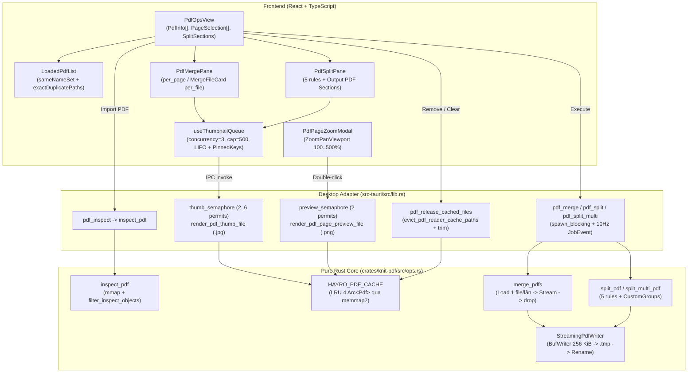
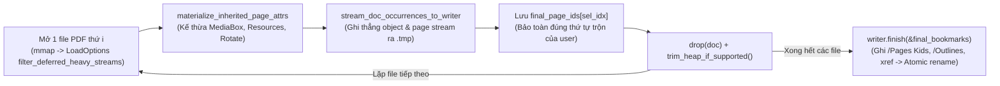
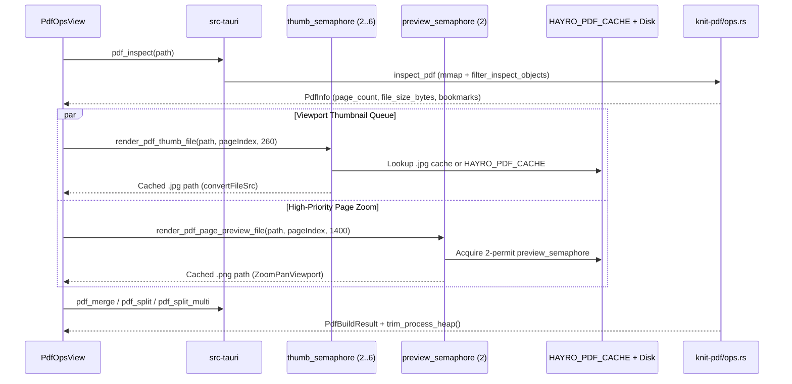

> Index: [`/llms.txt`](../llms.txt) · Runnable API & IPC Guide: [`docs/pdf-ops-agent-guide.md`](./pdf-ops-agent-guide.md) · JSON Schema Contract: [`docs/specs/pdf-ops.schema.json`](./specs/pdf-ops.schema.json) · Functional Tests: [`docs/pdf-ops-functional-tests.md`](./pdf-ops-functional-tests.md)

# Kiến trúc & Cơ chế Hoạt động của `PDF Merge & Split` (`pdf-ops`, Knit `v0.2.0`)

Tài liệu này mô tả cách công cụ **`PDF Merge & Split`** (`PdfOpsView` + `crates/knit-pdf/src/ops.rs`) xử lý hàng loạt tệp PDF dung lượng lớn (tổng lên tới nhiều GB / hàng nghìn trang) mà vẫn **không tràn RAM**, **giữ cuộn/kéo-thả mượt mà** và **bảo toàn cây mục lục (Bookmarks)**.

---

## 1. Tổng quan Kiến trúc 3 Tầng

Sơ đồ 3 tầng tách biệt trạng thái hiển thị nhẹ trên React/WebView khỏi đọc/render/stream PDF thuần Rust (`.mmd`: [`pdf_ops_01_architecture_three_layer.mmd`](./diagrams/pdf_ops_01_architecture_three_layer.mmd)):

---

## 2. Cơ chế Chống Tràn RAM & Tối ưu CPU ở Backend (`crates/knit-pdf/src/ops.rs`)

### 2.1. `inspect_pdf` Siêu nhẹ — Bỏ qua Stream Ảnh khi Đọc Metadata

Khi người dùng import nhiều tệp PDF tổng dung lượng vài GB chỉ để lấy số trang (`page_count`) và cây mục lục (`/Outlines`), việc parse toàn bộ stream ảnh/font vào RAM sẽ gây phình bộ nhớ ngay lúc mới thêm file.

`inspect_pdf` giải quyết bằng 2 lớp tối ưu:
1. Ánh xạ tệp ở chế độ chỉ đọc qua `memmap2` (`mmap_pdf_readonly(path)`), không cấp phát `Vec<u8>` đọc cả file.
2. Nạp cấu trúc bằng `Document::load_mem_with_options(&mmap, LoadOptions::with_filter(filter_inspect_objects))`:
   - Hàm lọc `filter_inspect_objects` chỉ giữ lại các object cấu trúc và `/ObjStm` (Object Streams nén của PDF 1.5+).
   - **Loại bỏ hoàn toàn mọi `Object::Stream` dữ liệu nặng** (ảnh, content stream, font nhúng) ngay trong quá trình parse, sau đó `drop(mmap)` ngay khi đọc xong `page_count` và `bookmarks`.

### 2.2. `HAYRO_PDF_CACHE` & Giải phóng Theo Đường dẫn (`pdf_release_cached_files`)

Trước đây, mỗi lần render 1 trang thumbnail đều gọi `Pdf::new(...)` lại từ đầu; với PDF vài nghìn trang, việc parse lại bảng `xref` và cây `/Pages` lặp đi lặp lại khiến CPU quá tải và đơ hàng đợi thumbnail.

`load_cached_hayro_pdf(path)` giải quyết triệt để:
- Duy trì cache LRU nội bộ `HAYRO_PDF_CACHE` tối đa **`HAYRO_CACHE_CAP = 4`** đối tượng `Arc<Pdf>` dựng trên `memmap2::Mmap`.
- Khóa cache theo bộ 3: `(canonical_path, file_len, mtime_nanos)` để tự vô hiệu hóa nếu tệp trên đĩa bị thay đổi.
- Khi cuộn qua hàng trăm trang của cùng một PDF, bảng `xref` và cây trang chỉ bị parse **đúng 1 lần duy nhất**.
- Khi người dùng xóa từng tệp khỏi danh sách hoặc bấm Clear All, UI gọi `pdf_release_cached_files` → `evict_pdf_reader_cache_paths(&paths)` (hoặc `clear_pdf_reader_cache()` khi Clear List) để nhả file mapping ngay lập tức và gọi `trim_heap_if_supported()` (`malloc_trim(0)` trên Linux glibc).

### 2.3. `merge_pdfs` Streaming — Chỉ Giữ Tối Đa 1 PDF Nguồn Trong RAM

Khi ghép nhiều file PDF (ví dụ 20 tệp tổng 6.6 GB) và đặc biệt khi người dùng kéo-thả trộn xen kẽ trang từ các file khác nhau (`selected_pages`), nếu mở tất cả `Document` nguồn cùng lúc để copy object thì RAM sẽ tràn ngay lập tức.

`merge_pdfs` thực thi theo vòng lặp tuần tự từng tệp nguồn (`for (file_idx, path) in config.inputs.iter().enumerate()`):

- **Chỉ giữ tối đa 1 tệp nguồn trong RAM** tại bất kỳ thời điểm nào.
- Ghi thẳng các object cần thiết xuống đĩa qua `StreamingPdfWriter` (buffer `256 KiB` -> `.tmp`), giữ `TempFilesGuard` để tự động xóa `.tmp` nếu bị hủy giữa chừng.
- Gọi `drop(doc)` và `trim_heap_if_supported()` (`malloc_trim(0)` trên Linux glibc) ngay sau khi xử lý xong mỗi tệp nguồn.
- Cuối cùng, tổng hợp cây bookmark bằng `remap_bookmarks_for_selection` (hoặc dùng `custom_bookmarks` từ `BookmarkTreeEditor`) và ghi vào đuôi file trước khi `fs::rename` nguyên tử sang file đích.

### 2.4. `split_pdf` & `split_multi_pdf` — 5 Chế độ Tách & Ghép Chéo Đa Tệp

| Chế độ (`PdfSplitRule`) | Cơ chế thực thi & Xử lý dữ liệu |
|---|---|
| **`PageRanges`** (`"1-5, 8, 10-15"`) | Parse bằng `parse_page_ranges` (1-based, hỗ trợ dải đảo `8-6`), stream các trang khớp ra `<stem>_extracted.pdf` qua `stream_subset_pdf_to_path`. |
| **`EveryNPages`** (`n`) | Chia đều từng block `n` trang thành `<stem>_part01.pdf`, `<stem>_part02.pdf`... |
| **`ExtractSelected`** | Xuất danh sách `page_indices` (0-based) đã chọn thành `<stem>_selected.pdf`. |
| **`MaxBytes`** (`max_mb`) | `split_pdf_by_max_bytes` dùng tìm kiếm nhị phân đo thử bằng `StreamingPdfWriter::from_writer(io::sink())` để cắt đúng ngưỡng `max_mb` MiB vào `<stem>_part01.pdf`, `<stem>_part02.pdf`... |
| **`CustomGroups`** *(Output PDF Sections)* | • **1 file:** Gọi `stream_subset_pdf_to_path` cho từng section kèm góc xoay `rotation_deg` riêng từng trang. • **Nhiều file (`split_multi_pdf`):** Với mỗi section, ánh xạ các `PageSelection` (mang `file_index` khác nhau) sang chỉ số cục bộ `local_inputs` rồi gọi `merge_pdfs` ở chế độ streaming, tự động khử ký tự cấm tên file (`sanitize_split_group_name`) và xử lý trùng tên section (`_2`, `_3`...). |

---

## 3. Cơ chế Giữ Độ Mượt UI & Tính năng Workbench (`src/`)

### 3.1. Tách IPC Semaphore & Trình tự Nạp / Xem trước / Xuất

Sơ đồ trình tự đầy đủ từ `pdf_inspect` đến xem trước song song và streaming export (`.mmd`: [`pdf_ops_02_sequence_merge_split.mmd`](./diagrams/pdf_ops_02_sequence_merge_split.mmd)):

### 3.2. Chế độ Merge `per_page` vs `per_file` & Bảo vệ Tính liên tục (`analyzePerPageContiguity`)

Trong `PdfMergePane.tsx` và `pdfOpsTypes.ts`, người dùng có thể chuyển đổi qua lại giữa 2 chế độ Merge:
- **`per_page`:** Hiển thị toàn bộ trang của các tệp PDF đã nạp dưới dạng thẻ lưới (`MergePageCard`), hỗ trợ xoay từng trang (`90°`/`180°`/`270°`), xóa trang, kéo-thả đan xen trang giữa nhiều tệp và chỉnh cây mục lục `BookmarkTreeEditor`.
- **`per_file`:** Hiển thị mỗi tệp PDF như một thẻ đại diện duy nhất (`MergeFileCard`), cho phép kéo-thả sắp xếp thứ tự nguyên tệp cực nhanh. Khi chuyển từ `per_page` sang `per_file`, hàm `analyzePerPageContiguity(selections, files)` kiểm tra xem các trang của từng tệp có còn nguyên vẹn, liên tục `0..page_count-1` và chưa xoay hay không (`intact`); nếu người dùng đã đan xen hoặc xoay/xóa trang (`reason: "interleaved" | "edited"`), UI hiển thị hộp thoại xác nhận trước khi tái tạo lại thứ tự nguyên tệp (`buildSelectionsFromFileOrder`).

### 3.3. Phân biệt Trùng Tên vs Trùng Tệp (`LoadedPdfList.tsx`)

`LoadedPdfList` phân biệt 2 trạng thái trên đúng một dòng cố định chiều cao:
1. **`sameNameSet`** (cùng `baseName.toLowerCase()` nhưng có thể khác thư mục): hiển thị đường dẫn `f.path` cắt gọn (`truncate`) ngay trên cùng hàng ngang để phân biệt mà không làm nhảy chiều cao dòng.
2. **`exactDuplicatePaths`** (trùng đường dẫn chuẩn hóa qua `normalizeComparePath(f.path)`): gắn badge Info phẳng màu xanh (`<Info />` + `Duplicate file`) ở `text-sm` scale theo `--knit-app-font-size`.

### 3.4. Ảo hóa Lưới 2 Chiều, `PinnedKeys` & Split Section Context Menu

- **Ảo hóa cả Merge lẫn Split Source:** Cả `PdfMergePane.tsx` và `PdfSplitPane.tsx` đều dùng `useVirtualizedGrid` (`overscanRows = 3`, `auto-rows-max`, thẻ gắn `shrink-0`), khắc phục lỗi WebKitGTK co sụp chiều cao khi vượt 300+ hàng.
- **Hàng đợi LIFO & `PinnedKeys` (`useThumbnailQueue`):** `concurrency: 3`, `maxCacheEntries: 500`, `flushIntervalMs: 40`. Các trang đã nằm trong `Output PDF Sections` được đánh dấu `setPinnedKeys(pinned, false)` để không bị LRU eviction đẩy ra nhưng không chen ngang vào hàng đợi render các trang nguồn đang cuộn.
- **Context Menu & Chia Section Bất đồng bộ:** Thẻ trang trong `Output PDF Sections` dùng `PdfPageContextMenu` hỗ trợ xoay nhanh `90°`/`180°`/`270°` và xóa trang khỏi section; chức năng `handlePopulateSectionsFromRule` chia nhỏ việc tạo section theo lô `CHUNK_SECTIONS = 200` nhường event loop (`setTimeout(..., 0)`) để tránh đơ giao diện khi sinh hàng trăm section.
- **Zoom Modal & Double-Click Guard:** Double-click vào thẻ trang mở `PdfPageZoomModal` tích hợp `ZoomPanViewport` (`100%..500%` phóng theo con trỏ + kéo pan); các nút hành động trên thẻ chặn `dblclick` nổi bọt (`closest("button")`).
- **Kéo-thả Con trỏ Không Reflow:** Dùng `hitTestGridInsertIndex` và `startSplitPointerDrag` trên `pointerdown`/`pointermove`/`pointerup` với ghost `translate3d` và auto-scroll mép `56px`, đồng thời dùng CSS variable `rAF` cho thanh chia cột `useHorizontalRatioResize`.

---

## 4. Tổng hợp Quyết định Thiết kế & Đánh đổi (Trade-offs)

| Quyết định Kiến trúc | Phương án bị loại bỏ | Lý do chọn & Đánh đổi |
|---|---|---|
| **Gộp PDF theo vòng lặp 1 file/lần + `StreamingPdfWriter`** | Mở đồng thời tất cả `lopdf::Document` nguồn trong `Vec<Document>` rồi ghép chung | **Được:** Đỉnh RAM chỉ tương đương 1 tệp lớn nhất thay vì tổng 6.6 GB. **Đổi:** Phải tự map lại `ObjectId` cho từng file theo thứ tự `final_page_ids` và hiện thực hóa thuộc tính kế thừa (`/MediaBox`, `/Resources`) trước khi stream. |
| **Cache `HAYRO_PDF_CACHE` (4 `Arc<Pdf>`) trên `memmap2`** | Gọi `Pdf::new` mới cho mỗi trang khi render thumbnail | **Được:** Cuộn mượt qua hàng nghìn trang mà không bị nghẽn CPU parse lại `xref`. **Đổi:** Cần gọi `pdf_release_cached_files` / `clear_pdf_reader_cache()` khi xóa file để nhả file handle / mmap trên Windows. |
| **Lọc `filter_inspect_objects` khi chạy `inspect_pdf`** | Gọi `Document::load` đầy đủ khi import tệp | **Được:** Import tức thì hàng GB PDF mà không nạp stream ảnh vào RAM. **Đổi:** Nếu tệp PDF bị lỗi cấu trúc nhẹ khiến lọc thất bại, code tự fallback sang `Document::load_mem(&mmap)`. |
| **`setPinnedKeys(pinned, false)` trong Split Sections** | Enqueue trước toàn bộ trang trong các section ngay cả khi đang cuộn nguồn | **Được:** Không làm nghẽn hàng đợi của trang đang hiển thị trên màn hình chính. **Đổi:** Trang nằm trong section ẩn chỉ tải thumbnail khi section đó cuộn vào tầm nhìn hoặc đã có sẵn trong cache. |

---

## 5. Tham chiếu Mã nguồn (Source Map)

- **Agent API & Schema:** [`docs/pdf-ops-agent-guide.md`](./pdf-ops-agent-guide.md), [`docs/specs/pdf-ops.schema.json`](./specs/pdf-ops.schema.json), [`docs/pdf-ops-functional-tests.md`](./pdf-ops-functional-tests.md)
- **Backend PDF Operations & Streaming:** [`crates/knit-pdf/src/ops.rs`](../crates/knit-pdf/src/ops.rs) (`inspect_pdf`, `HAYRO_PDF_CACHE`, `evict_pdf_reader_cache_paths`, `merge_pdfs`, `split_pdf`, `split_multi_pdf`, `parse_page_ranges`, `stream_doc_occurrences_to_writer`)
- **PDF Models & Split Rules:** [`crates/knit-pdf/src/models.rs`](../crates/knit-pdf/src/models.rs) (`PdfInfo`, `PdfMergeConfig`, `PageSelection`, `PdfSplitGroup`, `PdfSplitRule`, `PdfBuildResult`)
- **Tauri IPC, Semaphores & Heap Trim:** [`src-tauri/src/lib.rs`](../src-tauri/src/lib.rs) (`pdf_inspect`, `render_pdf_thumb_file`, `render_pdf_page_preview_file`, `read_pdf_file_bytes`, `pdf_release_cached_files`, `pdf_merge`, `pdf_split`, `pdf_split_multi`)
- **Frontend Views, Cards & Hooks:**
  - [`src/views/PdfOpsView.tsx`](../src/views/PdfOpsView.tsx)
  - [`src/views/pdf-ops/LoadedPdfList.tsx`](../src/views/pdf-ops/LoadedPdfList.tsx)
  - [`src/views/pdf-ops/PdfMergePane.tsx`](../src/views/pdf-ops/PdfMergePane.tsx)
  - [`src/views/pdf-ops/PdfSplitPane.tsx`](../src/views/pdf-ops/PdfSplitPane.tsx)
  - [`src/views/pdf-ops/pdfOpsTypes.ts`](../src/views/pdf-ops/pdfOpsTypes.ts)
  - [`src/components/PdfPageCards.tsx`](../src/components/PdfPageCards.tsx)
  - [`src/components/BookmarkPageBadge.tsx`](../src/components/BookmarkPageBadge.tsx)
