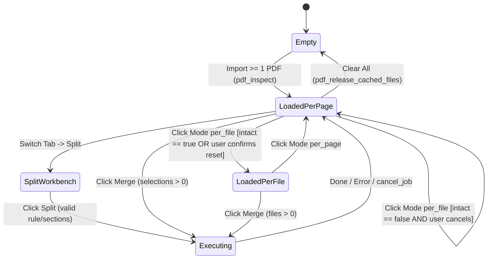

> Index: [`/llms.txt`](../llms.txt) · Agent Integration Guide: [`docs/pdf-ops-agent-guide.md`](./pdf-ops-agent-guide.md) · Architecture: [`docs/pdf-ops-architecture.md`](./pdf-ops-architecture.md) · Machine-Readable Spec: [`docs/specs/pdf-ops.schema.json`](./specs/pdf-ops.schema.json)

# Bộ Test Case Chức năng — `PDF Merge & Split` (`pdf-ops`, Knit `v0.2.0`)

Bộ thiết kế kiểm thử chức năng cho **`PDF Merge & Split`** (`PdfOpsView` + `crates/knit-pdf/src/ops.rs`), áp dụng 5 kỹ thuật kiểm thử chuẩn ISTQB đối chiếu trực tiếp với [`docs/pdf-ops-agent-guide.md`](./pdf-ops-agent-guide.md) và [`docs/specs/pdf-ops.schema.json`](./specs/pdf-ops.schema.json).

---

## 0. Tập Yêu cầu Nghiệp vụ (BR Inventory)

| Mã BR | Tóm tắt yêu cầu nghiệp vụ (`pdf-ops`) | Kỹ thuật chính | Kỹ thuật bổ trợ |
|---|---|---|---|
| **BR-01** | Đọc metadata `inspect_pdf` bằng `mmap` + `filter_inspect_objects` bỏ qua stream nặng, lấy chính xác `page_count`, `file_size_bytes` và `/Outlines`; nhận diện trùng tên khác thư mục vs trùng chính xác đường dẫn trên `LoadedPdfList`. | Use Case | Domain (EP/BVA) |
| **BR-02** | Ràng buộc miền giá trị cho `merge_pdfs` và `split_pdf` / `split_multi_pdf`: `inputs`, `file_index`, `page_index`, `rotation_deg`, `ranges` (1-based, hỗ trợ dải đảo), `every_n_pages.n`, `max_mb` (`> 0`), tên section `CustomGroups`. | Domain (EP + BVA) | — |
| **BR-03** | Quy tắc kết hợp mục lục (`preserve_bookmarks` × `custom_bookmarks` vs `remap_bookmarks_for_selection`) và chọn nhánh tách 1 file (`split_pdf`) vs ghép chéo nhiều file (`split_multi_pdf`). | Decision Table | — |
| **BR-04** | Chuyển đổi chế độ Merge `per_page` ↔ `per_file` kèm kiểm tra tính liên tục `analyzePerPageContiguity`, kéo-thả trang vào `Output PDF Sections` (với `PinnedKeys`), và context menu xoay/xóa item. | State Transition | Use Case |
| **BR-05** | Streaming 1 tệp nguồn/lần (`merge_pdfs`), `HAYRO_PDF_CACHE` (cap 4) + `pdf_release_cached_files`, và `TempFilesGuard` dọn file `.tmp` khi hủy hoặc lỗi. | Error Guessing | Use Case |

---

## 1. Domain Testing (EP + BVA) — Kiểm thử Miền giá trị & Biên

| TC ID | Biến kiểm thử | Lớp tương đương / Điểm biên | Đầu vào | Kết quả mong đợi | BR |
|---|---|---|---|---|---|
| **TC-DOM-01** | `inputs` (Merge) | Invalid (`0` items, LB−1) | `inputs = []` | `merge_pdfs` trả `"Can it nhat 1 file PDF de gop"` | BR-02 |
| **TC-DOM-02** | `file_index`, `page_index` | Invalid (`UB+1` out-of-bounds) | Case A: `inputs` có 2 PDF, `file_index = 2` Case B: PDF có 5 trang, `page_index = 5` | Case A: `"file_index 2 khong hop le"` Case B: `"page_index 5 khong ton tai trong file 0"` | BR-02 |
| **TC-DOM-03** | `PdfSplitRule::PageRanges.ranges` | Valid (nominal + reverse) vs Invalid (`0`, `total+1`, non-numeric) | PDF 10 trang: Valid: `"1-3, 8-6"` Invalid A: `"0-2"` Invalid B: `"11"` Invalid C: `"abc"` | Valid: trả index `[0,1,2,7,6,5]` Invalid A/B: `"So trang <v> nam ngoai pham vi 1..=10"` Invalid C: `"So trang khong hop le: 'abc'"` | BR-02 |
| **TC-DOM-04** | `EveryNPages.n` | BVA (`n = 0` clamped → `1`, `n = 1`, `n >= total`) | PDF 5 trang: Case A: `n = 0` Case B: `n = 2` Case C: `n = 10` | Case A: `(*n).max(1) = 1` → xuất 5 file `_part01.._part05` Case B: 3 file (`2, 2, 1` trang) Case C: 1 file (`5` trang) | BR-02 |
| **TC-DOM-05** | `MaxBytes.max_mb` | Invalid (`<= 0.0`, LB−1) vs Valid (`> 0.0`) | Case A: `max_mb = 0.0` Case B: `max_mb = -1.5` Case C: `max_mb = 0.5` | Case A/B: `"max_mb phai lon hon 0"` Case C: tách từng phần qua `split_pdf_by_max_bytes` ≤ 0.5 MiB/part (trừ trang đơn lẻ tự thân > 0.5 MiB) | BR-02 |
| **TC-DOM-06** | `CustomGroups.groups[].name` | Ký tự cấm đường dẫn & trùng tên | Groups: `["chap/1:a?", "chap/1:a?", "   "]` | `sanitize_split_group_name` sinh `chap_1_a_.pdf`, `chap_1_a__2.pdf`, `section_03.pdf` | BR-02 |
| **TC-DOM-07** | `ExtractSelected.page_indices` | Invalid (`[]` empty) & `UB+1` | PDF 4 trang: Case A: `[]` Case B: `[4]` | Case A: `"Chua chon trang nao de trich xuat"` Case B: `"Trang 5 vuot qua tong so trang 4"` | BR-02 |

---

## 2. Decision Table Testing — Bảng Quyết định

### 2A. Xử lý Bookmark khi `merge_pdfs`

| Điều kiện / Hành động | TC-DT-01 | TC-DT-02 | TC-DT-03 |
|---|---|---|---|
| `preserve_bookmarks` | `false` | `true` | `true` |
| `custom_bookmarks` | `null` | `null` | `Some([...])` |
| **Hành động:** Loại `/Outlines` khỏi PDF xuất | ✓ | — | — |
| **Hành động:** Chạy `remap_bookmarks_for_selection` theo `page_index_map` | — | ✓ | — |
| **Hành động:** Ghi thẳng `custom_bookmarks` từ `BookmarkTreeEditor` | — | — | ✓ |

### 2B. Định tuyến Split Đa tệp (`split_multi_pdf` vs `split_pdf`)

| Điều kiện / Hành động | TC-DT-04 | TC-DT-05 | TC-DT-06 |
|---|---|---|---|
| Số tệp nguồn (`inputs.len()`) | `1` | `>= 2` | `>= 2` |
| `rule` | `CustomGroups` | `CustomGroups` | `EveryNPages` / `PageRanges` / `MaxBytes` |
| **Hành động:** Gọi `split_pdf` trực tiếp trên 1 `Document` | ✓ | — | — |
| **Hành động:** Gộp chéo `local_inputs` per section + gọi `merge_pdfs` | — | ✓ | — |
| **Hành động:** Lặp từng tệp nguồn, gọi `split_pdf` theo `stems[idx]` | — | — | ✓ |

---

## 3. State Transition Testing — Chuyển đổi Trạng thái UI

| TC ID | Mô tả | Precondition | Trình tự thao tác | Kết quả & Trạng thái sau | BR |
|---|---|---|---|---|---|
| **TC-ST-01** | Chuyển `per_page` → `per_file` khi đã xoay/trộn trang (`analyzePerPageContiguity`) | `per_page` với 2 PDF, trang #1 của PDF 1 đã xoay `90°` | 1. Chọn chuyển sang mode `per_file` 2. Bấm `Cancel` ở modal cảnh báo 3. Đổi lại sang `per_file` và bấm `Confirm` | 1. Modal cảnh báo mất thay đổi `per_page` xuất hiện (`reason: "edited"`) 2. Sau bước 2: giữ nguyên `per_page` và góc xoay `90°` 3. Sau bước 3: chuyển sang `per_file` (`MergeFileCard`), `buildSelectionsFromFileOrder` reset thứ tự chuẩn nguyên tệp | BR-04 |
| **TC-ST-02** | Xóa 1 tệp khỏi `LoadedPdfList` và kiểm chứng `pdf_release_cached_files` | Đang nạp 2 PDF (`a.pdf`, `b.pdf`) | Bấm nút xóa `a.pdf` và xác nhận | Xóa toàn bộ `PageSelection` có `file_index == 0`, dời `file_index` của `b.pdf` từ `1 → 0`, gọi `releasePdfCachedFiles([a.pdf])` | BR-01, BR-05 |
| **TC-ST-03** | Kéo nhiều trang đang chọn (`Shift`/`Ctrl`) vào Split Section & Context Menu xoay/xóa | Tab Split với PDF 10 trang, đã chọn `{0, 2, 4}` | 1. Kéo nhóm 3 trang vào Section 1 2. Chuột phải vào trang thứ 2 trong Section 1 → `Rotate 90°` 3. Chuột phải → `Delete` | 1. Section 1 nhận đủ 3 trang giữ nguyên thứ tự; `setPinnedKeys` giữ cache thumbnail 2. Trang thứ 2 trong section mang `rotation_deg = 90` (trang nguồn không đổi) 3. Còn 2 trang trong Section 1 | BR-04 |

---

## 4. Use Case & Error Guessing (Fault Attack)

| TC ID | Loại | Kịch bản / Giả thuyết lỗi | Dữ liệu & Bước thực hiện | Kết quả mong đợi | BR |
|---|---|---|---|---|---|
| **TC-UCT-01** | Use Case | Merge 2 PDF có mục lục + xoay trang + xuất bảo toàn Outlines | `a.pdf` (3 trang, bookmark `Ch1 -> p0`), `b.pdf` (2 trang, bookmark `Ch2 -> p0`); chọn `[b:p1, a:p0(rot90), b:p0]` | File đích có 3 trang đúng thứ tự trộn, trang #2 xoay `90°`, `/Outlines` giữ `Ch1 -> p1`, `Ch2 -> p2` (bỏ qua `b:p1` không có bookmark) | BR-01, BR-03 |
| **TC-UCT-02** | Use Case | Tách chéo đa tệp (`split_multi_pdf` với `CustomGroups`) | `a.pdf` (3 trang), `b.pdf` (3 trang); Section `"mix"` gồm `a:p2(rot180)` + `b:p0` | Tạo `mix.pdf` gồm 2 trang từ 2 file nguồn đúng góc xoay `180°` ở trang 1 | BR-02, BR-03 |
| **TC-EG-01** | Fault Attack | Trùng tên tệp khác thư mục vs trùng chính xác đường dẫn trong `LoadedPdfList` | Nạp `/dir1/doc.pdf`, `/dir2/doc.pdf`, và nạp lại `/dir1/doc.pdf` | Cả 3 dòng đều hiển thị đường dẫn inline trên 1 hàng (`duplicate-pdf-path-*`); chỉ 2 dòng `/dir1/doc.pdf` hiện badge xanh `duplicate-pdf-badge-*`, không có viền vàng cảnh báo | BR-01 |
| **TC-EG-02** | Fault Attack | Thuộc tính kế thừa `/MediaBox` / `/Resources` trên cây `/Pages` cha bị mất khi trích 1 trang lẻ | PDF nguồn đặt `/MediaBox` và `/Resources` ở node `/Pages` cha thay vì từng `/Page` lá; tách trang #2 bằng `PageRanges` | `materialize_inherited_page_attrs` sao chép đầy đủ `/MediaBox`, `/Resources`, `/Rotate` xuống `/Page` trước khi stream; trang tách ra mở bình thường không bị trắng/lỗi font | BR-05 |
| **TC-EG-03** | Fault Attack | PDF chứa byte rác trước `%PDF-` header hoặc 300+ trang trên WebKitGTK Split grid | Case A: file PDF có 32 bytes padding trước `%PDF-1.7` Case B: PDF 400 trang mở trên Split Source grid | Case A: `merge_pdfs` tìm offset `%PDF-` và stream bình thường. Case B: Thẻ `shrink-0` trong `auto-rows-max` giữ đúng chiều cao thẻ, `useThumbnailQueue` prune thẻ khuất | BR-04, BR-05 |
| **TC-EG-04** | Fault Attack | Sinh 500 section bằng `EveryNPages (n=1)` qua `handlePopulateSectionsFromRule` và hủy giữa chừng `cancel_job` | PDF 500 trang → Populate sections (`CHUNK_SECTIONS = 200`) → chạy `pdf_split` → gọi `cancel_job` khi `done >= 50` | UI không bị treo khi tạo 500 section; sau khi `cancel_job`, job dừng ở biên part kế tiếp và không sót file `.knit_tmp.*` | BR-04, BR-05 |

---

## 5. Requirements Traceability Matrix (RTM)

| BR ID | Domain (EP/BVA) | Decision Table | State Transition | Use Case | Error Guessing | Trạng thái |
|---|---|---|---|---|---|---|
| **BR-01** | — | — | TC-ST-02 | TC-UCT-01 | TC-EG-01 | ✓ Covered |
| **BR-02** | TC-DOM-01..07 | — | — | TC-UCT-02 | — | ✓ Covered |
| **BR-03** | — | TC-DT-01..06 | — | TC-UCT-01, TC-UCT-02 | — | ✓ Covered |
| **BR-04** | — | — | TC-ST-01, TC-ST-03 | — | TC-EG-03, TC-EG-04 | ✓ Covered |
| **BR-05** | — | — | TC-ST-02 | — | TC-EG-02, TC-EG-03, TC-EG-04 | ✓ Covered |
