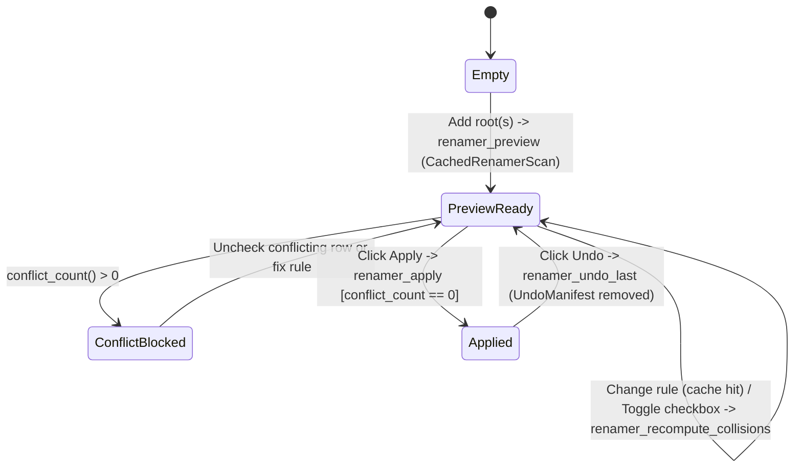

> Index: [`/llms.txt`](../llms.txt) · Agent Integration Guide: [`docs/renamer-agent-guide.md`](./renamer-agent-guide.md) · Architecture: [`docs/renamer-architecture.md`](./renamer-architecture.md) · Machine-Readable Spec: [`docs/specs/renamer.schema.json`](./specs/renamer.schema.json)

# Bộ Test Case Chức năng — `Batch Renamer` (`renamer`, Knit `v0.2.0`)

Bộ thiết kế kiểm thử chức năng cho **`Batch Renamer`** (`RenamerView` + `crates/knit-renamer`), đối chiếu trực tiếp với [`docs/renamer-agent-guide.md`](./renamer-agent-guide.md) và [`docs/specs/renamer.schema.json`](./specs/renamer.schema.json).

---

## 0. Tập Yêu cầu Nghiệp vụ (BR Inventory)

| Mã BR | Tóm tắt yêu cầu nghiệp vụ (`renamer`) | Kỹ thuật chính | Kỹ thuật bổ trợ |
|---|---|---|---|
| **BR-01** | Bộ lọc `ScanFilter` (`target_type`, `recursive`, `max_depth`, `ignore_hidden`, `include_extensions`, `include_patterns`, `exclude_patterns`) và parse rule `FindReplace`, `PerlPrename` (`s///`, `y///`), `10 FixedPresets`. | Domain (EP/BVA) | Decision Table |
| **BR-02** | Phát hiện xung đột tên (`recompute_collisions`) theo batch + trên đĩa (hỗ trợ `vacated_keys` khi hoán đổi tên, phân biệt trạng thái `unchanged`, `pending`, `conflict`), kết hợp checkbox `selected` từng dòng. | Decision Table | State Transition |
| **BR-03** | Sắp xếp thực thi Bottom-Up (`depth` giảm dần → file trước folder), đổi hoa-thường 2 bước an toàn (`rename_with_case_safety`), và hoàn tác `UndoManifest` (`renamer_undo_last`). | Use Case | Error Guessing |
| **BR-04** | Lưu trữ và quản lý `UserPreset` (`renamer_presets.json` qua `PresetStore`) và bảng Preview phân cấp (`RenamerPreviewTable`, `CachedRenamerScan`). | State Transition | Use Case |

---

## 1. Domain Testing (EP + BVA) — Kiểm thử Miền giá trị & Biên

| TC ID | Biến kiểm thử | Lớp / Điểm biên | Đầu vào | Kết quả mong đợi | BR |
|---|---|---|---|---|---|
| **TC-DOM-01** | `ScanFilter.recursive` & `max_depth` | `recursive=false` vs `max_depth=Some(1)` vs `Some(2)` vs `None` | Cây 3 tầng `/root/dir1/dir2/file.txt` | `recursive=false` hoặc `max_depth=1`: chỉ trả `dir1`; `max_depth=2`: thêm `dir2`; `None`: trả đủ `file.txt` | BR-01 |
| **TC-DOM-02** | `PerlPrename` (`PrenameEngine`) | Hợp lệ (`s///`, `y///`, chuỗi `;` + `\;`) vs Sai cú pháp | Valid: `s/(\d+)/ch$1/i; y/ /_/` Invalid: `x/abc/def/` | Valid: `"Ep 5"` → `"ch5"` (rồi thay space); Invalid: trả `"Cú pháp prename không hợp lệ: 'x/abc/def/'"` | BR-01 |
| **TC-DOM-03** | `build_rename_plan` (tên rỗng sau transform) | Biên chuỗi đầu ra rỗng `""` / toàn khoảng trắng | File `cover.jpg` với `s/.*/   /` | Trim ra chuỗi rỗng → giữ nguyên `original_name` (`"cover.jpg"`), `status = Unchanged` (không tạo tên file rỗng trên OS) | BR-01 |
| **TC-DOM-04** | `FilterPattern` | Glob/Regex sai cú pháp | `include_patterns: [{ kind: "regex", pattern: "[unclosed" }]` | Trả `"Regex không hợp lệ: ..."` (tương ứng `"Glob không hợp lệ '...'"` với glob sai) | BR-01 |

---

## 2. Decision Table Testing — `FilterMatcher` & `recompute_collisions`

### 2A. Quy tắc lọc `FilterMatcher::matches` (khi `target_type = Both`)

| Điều kiện / Hành động | TC-DT-01 | TC-DT-02 | TC-DT-03 | TC-DT-04 |
|---|---|---|---|---|
| `is_dir` | `true` | `false` | `false` | `false` |
| `include_extensions = ["jpg"]` khớp? | *(Bỏ qua cho thư mục)* | Có | Không (`file.png`) | Có |
| `include_patterns` (không rỗng) khớp? | Có | Có | Có | Có |
| `exclude_patterns` khớp? | Không | Không | Không | Có |
| **Kết quả:** Đưa vào `RenamePlan` | ✓ | ✓ | ✗ | ✗ |

### 2B. Trạng thái dòng trong `recompute_collisions`

| Điều kiện / Hành động | TC-DT-05 | TC-DT-06 | TC-DT-07 | TC-DT-08 |
|---|---|---|---|---|
| `new_name == original_name` | Có | Không | Không | Không |
| `selected` | bất kỳ | `false` | `true` | `true` |
| Trùng với dòng `selected` khác hoặc file không thuộc `vacated_keys`? | — | — | Không | Có |
| **Kết quả `RenameStatus`:** | `unchanged` | `pending` *(không xét conflict)* | `pending` | `conflict` *(chặn apply)* |

---

## 3. State Transition, Use Case & Error Guessing (Fault Attack)

| TC ID | Loại | Mô tả / Giả thuyết lỗi | Dữ liệu & Bước thực hiện | Kết quả mong đợi | BR |
|---|---|---|---|---|---|
| **TC-UCT-01** | Use Case | Đổi tên cả thư mục cha lẫn tệp con bên trong theo Bottom-Up + Undo | Cây `/root/Chap 1/img 1.jpg`; rule `s/ /_/g`; sau đó gọi `renamer_undo_last` | 1. `build_rename_plan` xếp `img 1.jpg` (`depth=2`) trước `Chap 1` (`depth=1`). 2. Đổi thành `/root/Chap_1/img_1.jpg` (`renamed_count == 2`, `undo_available == true`). 3. `undo_manifest` duyệt ngược trả về `Chap 1` rồi `img 1.jpg` không lỗi đường dẫn | BR-03 |
| **TC-ST-01** | State Transition | Bỏ chọn dòng gây xung đột bằng checkbox rồi Apply | 2 file `a.txt`, `b.txt` cùng bị đổi thành `same.txt`; bỏ tick `b.txt` → `renamer_recompute_collisions` → `renamer_apply` | Ban đầu cả 2 `conflict`; sau khi bỏ tick `b.txt`, `a.txt` chuyển sang `pending` và `renamer_apply` thực thi thành công (`renamed_count=1, skipped_count=1`) | BR-02 |
| **TC-ST-02** | State Transition | Lưu, nạp và xóa `UserPreset` qua `PresetStore` | Lưu preset `"Strip Tags"` (`FixedPreset::CleanTags`), liệt kê lại rồi xóa theo `id` | Ghi nguyên tử ra `renamer_presets.json`, danh sách cập nhật tức thì qua `renamer_list_presets` và biến mất sau `renamer_delete_preset` | BR-04 |
| **TC-EG-01** | Fault Attack | Đổi chữ hoa-thường cùng tên (`readme.md` → `README.md`) trên hệ thống case-insensitive (Windows) | `from = "readme.md"`, `to = "README.md"`, rule `uppercase` | `recompute_collisions` nhận diện `same_casefold_file == true` (không báo conflict giả với chính nó trên đĩa); `rename_with_case_safety` đổi qua file tạm `.knit_rename_tmp_<uuid>` thành công | BR-02, BR-03 |
| **TC-EG-02** | Fault Attack | Hoán đổi tên vòng `A.txt` → `B.txt` và `B.txt` → `A.txt` hoặc chèn 2 dòng cùng tên trên Windows | Kiểm tra `vacated_keys` trong `recompute_collisions` | Không báo xung đột sai đối với `B.txt` vì `B.txt` nằm trong `vacated_keys` đang nhường chỗ trong batch | BR-02 |
| **TC-EG-03** | Fault Attack | Bấm `Apply` khi vẫn còn conflict hoặc bấm `Undo` khi chưa có lịch sử | Case A: `apply_rename_plan` với 1 item `Conflict` Case B: `undo_manifest` khi không có manifest | Case A: `"Còn 1 xung đột tên chưa xử lý"` Case B: `"No rename history found to undo"` | BR-02, BR-03 |

---

## 4. Requirements Traceability Matrix (RTM)

| BR ID | Domain (EP/BVA) | Decision Table | State Transition | Use Case | Error Guessing | Trạng thái |
|---|---|---|---|---|---|---|
| **BR-01** | TC-DOM-01..04 | TC-DT-01..04 | — | — | — | ✓ Covered |
| **BR-02** | — | TC-DT-05..08 | TC-ST-01 | — | TC-EG-01..03 | ✓ Covered |
| **BR-03** | — | — | — | TC-UCT-01 | TC-EG-01, TC-EG-03 | ✓ Covered |
| **BR-04** | — | — | TC-ST-02 | — | — | ✓ Covered |
