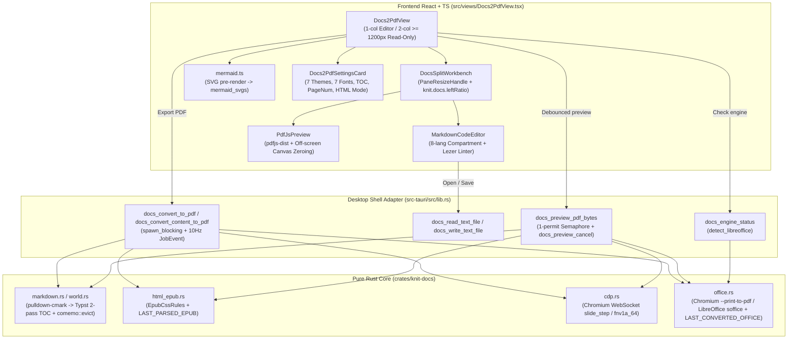
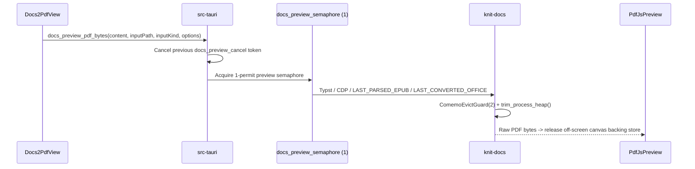

> Index: [`/llms.txt`](../../../llms.txt) · Runnable API & IPC Guide: [`docs/tools/docs2pdf/docs2pdf-agent-guide.md`](./docs2pdf-agent-guide.md) · JSON Schema Contract: [`docs/specs/docs2pdf.schema.json`](../../specs/docs2pdf.schema.json) · Functional Tests: [`docs/tools/docs2pdf/docs2pdf-functional-tests.md`](./docs2pdf-functional-tests.md)

# Kiến trúc & Cơ chế Hoạt động của `Document → PDF` (`docs2pdf`, Knit `v0.2.0`)

Tài liệu này mô tả kiến trúc phân tầng, luồng xem trước trực tiếp (Live Preview), cơ chế xuất HTML slide tương tác qua Chromium CDP WebSocket và quản lý bộ nhớ của công cụ **`Document → PDF`** (`Docs2PdfView` + `crates/knit-docs`).

---

## 1. Tổng quan Kiến trúc 3 Tầng

`docs2pdf` chia định tuyến biên dịch thành 3 tầng theo định dạng nguồn để giữ bộ cài đặt desktop gọn nhẹ trong khi vẫn render trung thực từ Markdown/Code đến HTML slide và tài liệu Office (`.mmd`: [`docs2pdf_01_architecture_three_layer.mmd`](../../diagrams/docs2pdf_01_architecture_three_layer.mmd)):



---

## 2. Định tuyến Engine Theo Định dạng (`DocInputKind`)

| `DocInputKind` | Đuôi tệp nhận diện (`DocInputKind::from_path`) | Pipeline chuyển đổi chính | Ghi chú đặc biệt |
|---|---|---|---|
| **`markdown`** | `.md`, `.markdown` | `pulldown-cmark` → `markdown_to_typst_with_assets` → `Typst` (`KnitTypstWorld`) | Pre-render khối ```` ```mermaid ```` sang SVG ở frontend (`mermaid_svgs`); nhúng sẵn font Afacad, Roboto, Lora, Libertinus Serif, New Computer Modern, DejaVu Sans Mono, Noto Emoji/Symbols. |
| **`plain_text`** | `.txt`, `.log`, `.rst`, `.css`, `.js`, `.mjs`, `.cjs`, `.ts`, `.jsx`, `.tsx` | `txt_to_typst` → `Typst` (hoặc bọc code fence Markdown qua `formatEditorContentForCompilation` cho CSS/JS/TS/JSX/TSX) | Giữ nguyên ký tự UTF-8, ngắt dòng tự động với các chuỗi/URL dài (`insert_wrap_opportunities`). |
| **`html`** | `.html`, `.htm`, `.xhtml` | 1. **Chromium CDP (`cdp.rs`)** nếu `HtmlRenderMode::SlideStep` (hoặc `Auto` phát hiện deck slide)<br>2. **Chromium `--print-to-pdf`** (`office.rs`)<br>3. **Fallback thuần Rust** (`html_to_typst`) nếu máy không có Chromium | Gỡ nhiễu ký tự lạ trước `<!DOCTYPE` (`sanitize_leading_doctype_junk`), khóa `window.alert/confirm/prompt`, tiêm CSS `@page` + `.slide .reveal` ở chế độ `document_print`. |
| **`epub`** | `.epub` | `html_epub.rs` (`EpubDoc` + `parse_epub_css` → `Typst`) | Trích xuất ảnh nội bộ vào `Arc<HashMap<String, Bytes>>`, dựng chữ hoa drop-cap `.gif` bằng `#grid(columns: (52pt, 1fr), ...)`, lưu cache 1 mục `LAST_PARSED_EPUB`. |
| **`docx` / `pptx`** | `.docx`, `.pptx` | `office.rs` gọi `soffice --headless --convert-to pdf` trong profile cô lập (`-env:UserInstallation=...`) | Không cần mở cửa sổ terminal trên Windows (`CREATE_NO_WINDOW`), timeout `120s`, lưu cache 1 mục `LAST_CONVERTED_OFFICE` dùng chung cho Preview và Export. |

---

## 3. Các Cơ chế Chuyên sâu trong `crates/knit-docs`

### 3.1. Typst 2-Pass Mid-Document TOC & Page Numbering (`markdown.rs` + `world.rs`)

- **Chèn Mục lục tại trang tùy chọn (`toc_page > 1`):** Pass 1 gắn nhãn ẩn `#metadata(idx) <knit-blk>` cho từng block nội dung, gọi `doc.introspector().query(...)` (`query_block_pages`) để biết chính xác block nào bắt đầu ở trang `>= toc_page`, rồi pass 2 chèn `#outline(indent: auto)` + `#pagebreak(weak: true)` vào đúng ranh giới đó (kèm tự điều chỉnh lùi 1 block nếu tiêu đề mục lục bị đẩy sang `toc_page + 1`).
- **Đánh số trang linh hoạt (`PageNumberingOptions`):** Hỗ trợ 6 vị trí (`bottom_center/right/left`, `top_center/left/right`), 3 định dạng (`number_only`, `page_of_total`, `page_label`), `start_from_page >= 1`, và **`start_number >= 0`** (cho phép đánh số từ trang `0` cho trang bìa).
- **Giới hạn biên tham số:** `margin_mm` clamp `[5.0, 60.0]`, `font_size_pt` clamp `[7.0, 24.0]`, `line_spacing` clamp `[0.8, 3.0]` (quy đổi `leading_em = (clamped - 0.75).clamp(0.15, 2.4)`).

### 3.2. Chromium Headless CDP WebSocket (`crates/knit-docs/src/cdp.rs`)

Để chuyển đổi các HTML slide deck điều hướng bằng phím (`Space`, `ArrowRight`, `PageDown`) hoặc nút Next JS mà `--print-to-pdf` thông thường chỉ in được slide 1:
1. `should_use_slide_step_auto` kiểm tra heuristic các deck phổ biến (`class="slide"`, `deck-stage`, `reveal.initialize`, `remark-slides-area`, sự kiện `keydown`).
2. Khởi chạy Chromium/Chrome/Edge/Brave với `--remote-debugging-port=0` và thư mục `--user-data-dir` tạm riêng biệt (tự kill khi `ChildProcessGuard` drop), đọc `DevToolsActivePort` và kết nối WebSocket cục bộ thuần `std` (`LocalWebSocket`, có retry `EINTR`).
3. Tự đo kích thước stage thực tế (`width_px` clamp `[320, 4096]`, `height_px` clamp `[240, 2304]`), đặt `Emulation.setDeviceMetricsOverride`, xóa CSS `@media print` gây tràn slide và ép transition về `0.01s`.
4. Lặp tối đa `MAX_SLIDE_STEPS = 250` bước (deadline `SLIDE_CAPTURE_DEADLINE_SECS = 90s`): chụp từng trang vector bằng `Page.printToPDF` (`pageRanges: "1"`), phát sự kiện theo `HtmlStepTrigger` (`AutoKey` tự thử `Space` rồi fallback `ArrowRight`, `Key`, `ClickSelector`, hoặc `ClickPoint` chuẩn hóa `[0.0, 1.0]`), dừng chính xác khi `fnv1a_64` hash trạng thái DOM + ảnh trùng với `seen_hashes`, rồi ghép các trang PDF qua `merge_pdf_documents_mem` (`lopdf`).

### 3.3. Vệ sinh Bộ nhớ & Điều phối Preview (`docs_preview_cancel`)

Sơ đồ trình tự xem trước & xuất PDF (`.mmd`: [`docs2pdf_02_sequence_preview_export.mmd`](../../diagrams/docs2pdf_02_sequence_preview_export.mmd)):



- **Chống chồng chéo Preview (`docs_preview_semaphore` = 1 permit):** Mỗi lần gọi `docs_preview_pdf_bytes` tự động `cancel()` token của lượt preview trước trong `AppState.docs_preview_cancel` trước khi chờ permit, tránh kẹt hàng đợi khi người dùng gõ nhanh hoặc đổi theme liên tiếp.
- **Giải phóng RAM Typst (`ComemoEvictGuard`):** `compile_typst_with_prepared_assets` luôn gọi `comemo::evict(2)` qua `Drop` guard và chia sẻ `Arc<HashMap<String, Bytes>>` giữa các pass TOC để không nhân đôi bộ đệm ảnh.
- **Cache 1 mục theo metadata file:** `LAST_PARSED_EPUB` (`html_epub.rs`) và `LAST_CONVERTED_OFFICE` (`office.rs`) khóa theo `(path, file_len, mtime_nanos)` giúp thay đổi cài đặt trang/số trang trên EPUB hoặc bấm Export trên DOCX/PPTX sau khi xem trước mà không cần giải nén hay chạy lại `soffice`; cả 2 cache đều được dọn khi gọi `clear_image_preview_cache`.
- **PDF.js Canvas Recycling (`PdfJsPreview.tsx`):** Hủy `doc.destroy()` / `loadingTask.destroy()` khi nạp PDF mới và đặt `canvas.width = 0; canvas.height = 0` qua hai chiều `IntersectionObserver` cho các trang đã cuộn khỏi khung nhìn.

---

## 4. Trình soạn thảo CodeMirror 6 & Bố cục Responsive (`src/`)

- **Ngôn ngữ động & Diagnostic Offline (`MarkdownCodeEditor.tsx`):** Dùng `@codemirror/state` `Compartment` chuyển đổi giữa 8 ngôn ngữ (`markdown`, `html`, `css`, `javascript`, `typescript`, `jsx`, `tsx`, `plain_text`) giữ nguyên lịch sử Undo/Redo và tự tô sáng block mã nhúng trong Markdown. Bộ `@codemirror/lint` chạy offline phát hiện node `isError` trên cây Lezer, lỗi đóng/mở thẻ HTML (bao gồm ký tự thừa trước `<!DOCTYPE`) và fenced code block Markdown chưa đóng, hiển thị badge đếm lỗi `editor-syntax-error-badge`.
- **Bố cục 2 cột cho tài liệu Chỉ đọc (EPUB / DOCX / PPTX):** Khi `isPreviewableDoc && !isEditableText`:
  - Trên màn hình rộng (`>= 1200px`): Cột trái (`col-span-7`) hiển thị **Preview PDF**; Cột phải (`col-span-5`) đặt cụm **Dropzone + Tên tệp + Cài đặt**.
  - Trên màn hình hẹp (`< 1200px`): Tự xếp lại 1 cột (`controlsCluster` trên, `PdfJsPreview` dưới) mà không remount state PDF.js.
  - Khi mở file Office (`.docx`/`.pptx`), `<fieldset disabled={isOfficeFile}>` tự khóa các tùy chọn layout riêng của Typst vì LibreOffice giữ nguyên định dạng gốc.

---

## 5. Tham chiếu Mã nguồn (Source Map)

- **Agent API & Schema:** [`docs/tools/docs2pdf/docs2pdf-agent-guide.md`](./docs2pdf-agent-guide.md), [`docs/specs/docs2pdf.schema.json`](../../specs/docs2pdf.schema.json), [`docs/tools/docs2pdf/docs2pdf-functional-tests.md`](./docs2pdf-functional-tests.md)
- **Backend Models & Routing:** [`crates/knit-docs/src/models.rs`](../../../crates/knit-docs/src/models.rs), [`crates/knit-docs/src/lib.rs`](../../../crates/knit-docs/src/lib.rs)
- **Typst Markdown & World:** [`crates/knit-docs/src/markdown.rs`](../../../crates/knit-docs/src/markdown.rs), [`crates/knit-docs/src/world.rs`](../../../crates/knit-docs/src/world.rs)
- **EPUB & HTML CSS:** [`crates/knit-docs/src/html_epub.rs`](../../../crates/knit-docs/src/html_epub.rs)
- **Chromium CDP & LibreOffice:** [`crates/knit-docs/src/cdp.rs`](../../../crates/knit-docs/src/cdp.rs), [`crates/knit-docs/src/office.rs`](../../../crates/knit-docs/src/office.rs)
- **Tauri IPC:** [`src-tauri/src/lib.rs`](../../../src-tauri/src/lib.rs) (`docs_engine_status`, `docs_read_text_file`, `docs_write_text_file`, `docs_preview_pdf_bytes`, `docs_preview_markdown`, `docs_convert_to_pdf`, `docs_convert_content_to_pdf`)
- **Frontend:** [`src/views/Docs2PdfView.tsx`](../../../src/views/Docs2PdfView.tsx), [`src/views/docs2pdf/DocsSplitWorkbench.tsx`](../../../src/views/docs2pdf/DocsSplitWorkbench.tsx), [`src/views/docs2pdf/Docs2PdfSettingsCard.tsx`](../../../src/views/docs2pdf/Docs2PdfSettingsCard.tsx), [`src/components/MarkdownCodeEditor.tsx`](../../../src/components/MarkdownCodeEditor.tsx), [`src/components/PdfJsPreview.tsx`](../../../src/components/PdfJsPreview.tsx)
