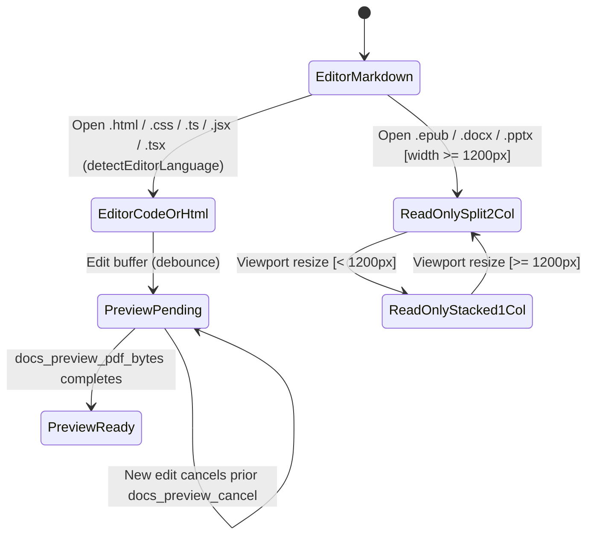

> Index: [`/llms.txt`](../../../llms.txt) · Agent Integration Guide: [`docs/tools/docs2pdf/docs2pdf-agent-guide.md`](./docs2pdf-agent-guide.md) · Architecture: [`docs/tools/docs2pdf/docs2pdf-architecture.md`](./docs2pdf-architecture.md) · Machine-Readable Spec: [`docs/specs/docs2pdf.schema.json`](../../specs/docs2pdf.schema.json)

# Bộ Test Case Chức năng — `Document → PDF` (`docs2pdf`, Knit `v0.2.0`)

Bộ thiết kế kiểm thử chức năng cho **`Document → PDF`** (`Docs2PdfView` + `crates/knit-docs`), áp dụng 5 kỹ thuật ISTQB đối chiếu trực tiếp với [`docs/tools/docs2pdf/docs2pdf-agent-guide.md`](./docs2pdf-agent-guide.md) và [`docs/specs/docs2pdf.schema.json`](../../specs/docs2pdf.schema.json).

---

## 0. Tập Yêu cầu Nghiệp vụ (BR Inventory)

| Mã BR | Tóm tắt yêu cầu nghiệp vụ (`docs2pdf`) | Kỹ thuật chính | Kỹ thuật bổ trợ |
|---|---|---|---|
| **BR-01** | Nhận diện định dạng (`md`, `txt`, `css/js/ts/jsx/tsx`, `html`, `epub`, `docx`, `pptx`) và định tuyến đúng giữa Typst native, Chromium headless/CDP, và LibreOffice `soffice` headless. | Decision Table | Domain (EP/BVA) |
| **BR-02** | Ràng buộc biên cho `margin_mm` `[5.0, 60.0]`, `font_size_pt` `[7.0, 24.0]`, `line_spacing` `[0.8, 3.0]`, `toc_page` (`1` vs `> 1`), `page_numbering.start_number` (`>= 0`), và `click_x`/`click_y` `[0.0, 1.0]`. | Domain (EP + BVA) | — |
| **BR-03** | Trình soạn thảo `MarkdownCodeEditor` 8 ngôn ngữ + `@codemirror/lint` phát hiện lỗi cú pháp offline, bọc code fence an toàn qua `formatEditorContentForCompilation`, và bố cục 2 cột `>= 1200px` cho tài liệu chỉ đọc (`EPUB`/`DOCX`/`PPTX`). | State Transition | Use Case |
| **BR-04** | Chuyển đổi HTML slide deck tương tác qua Chromium CDP WebSocket (`slide_step`, `AutoKey`, `ClickSelector`, `ClickPoint`) kèm vòng lặp chống trùng trang `fnv1a_64` và gỡ nhiễu trước `<!DOCTYPE`. | Use Case | Error Guessing |
| **BR-05** | Điều phối preview chống kẹt (`docs_preview_cancel` + `docs_preview_semaphore`), cache 1 mục `LAST_PARSED_EPUB` / `LAST_CONVERTED_OFFICE`, `ComemoEvictGuard` (`comemo::evict(2)`), và giải phóng `<canvas>` PDF.js ngoài viewport. | Error Guessing | State Transition |

---

## 1. Domain Testing (EP + BVA) — Kiểm thử Miền giá trị & Biên

| TC ID | Biến kiểm thử | Lớp / Điểm biên | Đầu vào | Kết quả mong đợi | BR |
|---|---|---|---|---|---|
| **TC-DOM-01** | `margin_mm` | Clamped `< 5.0` / Nominal / `> 60.0` | Case A: `0.0`<br>Case B: `20.0`<br>Case C: `100.0` | `typst_preamble` clamp về `5mm`, `20mm`, `60mm` tương ứng, không lỗi biên dịch | BR-02 |
| **TC-DOM-02** | `font_size_pt` | Clamped `< 7.0` / Nominal / `> 24.0` | Case A: `2.0`<br>Case B: `11.0`<br>Case C: `48.0` | Clamp về `7pt`, `11pt`, `24pt` | BR-02 |
| **TC-DOM-03** | `line_spacing` | `null` vs `< 0.8` vs `> 3.0` | Case A: `null`<br>Case B: `0.2`<br>Case C: `5.0` | Case A dùng mặc định theme; Case B clamp `0.8`; Case C clamp `3.0` | BR-02 |
| **TC-DOM-04** | `page_numbering.start_number` | BVA (`LB = 0`, `1`, `10`) | `enabled=true, start_from_page=1, start_number=0` với PDF 3 trang | Trang 1 đánh số `0`, trang 2 đánh `1`, trang 3 đánh `2` (`page_of_total` hiển thị `0 / 2`) | BR-02 |
| **TC-DOM-05** | `include_toc` + `toc_page` | `toc_page = 1` vs `toc_page = 2` vs `toc_page > total` | Markdown 3 trang:<br>Case A: `toc_page=1`<br>Case B: `toc_page=2`<br>Case C: `toc_page=99` | Case A: mục lục ở trang 1.<br>Case B: 2-pass introspection đặt mục lục tại trang 2.<br>Case C: đặt cuối tài liệu an toàn | BR-02 |
| **TC-DOM-06** | `html_step_trigger.click_x/y` | Clamped `< 0.0`, `[0.0, 1.0]`, `> 1.0` | `click_x = -0.5, click_y = 1.5` trên stage `1280×720` | Tọa độ chuẩn hóa clamp về `(0.0, 1.0)` và pixel click kẹp trong `[1.0, width-1] × [1.0, height-1]` | BR-02 |
| **TC-DOM-07** | Extension không hỗ trợ | Invalid extension | `input_path = "/tmp/video.mp4"` | `convert_document_to_pdf` trả `"Invalid input: Unsupported document format: /tmp/video.mp4"` | BR-01 |

---

## 2. Decision Table Testing — Định tuyến Engine & Chế độ HTML

| Điều kiện / Hành động | TC-DT-01 | TC-DT-02 | TC-DT-03 | TC-DT-04 | TC-DT-05 | TC-DT-06 |
|---|---|---|---|---|---|---|
| `DocInputKind` | `markdown` / `plain_text` | `epub` | `docx` / `pptx` | `html` | `html` | `html` |
| `HtmlRenderMode` | N/A | N/A | N/A | `auto` (không có slide) hoặc `document_print` | `slide_step` (hoặc `auto` khớp deck) | bất kỳ |
| Chromium / LibreOffice có sẵn? | N/A | N/A | LibreOffice có sẵn | Chromium có sẵn | Chromium có sẵn | Không có Chromium |
| **Engine thực thi:** `Typst` native | ✓ | ✓ | — | — | — | ✓ *(fallback `html_to_typst`)* |
| **Engine thực thi:** Chromium `--print-to-pdf` | — | — | — | ✓ | — | — |
| **Engine thực thi:** Chromium CDP `slide_step` | — | — | — | — | ✓ | — |
| **Engine thực thi:** LibreOffice `soffice` | — | — | ✓ | — | — | — |

---

## 3. State Transition Testing — Trạng thái Editor, Preview & Bố cục Responsive



| TC ID | Mô tả | Precondition | Trình tự thao tác | Kết quả mong đợi | BR |
|---|---|---|---|---|---|
| **TC-ST-01** | Bọc code fence an toàn khi biên dịch file `.ts` có chứa sẵn dấu `` ``` `` | Mở `sample.ts` chứa chuỗi `` ``` `` bên trong comment | Kiểm tra `detectEditorLanguage`, đổi ngôn ngữ hoặc chạy `formatEditorContentForCompilation` | Ngôn ngữ chọn `typescript`; fence bọc ngoài dài hơn chuỗi backtick dài nhất trong file (```` ````ts ````) để Typst không đóng nhầm block | BR-03 |
| **TC-ST-02** | Chuyển bố cục 2 cột ↔ 1 cột quanh ngưỡng `1200px` cho file `.epub` / `.docx` không làm mất state Preview | Nạp `book.epub` (`!isEditableText && isPreviewableDoc`) | 1. Render ở viewport `1360px`<br>2. Cuộn `PdfJsPreview` tới trang 3<br>3. Thu nhỏ viewport xuống `1024px` | Cả 2 kích thước dùng chung một DOM node (`docs2pdf-no-editor-split-layout`); trang hiện tại và mức zoom `PdfJsPreview` giữ nguyên không bị remount; khi mở `.docx`, `Docs2PdfSettingsCard` bị `<fieldset disabled>` | BR-03 |
| **TC-ST-03** | Gửi nhiều request `docs_preview_pdf_bytes` liên tiếp khi gõ nhanh | Đang mở tệp Markdown dài | Kích hoạt 5 lần thay đổi nội dung liên tiếp trong 200ms | Chỉ request cuối cùng chạy tới đích; các request trước bị `docs_preview_cancel` hủy sớm với `"Job cancelled by user"` và UI bỏ qua lỗi hủy preview | BR-05 |

---

## 4. Use Case & Error Guessing (Fault Attack)

| TC ID | Loại | Kịch bản / Giả thuyết lỗi | Dữ liệu & Bước thực hiện | Kết quả mong đợi | BR |
|---|---|---|---|---|---|
| **TC-UCT-01** | Use Case | Chuyển đổi HTML slide deck điều hướng bằng `Space` / `ArrowRight` qua CDP (`slide_step`) | File HTML 5 `.slide` ẩn qua `.reveal { opacity: 0 }`, chuyển slide bằng phím `Space`, có ký tự thừa `z` trước `<!DOCTYPE html>` | 1. `sanitize_leading_doctype_junk` cắt bỏ `z` thừa (không sinh trang trắng đầu).<br>2. CDP `compile_html_via_cdp_slide_step` chụp đủ 5 trang PDF vector sắc nét, tự dừng khi hash `fnv1a_64` lặp lại ở slide 5.<br>3. `DocConvertResult.page_count == Some(5)` | BR-04 |
| **TC-UCT-02** | Use Case | Chuyển đổi EPUB có `.gif` drop-cap CSS và cache `LAST_PARSED_EPUB` | File `.epub` có `OEBPS/css/*.css` gắn `.dropcap_T { background-image: url(../images/T.gif); }` + `<span class="hidden">T</span>` | Lần compile 1 parse EPUB và dựng `#grid` drop-cap T.gif + bỏ chữ `T` lặp; đổi `font_size_pt` compile lần 2 hit `LAST_PARSED_EPUB` không giải nén lại ZIP | BR-01, BR-05 |
| **TC-EG-01** | Fault Attack | Cú pháp lỗi trong HTML/JS/Markdown không hiển thị hoặc làm kẹt CodeMirror | Dán `z<!DOCTYPE html><div><span></div>` hoặc mở code fence ```` ``` ```` chưa đóng | `@codemirror/lint` gắn diagnostic trên Lezer error / thẻ HTML chưa đóng / `z<!DOCTYPE`, hiển thị `editor-syntax-error-badge` mà không crash editor | BR-03 |
| **TC-EG-02** | Fault Attack | Bấm Export `.docx`/`.pptx` ngay sau khi Preview PDF làm `soffice` chạy lại 2 lần tốn thời gian | Nạp `report.docx`, đợi `docs_preview_pdf_bytes` xong, sau đó bấm Export PDF | `compile_office_to_pdf_bytes` hit `LAST_CONVERTED_OFFICE` theo `(path, file_len, mtime_nanos)`, xuất tức thì mà không spawn `soffice` lần thứ 2 | BR-05 |
| **TC-EG-03** | Fault Attack | Slide deck HTML chứa `window.alert(...)` hoặc vòng lặp slide vô tận khi nhấn phím | Slide deck tự gọi `alert('done')` hoặc quay vòng từ slide cuối về slide 1 | `inject_slide_dialog_guard` vô hiệu hóa `alert`/`confirm`/`prompt`; `seen_hashes` trong `cdp.rs` phát hiện quay vòng về hash slide 1 và dừng ngay, không lặp tới `MAX_SLIDE_STEPS = 250` | BR-04 |
| **TC-EG-04** | Fault Attack | Chuyển đổi Markdown không tồn tại hoặc gọi `convert_text_to_pdf` với `DocInputKind::Epub` | Case A: `input_path = "/tmp/missing.md"`<br>Case B: `convert_text_to_pdf(..., DocInputKind::Epub, ...)` | Case A: `KnitError::NotFound("/tmp/missing.md")`<br>Case B: `"Chi ho tro bien dich noi dung van ban cho Markdown, Plain Text hoac HTML"` | BR-01 |

---

## 5. Requirements Traceability Matrix (RTM)

| BR ID | Domain (EP/BVA) | Decision Table | State Transition | Use Case | Error Guessing | Trạng thái |
|---|---|---|---|---|---|---|
| **BR-01** | TC-DOM-07 | TC-DT-01..06 | — | TC-UCT-02 | TC-EG-04 | ✓ Covered |
| **BR-02** | TC-DOM-01..06 | — | — | — | — | ✓ Covered |
| **BR-03** | — | — | TC-ST-01, TC-ST-02 | — | TC-EG-01 | ✓ Covered |
| **BR-04** | TC-DOM-06 | TC-DT-05 | — | TC-UCT-01 | TC-EG-03 | ✓ Covered |
| **BR-05** | — | — | TC-ST-03 | TC-UCT-02 | TC-EG-02 | ✓ Covered |
