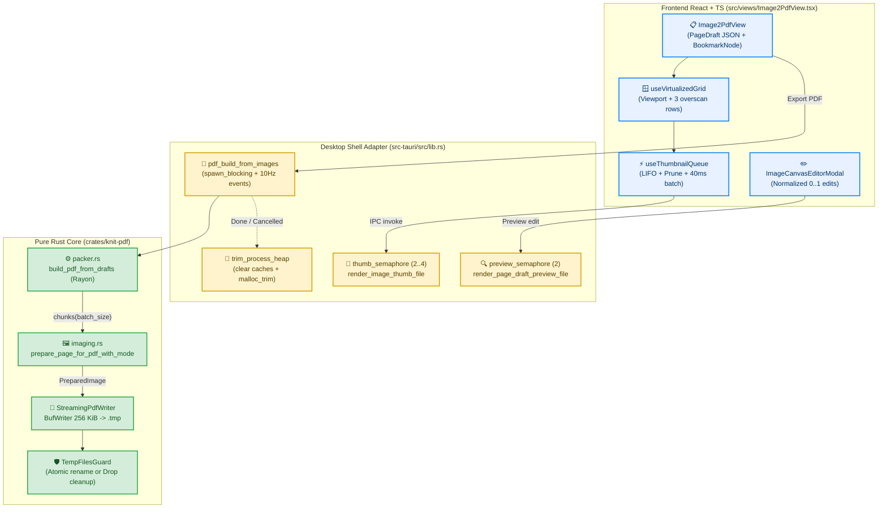
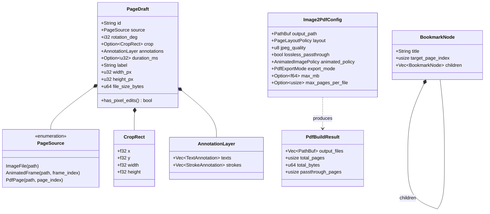
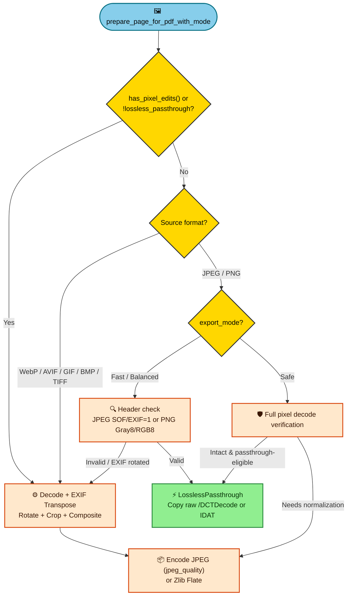
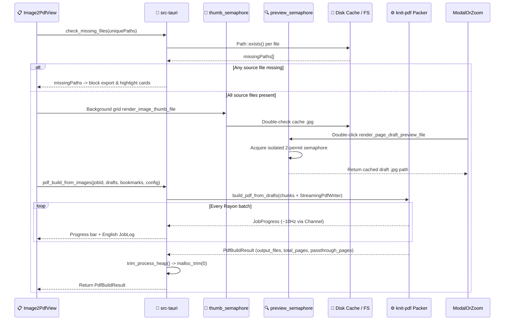

> Index: [`/llms.txt`](../../../llms.txt) · Runnable API & IPC Guide: [`docs/tools/image2pdf/image2pdf-agent-guide.md`](./image2pdf-agent-guide.md) · JSON Schema Contract: [`docs/specs/image2pdf.schema.json`](../../specs/image2pdf.schema.json)

# Kiến trúc & Cơ chế Hoạt động của `image2pdf` (Knit `v0.2.0`)

Tài liệu này mô tả kiến trúc hệ thống và các sơ đồ Mermaid đã kiểm chứng cho công cụ **`image2pdf`** của Knit khi xử lý hàng nghìn ảnh dung lượng lớn (1.5 GB – 2+ GB) thành PDF với 3 mục tiêu cốt lõi: **chống tràn RAM**, **giữ UI mượt mà**, và **tốc độ export cao**.

---

## 1. Tổng quan Kiến trúc 3 Tầng

`image2pdf` tách biệt hoàn toàn trạng thái giao diện nhẹ trên WebView khỏi quá trình giải mã và đóng gói ảnh nặng dưới Rust (`.mmd`: [`image2pdf_01_architecture_three_layer.mmd`](../../diagrams/image2pdf_01_architecture_three_layer.mmd)):

---

## 2. Mô hình Dữ liệu Miền (`crates/knit-pdf/src/models.rs`)

Thay vì giữ bitmap trong RAM trình duyệt hoặc sửa ảnh gốc trên đĩa, mỗi trang là một `PageDraft` chuẩn hóa tọa độ `[0.0, 1.0]` (`.mmd`: [`image2pdf_04_class_domain_model.mmd`](../../diagrams/image2pdf_04_class_domain_model.mmd)):

- **Nguồn (`PageSource`):** Chỉ giữ đường dẫn tệp ảnh trên đĩa (`ImageFile` / `AnimatedFrame`), giữ nguyên tệp gốc read-only. Hỗ trợ đầy đủ 11 định dạng gồm `jpg, jpeg, jfif, png, webp, avif, gif, bmp, tiff, tif, svg` (`usvg`/`resvg`/`tiny-skia` thuần Rust trong `imaging.rs`). Nếu thay đổi `AnimatedImagePolicy` sau khi import (giữa `first_frame_only`, `unpack_all_frames`, `embed_rich_media`), `pdf_sync_animated_drafts` (`expand_drafts_for_animated_policy`) tự động tách/gộp frame và ánh xạ lại chỉ số `BookmarkNode`; riêng `embed_rich_media` nhúng trực tiếp GIF động qua `/RichMedia` và `/Screen` annotation trong `packer.rs`. *(Lưu ý: biến thể `PdfPage` dùng chung struct `PageDraft` cho PDF editor, không phải đầu vào của `image2pdf`).*
- **Chỉnh sửa chuẩn hóa (`[0.0, 1.0]`):** `rotation_deg` (`0/90/180/270`), `CropRect`, `TextAnnotation` (`font_size_ratio`), và `StrokeAnnotation` (`stroke_width_ratio`) độc lập độ phân giải hiển thị.
- **Hệ quả:** 2.000+ ảnh trên React chỉ chiếm vài trăm KB JSON; chỉ khi Export hoặc Double-click xem chi tiết, Rust mới dựng ảnh thật 1 lần.

---

## 3. Luồng Chuyển đổi & Chống Tràn RAM khi Export

### 3.1. `StreamingPdfWriter` & Chia Part Nguyên Tử (`crates/knit-pdf/src/packer.rs`)

1. **Buffer ghi tuần tự cố định (`STREAM_BUF_CAPACITY = 256 KiB`):** Ghi header `%PDF-1.5` thẳng vào file tạm `.knit_tmp.<pid>.p01`.
2. **Ghi từng trang & `drop()` ngay lập tức:** `write_page()` đẩy stream `/DCTDecode` hoặc `/FlateDecode` qua `CountingWriter`, chỉ giữ lại `offsets: Vec<u64>` và `page_ids: Vec<u32>` rồi `drop(bytes)` ngay sau khi ghi xong trang.
3. **Chia Part tự động (`max_mb` / `max_pages_per_file`):** Trước khi ghi trang kế tiếp, kiểm tra `bytes_written + stream_len + PAGE_STRUCT_OVERHEAD (700B) + TAIL_OVERHEAD (2048B) > max_bytes` (hoặc đạt `max_pages_per_file`), đóng gói part kèm `remap_tree(bookmarks, current_part_start, global_page_idx)`, rồi mở `StreamingPdfWriter` mới.
4. **An toàn nguyên tử (`TempFilesGuard`):** Nếu `CancellationToken` kích hoạt hoặc gặp lỗi I/O, `Drop` tự động xóa toàn bộ file `.tmp` chưa commit. Chỉ `fs::rename` sang `.pdf` đích khi hoàn tất 100%.

### 3.2. Xử lý Song song Theo Chunk Giới Hạn (`drafts.chunks(batch_size)`)

`build_pdf_from_drafts` chia `drafts` thành từng batch nhỏ chạy trên `rayon::ThreadPool` riêng biệt để giới hạn số ảnh giải mã đồng thời trong RAM, đồng thời gọi `trim_heap_if_supported()` sau mỗi 64 trang và `trim_process_heap()` (`malloc_trim(0)` trên Linux GNU) khi job kết thúc hoặc người dùng bấm **Clear List**.

### 3.3. Nhánh Kép `LosslessPassthrough` vs `Render & Composite` (`imaging.rs`)

Biểu đồ quyết định nhánh xử lý từng trang (`.mmd`: [`image2pdf_03_flowchart_imaging_pipeline.mmd`](../../diagrams/image2pdf_03_flowchart_imaging_pipeline.mmd)):

| `PdfExportMode` | `worker_threads` | `batch_size` | `ensure_disk_space` | Chia Part (`max_mb` / `max_pages`) | Kiểm chứng Ảnh |
|---|---|---|---|---|---|
| **`fast`** | `cpus.clamp(4, 8)` | `24` | Bỏ qua | Bỏ qua (luôn xuất 1 file) | Header JPEG/PNG |
| **`balanced`** *(Mặc định)* | `cpus.clamp(2, 4)` | `(cpus.clamp(2, 4) * 2).clamp(4, 8)` | `1x` ước lượng đầu vào | Có | Header JPEG/PNG, lỗi header fallback decode |
| **`safe`** | `cpus.clamp(2, 4)` | `4` | `2x` ước lượng đầu vào | Có | Giải mã pixel toàn vẹn |

---

## 4. Trình tự Tương tác, Semaphore Cô lập & Tiền kiểm Trước Export

Biểu đồ trình tự đầy đủ từ lúc preview thumbnail song song với zoom ưu tiên cao đến preflight `check_missing_files`, xuất streaming và giải phóng heap (`.mmd`: [`image2pdf_02_sequence_preview_export.mmd`](../../diagrams/image2pdf_02_sequence_preview_export.mmd)):

- **Đường dẫn Cache + Asset Protocol (`convertFileSrc`):** `render_image_thumb_file` và `render_page_draft_preview_file` ghi JPEG vào `app_cache_dir("image-thumbs")` bằng atomic `.tmp -> rename` rồi trả `PathBuf` thay vì Base64.
- **Hàng đợi Frontend:** `useVirtualizedGrid` chỉ giữ DOM vùng nhìn thấy (`overscanRows = 3`); `useThumbnailQueue` dùng LIFO + prune các thẻ cuộn khuất + batch state mỗi `40ms` + bảo vệ LRU cache.

---

## 5. Đánh đổi Kiến trúc (Trade-offs)

| Quyết định Kiến trúc | Phương án bị loại bỏ | Lý do chọn & Đánh đổi |
|---|---|---|
| **Ghi PDF trực tiếp bằng `StreamingPdfWriter`** | Dựng toàn bộ `lopdf::Document` trong RAM rồi mới gọi `save()` | **Được:** RAM giữ ổn định kể cả với 2 GB ảnh. **Đổi:** Phải tự quản lý byte offset bảng `xref` và object ID thủ công trong `packer.rs`. |
| **Lưu chỉnh sửa dưới dạng `PageDraft` chuẩn hóa `[0.0, 1.0]`** | Render bitmap mỗi lần crop/vẽ rồi lưu PNG tạm | **Được:** Không phá hủy ảnh gốc, Undo/Redo tức thì, giữ `LosslessPassthrough` cho trang không sửa. **Đổi:** Cần rasterizer riêng trên Rust (`imaging.rs`) cho trang có chỉnh sửa. |
| **Tách 3 Export Mode (`fast` / `balanced` / `safe`)** | Chỉ có 1 pipeline kiểm tra chặt chẽ duy nhất | **Được:** Cân bằng linh hoạt tốc độ vs kiểm tra pixel toàn vẹn. |
| **Dùng Asset Protocol (`convertFileSrc`) thay Base64** | Trả chuỗi Base64 qua IPC (`render_image_thumb`) | **Được:** Tránh tốn CPU encode/decode Base64 và phình heap WebView. **Đổi:** Cần dọn thư mục cache đĩa (`clear_image_preview_cache`). |

---

## 6. Tham chiếu Mã nguồn (Source Map)

- **Agent API & Copy-Paste Integration:** [`docs/tools/image2pdf/image2pdf-agent-guide.md`](./image2pdf-agent-guide.md)
- **Machine-Readable Schema:** [`docs/specs/image2pdf.schema.json`](../../specs/image2pdf.schema.json)
- **Core Models:** [`crates/knit-pdf/src/models.rs`](../../../crates/knit-pdf/src/models.rs)
- **Streaming PDF Writer:** [`crates/knit-pdf/src/packer.rs`](../../../crates/knit-pdf/src/packer.rs)
- **Lossless Passthrough & Rasterizer:** [`crates/knit-pdf/src/imaging.rs`](../../../crates/knit-pdf/src/imaging.rs)
- **IPC Handlers & Heap Trimming:** [`src-tauri/src/lib.rs`](../../../src-tauri/src/lib.rs)
- **Frontend Workbench & Hooks:** [`src/views/Image2PdfView.tsx`](../../../src/views/Image2PdfView.tsx), [`src/lib/ipc.ts`](../../../src/lib/ipc.ts), [`src/hooks/useVirtualizedGrid.ts`](../../../src/hooks/useVirtualizedGrid.ts), [`src/hooks/useThumbnailQueue.ts`](../../../src/hooks/useThumbnailQueue.ts)
