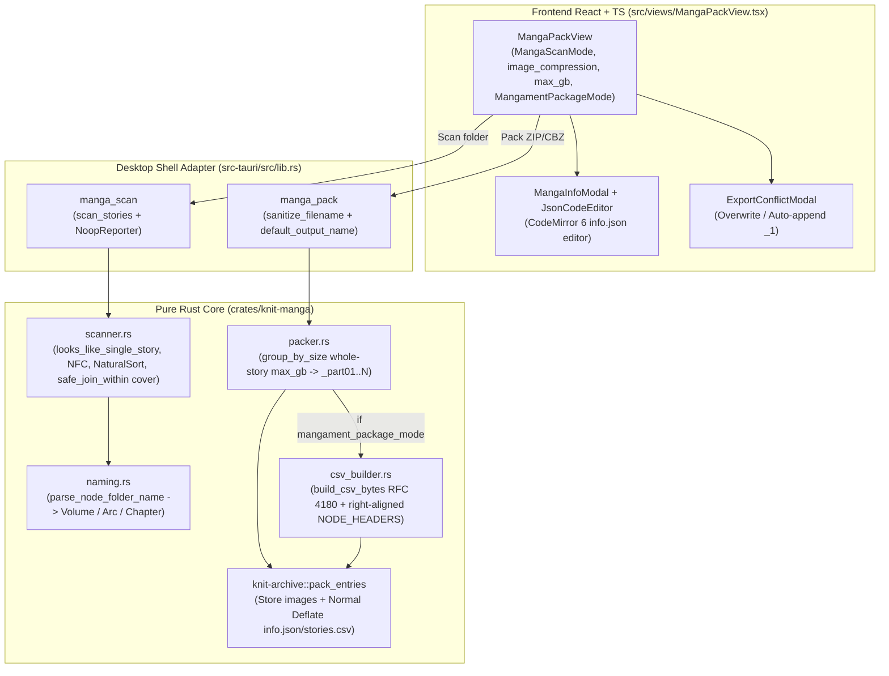

> Index: [`/llms.txt`](../../../llms.txt) · Runnable API & IPC Guide: [`docs/tools/manga-pack/manga-pack-agent-guide.md`](./manga-pack-agent-guide.md) · JSON Schema Contract: [`docs/specs/manga-pack.schema.json`](../../specs/manga-pack.schema.json) · Functional Tests: [`docs/tools/manga-pack/manga-pack-functional-tests.md`](./manga-pack-functional-tests.md)

# Kiến trúc & Cơ chế Hoạt động của `Manga Packager` (`manga-pack`, Knit `v0.2.0`)

Tài liệu này mô tả luồng quét cây thư mục truyện tranh, chuẩn hóa tên phân cấp, biên tập `info.json` và đóng gói `.zip`/`.cbz` nguyên vẹn theo từng bộ truyện của **`Manga Packager`** (`MangaPackView` + `crates/knit-manga`).

---

## 1. Tổng quan Kiến trúc 3 Tầng

Sơ đồ luồng quét, kiểm tra cảnh báo và xuất ZIP/CBZ qua `knit-archive` (`.mmd`: [`manga_pack_01_architecture_pipeline.mmd`](../../diagrams/manga_pack_01_architecture_pipeline.mmd)):

---

## 2. Cơ chế Quét & Nhận diện Phân cấp (`scanner.rs` + `naming.rs`)

### 2.1. Heuristic `MangaScanMode::Auto` (`looks_like_single_story`)

Khi `mode = "auto"`, `scan_stories` phân biệt thư mục **1 truyện đơn (`Single`)** với **thư viện nhiều truyện (`Library`)**:
- Trả `Single` nếu thư mục gốc có trực tiếp `info.json` hoặc ảnh trang (`jpg`, `jpeg`, `png`, `webp`, `avif`, `gif`).
- Trả `Single` nếu không có thư mục con nào.
- Trả `Library` nếu bất kỳ thư mục con trực tiếp nào chứa `info.json`.
- Ngược lại, kiểm tra tỷ lệ thư mục con khớp `parse_node_folder_name`: nếu `valid_count * 2 >= subdirs.len()` (tức `>= 50%` thư mục con mang tên kiểu `Chapter/Vol/Arc/số`) thì coi là `Single`, ngược lại là `Library`.

### 2.2. Chuẩn hóa Unicode NFC & Parser `parse_node_folder_name`

- `parse_node_folder_name` chuẩn hóa Unicode **NFC** (`nfc_normalize`) trước khi khớp regex để không lỗi dấu tiếng Việt NFD từ macOS.
- Nhận diện 3 loại `NodeKind`:
  - `Volume`: `volume`, `vol`, `tập`, `tap`
  - `Arc`: `arc`, `hồi`, `hoi`
  - `Chapter`: `chapter`, `chap`, `ch`, `c`, `chương`, `chuong`, hoặc tên chỉ có số (`"05"`, `"12.5"`).
- Hỗ trợ số thập phân (`order_index: f64`, ví dụ `1.5`), hiển thị gọn qua `fmt_num` (`1.0` → `"1"`, `1.5` → `"1.5"`).
- `collapse_dupes = true` loại bỏ cấp node trùng `(kind, order_index)` liên tiếp nếu người dùng lồng thừa thư mục (vd: `Chapter 1/Chapter 1/`).
- Sắp xếp chương theo chuỗi `order_index` tăng dần; nếu có từ 2 thư mục cùng quy về một `(kind, order_index)` (độ lệch `< 1e-9`) hoặc cùng thư mục chứa cả ảnh lẫn thư mục con, ghi cảnh báo vào `Story.warnings` (không chặn đóng gói).

### 2.3. Nhận diện Ảnh bìa An toàn (`find_cover`) & Đọc `info.json`

- **Ảnh bìa ưu tiên (`cover_priority`):** Tìm file tại gốc thư mục truyện theo thứ tự ưu tiên `cover_art.*` (`0`) > `cover.*` (`1`) > `poster.*` (`2`) với đuôi `jpg/jpeg/png/webp/avif`, bỏ qua ảnh bìa khỏi danh sách ảnh trong các chapter (`skip_rel`).
- **Fallback từ `info.json` (`raw_cover_art`):** Nếu gốc chưa có file bìa chuẩn, kiểm tra trường `cover_art` trong `info.json` thông qua `safe_join_within(story_dir, &rel_clean)` để **chặn tuyệt đối path traversal** (`../`, đường dẫn tuyệt đối ngoài thư mục truyện).
- **`info.json` & Biên tập trực tiếp:** `read_story_info` hỗ trợ UTF-8 BOM (`\u{feff}`) và nhiều alias trường từ `MangamentTools` (`description`/`summary`, `author`/`authors`/`author_ids`, `type`/`story_type`, `status`/`story_status`). Trên UI, `MangaInfoModal` sử dụng `JsonCodeEditor` (CodeMirror 6) cho phép tạo hoặc chỉnh sửa trực tiếp `info.json` rồi lưu về đĩa (`writeDocTextFile`).

---

## 3. Đóng gói Nguyên bộ Truyện & Chế độ `MangamentPackageMode` (`packer.rs` + `csv_builder.rs`)

### 3.1. Chia Part Không Cắt Đôi Truyện (`group_by_size`)

- Tính tổng dung lượng đầu vào (`Story.total_bytes`) ngay khi quét để hiển thị ước lượng kích thước trên UI (`estimateMangaPackOutput`) mà không cần đọc pixel ảnh.
- Khi `max_gb > 0.0` (`max_bytes = (max_gb * 2^30) as u64`), `group_by_size` gom **nguyên vẹn từng bộ `Story`** vào từng file ZIP (`_part01.zip`, `_part02.zip`... hoặc giữ đuôi `.cbz` nếu output được đặt là `.cbz`), tuyệt đối không xé lẻ 1 bộ truyện sang 2 file ZIP. Nếu một bộ truyện đơn lẻ tự thân lớn hơn `max_gb`, nó vẫn được đóng gói nguyên vẹn vào 1 part riêng.

### 3.2. Định dạng Nén & `stories.csv` (RFC 4180)

- **Chính sách nén theo loại tệp:**
  - Ảnh truyện (`cover` & `chapters[].images`) dùng `options.image_compression`: mặc định `0` → `CompressionLevel::Store` (không tái nén JPEG/PNG/WebP/AVIF để đạt tốc độ tối đa và tránh tốn CPU vô ích); `1..=3` → `Fast`, `4..=6` → `Normal`, `7..=9` → `Best`.
  - Metadata `info.json` và `stories.csv` luôn nén `CompressionLevel::Normal` (Deflate level 6).
- **Tạo `stories.csv` cho mỗi part (`MangamentPackageMode = true`):**
  - Sinh bằng crate `csv` với newline `\n` (RFC 4180), đặt tại gốc từng file ZIP part (`stories.csv`).
  - Cấu trúc cột cố định tương thích `zip_pack/csv_builder.py` của `MangamentTools`:
    - **11 cột cơ sở (`BASE_HEADERS`):** `title`, `other_titles`, `story_type`, `story_status`, `nation`, `nation_id`, `poster_id`, `author`, `genres`, `summary`, `cover_art_path`.
    - **`max_depth * 3` cột phân cấp (`NODE_HEADERS`):** `story_node_title`, `story_node_type`, `story_node_order_index` — **căn phải (`node_cols`)**: nếu độ sâu cây lớn nhất là 2 (`Volume > Chapter`) mà một chương chỉ có 1 cấp (`Chapter`), 3 cột đầu để trống và cấp `Chapter` được đặt ở nhóm cột sát bên phải.
    - **2 cột nội dung (`CONTENT_HEADERS`):** `story_node_content_order_index` (1-based index ảnh trong chương), `story_node_content_image_path` (đường dẫn POSIX `<dir_name>/<chapter.folder>/`).
- **Dọn lỗi nguyên tử:** Nếu bất kỳ part nào thất bại hoặc bị `cancel_job` giữa chừng, toàn bộ các part đã tạo trước đó trong phiên (`created`) đều bị xóa sạch (`fs::remove_file`), không để lại bộ part thiếu hụt.

---

## 4. Tham chiếu Mã nguồn (Source Map)

- **Agent API & Schema:** [`docs/tools/manga-pack/manga-pack-agent-guide.md`](./manga-pack-agent-guide.md), [`docs/specs/manga-pack.schema.json`](../../specs/manga-pack.schema.json), [`docs/tools/manga-pack/manga-pack-functional-tests.md`](./manga-pack-functional-tests.md)
- **Models & Naming Parser:** [`crates/knit-manga/src/models.rs`](../../../crates/knit-manga/src/models.rs), [`crates/knit-manga/src/naming.rs`](../../../crates/knit-manga/src/naming.rs)
- **Scanner & Packer & CSV Builder:** [`crates/knit-manga/src/scanner.rs`](../../../crates/knit-manga/src/scanner.rs), [`crates/knit-manga/src/packer.rs`](../../../crates/knit-manga/src/packer.rs), [`crates/knit-manga/src/csv_builder.rs`](../../../crates/knit-manga/src/csv_builder.rs)
- **Tauri IPC:** [`src-tauri/src/lib.rs`](../../../src-tauri/src/lib.rs) (`manga_scan`, `manga_pack`)
- **Frontend:** [`src/views/MangaPackView.tsx`](../../../src/views/MangaPackView.tsx), [`src/components/MangaInfoModal.tsx`](../../../src/components/MangaInfoModal.tsx), [`src/lib/mangaInfo.ts`](../../../src/lib/mangaInfo.ts), [`src/lib/sizeEstimate.ts`](../../../src/lib/sizeEstimate.ts)
