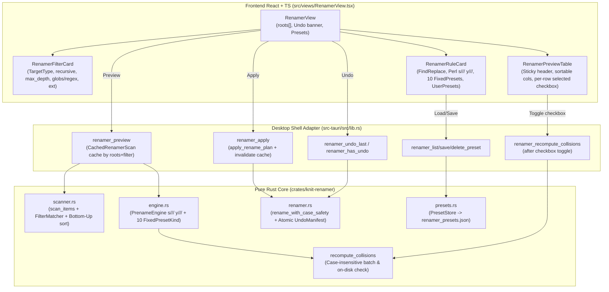

> Index: [`/llms.txt`](../../../llms.txt) · Runnable API & IPC Guide: [`docs/tools/renamer/renamer-agent-guide.md`](./renamer-agent-guide.md) · JSON Schema Contract: [`docs/specs/renamer.schema.json`](../../specs/renamer.schema.json) · Functional Tests: [`docs/tools/renamer/renamer-functional-tests.md`](./renamer-functional-tests.md)

# Kiến trúc & Cơ chế Hoạt động của `Batch Renamer` (`renamer`, Knit `v0.2.0`)

Tài liệu này mô tả thiết kế an toàn hai lớp lọc, công cụ biến đổi tên (`FindReplace`, `PerlPrename`, `FixedPreset`), phát hiện xung đột không phân biệt hoa-thường, thực thi Bottom-Up và khôi phục `UndoManifest` của **`Batch Renamer`** (`RenamerView` + `crates/knit-renamer`).

---

## 1. Tổng quan Kiến trúc 3 Tầng

Sơ đồ kiến trúc từ `RenamerView` xuống các IPC commands, cache quét và lõi `knit-renamer` (`.mmd`: [`renamer_01_architecture_pipeline.mmd`](../../diagrams/renamer_01_architecture_pipeline.mmd)):

---

## 2. Bộ lọc Hai Lớp & Cache Quét (`CachedRenamerScan`)

### 2.1. Lớp 1 — Bộ lọc Tệp/Thư mục (`ScanFilter` & `FilterMatcher`)

- `target_type`: `Files` | `Folders` | `Both` (khi chọn `Both`, `include_extensions` chỉ áp dụng cho file để giữ nguyên thư mục nếu người dùng cần lọc theo đuôi file).
- `recursive` & `max_depth`: Nếu `recursive == false`, `WalkDir` ép `max_depth = 1`; nếu `recursive == true`, `max_depth` có thể giới hạn độ sâu `>= 1` hoặc không giới hạn (`None`). Theo `follow_links(false)` để chống lặp symlink.
- `ignore_hidden`: Bỏ qua mọi entry có tên bắt đầu bằng dấu `.`.
- `include_patterns` & `exclude_patterns`: Hỗ trợ cả `Glob` (`globset`, case-insensitive) và `Regex` (`regex`, case-insensitive). Logic khớp: phải thỏa ít nhất 1 `include_pattern` (nếu danh sách không rỗng) và không khớp bất kỳ `exclude_pattern` nào.

### 2.2. Lớp 2 — Dry-Run Preview & Checkbox Từng Dòng (`RenamerPreviewTable`)

- Để tránh đi bộ lại toàn bộ cây thư mục trên đĩa mỗi khi người dùng thử gõ biểu thức tìm kiếm/regex, `src-tauri` lưu **`CachedRenamerScan`** trong `AppState.renamer_scan_cache` (khóa theo `roots` + `filter`): nếu chỉ đổi `RenameRule`, `renamer_preview` tái sử dụng ngay danh sách đã quét. Cache bị vô hiệu hóa (`invalidate_renamer_cache`) ngay khi gọi `renamer_apply` hoặc `renamer_undo_last`.
- Trên UI (`RenamerPreviewTable.tsx` + `src/lib/renamerTree.ts`), người dùng có thể sắp xếp theo cột (`buildRenamerTree` giữ cấu trúc cha-con hoặc `sortFlatRenameItems`), tick/bỏ tick `selected` từng dòng hoặc cả cụm thư mục, rồi gọi `renamer_recompute_collisions` tức thì.

---

## 3. Công cụ Biến đổi Tên (`engine.rs`) & Presets (`presets.rs`)

- **`FindReplace`:** Hỗ trợ tìm-thay thế chuỗi thường hoặc Regex với cờ `match_case` và `use_regex`.
- **`PerlPrename` (`PrenameEngine`):**
  - Hỗ trợ nối nhiều lệnh bằng `;` (hỗ trợ escape `\;`), dùng 10 dấu phân cách `/ | # , ; : ! ~ _ @`.
  - Lệnh thay thế `s/pattern/replace/flags`: hỗ trợ cờ `i` (không phân biệt hoa-thường), `g` (toàn chuỗi), `m` (multiline), `s` (dotall), `x` (bỏ qua whitespace), `a` (tắt unicode), tự động chuyển backreference `$1`, `\1` sang `${1}` của Rust `regex`.
  - Lệnh ánh xạ ký tự `y/from/to/flags` hoặc `tr/from/to/flags`: hỗ trợ dải ký tự `a-z`, `0-9`, và cờ `d` (xóa ký tự không ánh xạ sang đích).
- **`FixedPreset` (10 preset dựng sẵn):** `manga_chapter`, `manga_volume`, `pad2`, `pad3`, `clean_tags`, `clean_whitespace`, `normalize_extensions`, `lowercase`, `uppercase`, `titlecase`.
- **`UserPreset` (`PresetStore`):** Lưu bền vững trong `app_config_dir().join("renamer_presets.json")` bằng `atomic_write_file`.

---

## 4. An toàn Thực thi: Collision Detection, Bottom-Up, Case-Safety & Undo

1. **Phát hiện Xung đột (`recompute_collisions`):**
   - Chỉ kiểm tra các dòng đang chọn (`selected == true`) và có tên mới khác tên cũ (`RenameStatus::Pending`).
   - Đếm trùng lặp trong cùng batch (`target_counts` theo đường dẫn viết thường `to_lowercase()`).
   - Tính tập `vacated_keys` (các tên gốc sẽ được nhường chỗ trong batch — cho phép hoán đổi tên `A -> B, B -> A` hoặc đổi chéo mà không báo xung đột giả nếu tên cũ được giải phóng).
   - Đối chiếu với các tệp hiện hữu trên đĩa trong `parent_dir` (case-sensitive trên Unix, case-insensitive trên Windows/non-Unix); đánh dấu `RenameStatus::Conflict` kèm thông báo lỗi chi tiết và chặn `apply_rename_plan` nếu `plan.conflict_count() > 0`.
2. **Thứ tự Bottom-Up (`build_rename_plan`):** Sắp xếp toàn bộ `RenameItem` theo `depth` giảm dần → `is_dir` (`false` trước `true`, tức file trước folder cùng cấp) → `natural_cmp`, đảm bảo đường dẫn thư mục cha không bị đổi trước khi đổi tên tệp/thư mục con bên trong.
3. **Đổi Hoa-Thường An toàn trên Windows NTFS/exFAT (`rename_with_case_safety`):** Khi đường dẫn cũ và mới trùng nhau theo `eq_ignore_ascii_case` nhưng khác nhau về chữ hoa/thường (`abc.txt` → `ABC.txt`), thực hiện đổi 2 bước qua tên tạm `.knit_rename_tmp_<uuid>` (tự rollback về tên cũ nếu bước 2 lỗi).
4. **Hoàn tác Nguyên tử (`UndoManifest`):** `apply_rename_plan` ghi danh sách `UndoEntry { original_path, new_path, is_dir }` ra file JSON (`undo_manifest_path` trong `AppState`) bằng `atomic_write_file`. Khi gọi `renamer_undo_last` (`undo_manifest`), duyệt ngược mảng (`entries.iter().rev()`) để trả lại tên cũ theo thứ tự Top-Down an toàn (bỏ qua có cảnh báo nếu file mới mất hoặc tên cũ đã có file khác chiếm chỗ), rồi xóa manifest.

---

## 5. Tham chiếu Mã nguồn (Source Map)

- **Agent API & Schema:** [`docs/tools/renamer/renamer-agent-guide.md`](./renamer-agent-guide.md), [`docs/specs/renamer.schema.json`](../../specs/renamer.schema.json), [`docs/tools/renamer/renamer-functional-tests.md`](./renamer-functional-tests.md)
- **Models & Presets:** [`crates/knit-renamer/src/models.rs`](../../../crates/knit-renamer/src/models.rs), [`crates/knit-renamer/src/presets.rs`](../../../crates/knit-renamer/src/presets.rs)
- **Scanner, Engine & Renamer:** [`crates/knit-renamer/src/scanner.rs`](../../../crates/knit-renamer/src/scanner.rs), [`crates/knit-renamer/src/engine.rs`](../../../crates/knit-renamer/src/engine.rs), [`crates/knit-renamer/src/renamer.rs`](../../../crates/knit-renamer/src/renamer.rs)
- **Tauri IPC:** [`src-tauri/src/lib.rs`](../../../src-tauri/src/lib.rs) (`renamer_preview`, `renamer_recompute_collisions`, `renamer_apply`, `renamer_undo_last`, `renamer_has_undo`, `renamer_list_presets`, `renamer_save_preset`, `renamer_delete_preset`)
- **Frontend:** [`src/views/RenamerView.tsx`](../../../src/views/RenamerView.tsx), [`src/views/renamer/RenamerFilterCard.tsx`](../../../src/views/renamer/RenamerFilterCard.tsx), [`src/views/renamer/RenamerRuleCard.tsx`](../../../src/views/renamer/RenamerRuleCard.tsx), [`src/views/renamer/RenamerPreviewTable.tsx`](../../../src/views/renamer/RenamerPreviewTable.tsx), [`src/lib/renamerTree.ts`](../../../src/lib/renamerTree.ts)
